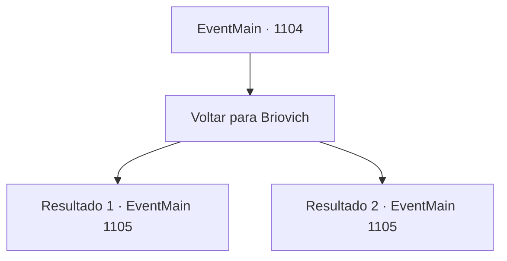

# Eventos principais · 1104

[Índice da tabela](index.md) · [Índice geral](../index.md)

ID: `pt:EventMain:1104` · Fonte: `EventMain4` · Versão: 1.2.47.

Mapeamento estático dos arquivos; a disponibilidade e a execução dependem do estado da run.

## Texto do evento

*Sem texto no arquivo.*

## Dados de entrada

```json
{
  "id": 1104,
  "grade": 1,
  "normalGoal": "",
  "required": ""
}
```

## Mapa das escolhas



## Escolhas e resultados

### Escolha 1

Voltar para Briovich

Requisitos e outros campos da escolha:

```json
{
  "required": ""
}
```

#### Resultado 1.1

Com o Tomo da Purificação em mãos, você pega emprestado um cavalo do mosteiro e cavalga de volta a Briovich. 

 Alguns dias se passam, e você chega ao Castelo Briovich. O portão familiar se abre enquanto Rennart o cumprimenta. 

 "Você voltou."

 Você prende o cavalo no estábulo, então segue Rennart até seu escritório. Lá, você conta tudo o que aconteceu no mosteiro. Você coloca o Tomo da Purificação sobre a mesa, e o olhar de Rennart demora-se na capa de couro. Cuidadosamente, ele abre o livro e começa a folhear as páginas. Seus olhos se estreitam enquanto ele começa a interpretar instruções extensas e ilustrações complexas. 

 "É melhor procedermos com o ritual, então. Quanto mais demorarmos, mais mortos-vivos haverá."

 Os dedos de Rennart percorrem o mapa. 

 "Floresta de Brindel, ao norte do castelo."

 Então, ele segue para leste. 

 "E em torno do moinho de água, construído sobre o Rio Shilling. Esses são os dois lugares."


Continuação registrada: [Evento 1105](1105.md) na mesma tabela.

```json
{
  "required": "5_898_1",
  "chance": "1",
  "nextEvent": 1105,
  "type": 2,
  "reward": ""
}
```

#### Resultado 1.2

Com Mathilda, você toma emprestado um cavalo do mosteiro e volta cavalgando para Briovich. 

 Alguns dias se passam, e você chega ao Castelo Briovich. O portão familiar se abre enquanto Rennart o cumprimenta. 

 "Você voltou. E com uma convidada."

 Seu olhar se volta para Mathilda. Ela faz uma reverência educada. 

 "Sou Mathilda, uma irmã do Mosteiro de Nordil."

 Rennart retribui a cortesia. 

 "Prazer em conhecê-la. Por aqui, por favor."

 Você e Mathilda seguem Rennart de volta ao seu escritório. 

 "É melhor procedermos com o ritual, então. Quanto mais demorarmos, mais mortos-vivos haverá."

 Os dedos de Rennart percorrem o mapa. 

 "Floresta Brindel, ao norte do castelo."

 Então, ele se move para leste. 

 "E em torno do moinho d’água, construído no rio Shilling. Estes são os dois lugares."


Continuação registrada: [Evento 1105](1105.md) na mesma tabela.

```json
{
  "required": "5_902_1",
  "chance": "1",
  "nextEvent": 1105,
  "type": 2,
  "reward": ""
}
```

## Referências que chegam a este evento

- [Evento 1100 · escolha 1 · resultado 1](1100.md#escolha-1)
- [Evento 1100 · escolha 1 · resultado 3](1100.md#escolha-1)
- [Evento 1100 · escolha 2 · resultado 1](1100.md#escolha-2)
- [Evento 1102 · escolha 1 · resultado 1](1102.md#escolha-1)
- [Evento 1103 · escolha 1 · resultado 1](1103.md#escolha-1)
