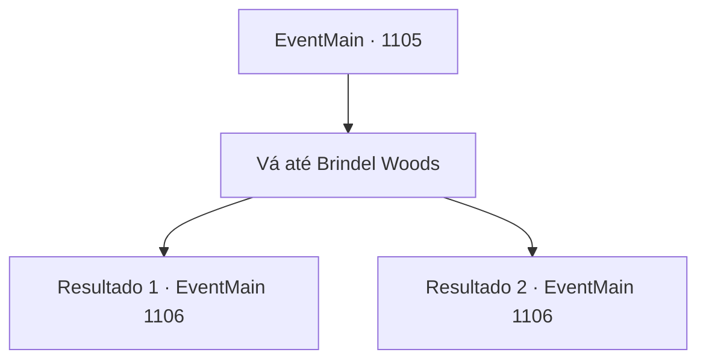

# Eventos principais · 1105

[Índice da tabela](index.md) · [Índice geral](../index.md)

ID: `pt:EventMain:1105` · Fonte: `EventMain4` · Versão: 1.2.47.

Mapeamento estático dos arquivos; a disponibilidade e a execução dependem do estado da run.

## Texto do evento

*Sem texto no arquivo.*

## Dados de entrada

```json
{
  "id": 1105,
  "grade": 1,
  "normalGoal": "",
  "required": ""
}
```

## Mapa das escolhas



## Escolhas e resultados

### Escolha 1

Vá até Brindel Woods

Requisitos e outros campos da escolha:

```json
{
  "required": ""
}
```

#### Resultado 1.1

Quatro soldados o acompanham. Após cerca de uma hora caminhando para o norte, aparece a entrada da Floresta Brindel. Mesmo antes de entrar na floresta propriamente dita, sente-se um cheiro horrível. O fedor de carne podre e terra molhada. Todos os seus soldados reagem cobrindo o nariz e a boca. Você entra e então encontra algo se movendo pela mata. Ghouls e wights, com a carne pela metade, permanecem ali com membros quebrados. Além deles, um grupo de esqueletos vagueia sem rumo.

Continuação registrada: [Evento 1106](1106.md) na mesma tabela.

```json
{
  "required": "5_898_1",
  "chance": "1",
  "nextEvent": 1106,
  "type": 2,
  "reward": ""
}
```

#### Resultado 1.2

Quatro soldados acompanham você e Mathilda. Depois de cerca de uma hora caminhando para o norte, surge a entrada da Floresta Brindel. Mesmo antes de entrar de fato na mata, sente-se um cheiro horrível. O fedor de carne podre e terra molhada. Seus soldados reagem cobrindo o nariz e a boca. Você entra, então encontra algo se movendo pela mata. Ghouls e wights, com a carne pela metade consumida, permanecem por ali com membros quebrados. Além deles, um grupo de esqueletos vagueia sem rumo. Mathilda franze a testa e fala. 

 "Isso.... não é normal. Deve haver alguma fonte de mal, algo que reúna essas criaturas, nas redondezas."


Continuação registrada: [Evento 1106](1106.md) na mesma tabela.

```json
{
  "required": "5_902_1",
  "chance": "1",
  "nextEvent": 1106,
  "type": 2,
  "reward": ""
}
```

## Referências que chegam a este evento

- [Evento 1104 · escolha 1 · resultado 1](1104.md#escolha-1)
- [Evento 1104 · escolha 1 · resultado 2](1104.md#escolha-1)
