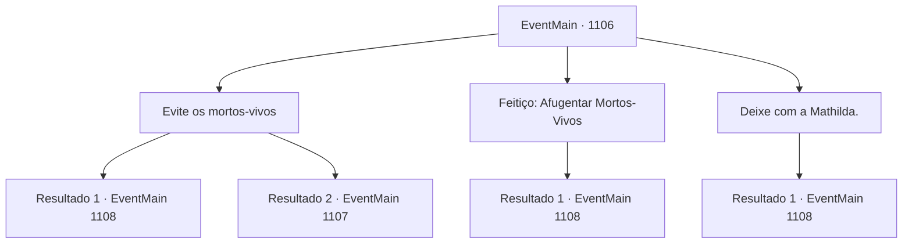

# Eventos principais · 1106

[Índice da tabela](index.md) · [Índice geral](../index.md)

ID: `pt:EventMain:1106` · Fonte: `EventMain4` · Versão: 1.2.47.

Mapeamento estático dos arquivos; a disponibilidade e a execução dependem do estado da run.

## Texto do evento

*Sem texto no arquivo.*

## Dados de entrada

```json
{
  "id": 1106,
  "grade": 1,
  "normalGoal": "",
  "required": ""
}
```

## Mapa das escolhas



## Escolhas e resultados

### Escolha 1

Evite os mortos-vivos

Requisitos e outros campos da escolha:

```json
{
  "required": "18_902_1"
}
```

#### Resultado 1.1

Você abaixa o corpo, fazendo um gesto para que os soldados atrás se calem. Seu grupo se move lentamente pela mata. Um dos wights está a cerca de três passos de você, mas não o percebe. Dois esqueletos ficam imóveis, encarando na mesma direção. As cavidades oculares estão completamente vazias. Nenhum indício de emoção pode ser sentido. À medida que você adentra a mata, o fedor se intensifica. As folhas começam a se tornar muito mais raras, com o solo sob seus pés transformando-se lentamente em lama. Você para quando encontra uma pequena clareira. Há uma árvore velha no centro, com sua casca negra repleta de rachaduras e fungos azuis densos preenchendo suas raízes. Entre os fungos, você percebe esporos brancos flutuando. Seu olhar se volta para as raízes da árvore. Pó de osso está espalhado pelas fendas das raízes. Ele circula ao redor dos anéis do toco e, ao seguir as raízes para cima, sangue seco cobre a casca da árvore. Você nota letras indecifráveis inscritas nas linhas carmesim. |drawing_undeadTotem|

Continuação registrada: [Evento 1108](1108.md) na mesma tabela.

```json
{
  "required": "",
  "chance": "1|0_6_1",
  "nextEvent": 1108,
  "type": 0,
  "reward": ""
}
```

#### Resultado 1.2

Você abaixa o corpo, fazendo um gesto para os soldados atrás ficarem em silêncio. Seu grupo avança lentamente pela mata. Um dos wights está a cerca de três passos de você. Então, algo estala sob seus pés. O som de um galho se quebrando ecoa pela mata. Você para, mas é tarde demais. O wight vira a cabeça para você. Seu pescoço começa a estalar e ranger, enquanto ele começa a caminhar na sua direção. Os ghouls e os esqueletos fazem o mesmo. Eles deixam de vagar sem rumo e se voltam para você. Os soldados sacam suas espadas. Um soldado segurando uma lança bate o escudo à frente, formando uma posição defensiva. A mandíbula do ghoul se abre. Uma respiração abafada escapa de sua garganta enquanto ele avança.

Continuação registrada: [Evento 1107](1107.md) na mesma tabela.

```json
{
  "required": "",
  "chance": "28",
  "nextEvent": 1107,
  "type": 1,
  "reward": "6_0_89",
  "place": 1
}
```

### Escolha 2

Feitiço: Afugentar Mortos-Vivos

Requisitos e outros campos da escolha:

```json
{
  "required": "20_0_1|20_3_1|1_1_2"
}
```

#### Resultado 2.1

Você conjura Afastar Mortos-Vivos. Suas pontas dos dedos começam a brilhar. O que a princípio parecia um raio de luz de vela cresceu até virar um feixe de luz sagrada, perfurando a floresta. À medida que a luz envolve os mortos-vivos, sua carne começa a derreter. Os esqueletos ao fundo começam a se contorcer também, seus ossos se partindo em fragmentos, suas armaduras caindo ao chão. A luz se dissipa, e nada resta além de pilhas de pó. 

 "U- uau, meu Senhor...!"

 Você dá de ombros, levando-os mais para dentro da floresta. Quanto mais você avança, mais o fedor aumenta. As folhas começam a ficar muito mais raras, com o solo abaixo de você lentamente se transformando em lama. Você para ao encontrar uma pequena clareira. Há uma árvore antiga no centro, com sua casca negra cheia de rachaduras e fungos azuis densos preenchendo suas raízes. Entre os fungos, você percebe esporos brancos flutuando. Seu olhar se volta para as raízes da árvore. Pó de osso está espalhado pelas fendas das raízes. Ele circunda os anéis do toco, e conforme você segue as raízes para cima, sangue seco cobre a casca da árvore. Você nota letras indecifráveis inscritas nas linhas carmesim. |drawing_undeadTotem|

Continuação registrada: [Evento 1108](1108.md) na mesma tabela.

```json
{
  "required": "",
  "chance": "1",
  "nextEvent": 1108,
  "type": 2,
  "reward": "0_2_1|0_1_-1"
}
```

### Escolha 3

Deixe com a Mathilda.

Requisitos e outros campos da escolha:

```json
{
  "required": "5_902_1"
}
```

#### Resultado 3.1

Você se vira para olhar para Mathilda. Ela avança com confiança, então lança Afugentar Mortos-Vivos. A ponta dos seus dedos começa a brilhar. O que a princípio parecia um foco de luz de vela cresceu até se tornar um raio de luz sagrada, cortando a mata. À medida que a luz envolve os mortos-vivos, a carne deles começa a derreter. Os esqueletos no fundo começam a se contorcer também, seus ossos se quebrando em fragmentos, suas armaduras caindo ao chão. A luz se dissipa, e nada resta além de montes de pó. Os olhos dos soldados se arregalam de admiração. 

 "U- uau...!"

 Você diz aos soldados para se manterem firmes, conduzindo-os adiante. À medida que vocês avançam floresta adentro, o fedor se intensifica. As folhas começam a ficar muito mais escassas, e o solo sob seus pés vai se transformando lentamente em lama. Você para ao encontrar uma pequena clareira. Há uma árvore velha no meio, com sua casca negra cheia de rachaduras e fungos azuis densos preenchendo suas raízes. Entre os fungos, você nota esporos brancos flutuando no ar. Seu olhar se volta para as raízes da árvore. Pó de osso está espalhado pelas fendas das raízes. Ele circula os anéis do tronco, e ao seguir as raízes para cima, sangue seco cobre a casca da árvore. Você nota letras indecifráveis inscritas nas linhas carmesim. |drawing_undeadTotem| Mathilda se aproxima da árvore e murmura para si mesma. 

 "Essa aura... isso é um totem de necromante."


Continuação registrada: [Evento 1108](1108.md) na mesma tabela.

```json
{
  "required": "",
  "chance": "1",
  "nextEvent": 1108,
  "type": 2,
  "reward": ""
}
```

## Referências que chegam a este evento

- [Evento 1105 · escolha 1 · resultado 1](1105.md#escolha-1)
- [Evento 1105 · escolha 1 · resultado 2](1105.md#escolha-1)
