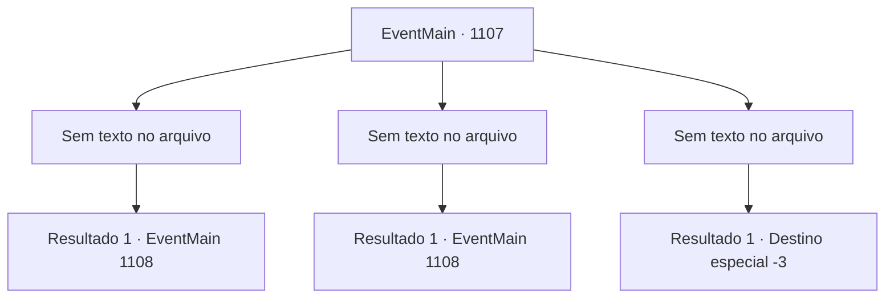

# Eventos principais · 1107

[Índice da tabela](index.md) · [Índice geral](../index.md)

ID: `pt:EventMain:1107` · Fonte: `EventMain4` · Versão: 1.2.47.

Mapeamento estático dos arquivos; a disponibilidade e a execução dependem do estado da run.

## Texto do evento

*Sem texto no arquivo.*

## Dados de entrada

```json
{
  "id": 1107,
  "grade": 1,
  "normalGoal": "",
  "required": ""
}
```

## Mapa das escolhas



## Escolhas e resultados

### Escolha 1

*Sem texto no arquivo; o papel dessa opção depende da interface do jogo.*

Requisitos e outros campos da escolha:

```json
{
  "required": ""
}
```

#### Resultado 1.1

A floresta volta a ficar silenciosa. Você escove o pó de ossos da sua armadura para verificar os soldados. Você os ordena a manterem a formação, conduzindo-os para mais fundo. À medida que avança na mata, o fedor se intensifica. As folhas começam a ficar muito mais escassas, com o solo sob seus pés se transformando lentamente em lama. Você para ao encontrar uma pequena clareira. Há uma árvore velha no meio, com sua casca negra cheia de rachaduras e fungos azuis densos preenchendo suas raízes. Entre os fungos, você nota esporos brancos flutuando. Seu olhar se volta para as raízes da árvore. Pó de ossos está espalhado pelas fendas das raízes. Ele circula ao redor dos anéis do toco, e ao seguir as raízes para cima, sangue seco cobre a casca da árvore. Você percebe letras indecifráveis inscritas nas linhas carmesim. |drawing_undeadTotem| Você sente uma aura sinistra ao redor — supõe que seja um totem de necromante.

Continuação registrada: [Evento 1108](1108.md) na mesma tabela.

```json
{
  "required": "",
  "chance": "1",
  "nextEvent": 1108,
  "type": 2,
  "reward": ""
}
```

### Escolha 2

*Sem texto no arquivo; o papel dessa opção depende da interface do jogo.*

Requisitos e outros campos da escolha:

```json
{
  "required": ""
}
```

#### Resultado 2.1

Você é arremessado para trás pelo ataque do morto-vivo. Ele te atinge sem piedade, seus dentes podres vindo em direção ao seu pescoço. Então, um soldado crava sua lança, perfurando o crânio do morto-vivo. 

 "Meu Senhor! Está tudo bem?!"

 Ele te ajuda a se levantar. Enquanto isso, os outros soldados conseguiram eliminar os demais ghouls e esqueletos. A luta termina, e a floresta fica silenciosa novamente. Você ordena que os soldados permaneçam em formação, conduzindo-os mais para dentro. À medida que você adentra a mata, o fedor se intensifica. As folhas começam a ficar muito mais escassas, com o solo abaixo de você lentamente virando lama. Você para quando encontra uma pequena clareira. Há uma árvore velha no meio, com sua casca negra cheia de rachaduras e fungos densos e azuis preenchendo suas raízes. Entre os fungos, você nota esporos brancos flutuando. Seu olhar se volta para as raízes da árvore. Pó de osso está espalhado pelas fendas das raízes. Ele circunda os anéis do toco, e ao seguir as raízes para cima, sangue seco cobre a casca da árvore. Você percebe letras indecifráveis inscritas nas linhas carmesim. |drawing_undeadTotem| Você sente uma aura sinistra ao redor — supõe que seja um totem de necromante.

Continuação registrada: [Evento 1108](1108.md) na mesma tabela.

```json
{
  "required": "1_0_2|1_1_2",
  "chance": "1",
  "nextEvent": 1108,
  "type": 2,
  "reward": "0_0_-1|0_1_-1"
}
```

### Escolha 3

*Sem texto no arquivo; o papel dessa opção depende da interface do jogo.*

Requisitos e outros campos da escolha:

```json
{
  "required": ""
}
```

#### Resultado 3.1

Você é arremessado para trás pelo ataque do wight.   Ele ataca você sem piedade, cravando seus dentes podres em seu pescoço.   Os soldados rapidamente correm ao seu socorro e derrubam o wight.   Você tenta estancar o sangramento, mas o sangue não para.   Lamentavelmente, sua visão se apaga, enquanto tudo fica escuro.

Continuação registrada: [Destino especial `-3`](../destinos-especiais.md).

```json
{
  "required": "-1|2_0_2|2_1_2",
  "chance": "1",
  "nextEvent": -3,
  "type": 2,
  "reward": "0_0_-1|0_1_-1"
}
```

## Referências que chegam a este evento

- [Evento 1106 · escolha 1 · resultado 2](1106.md#escolha-1)
