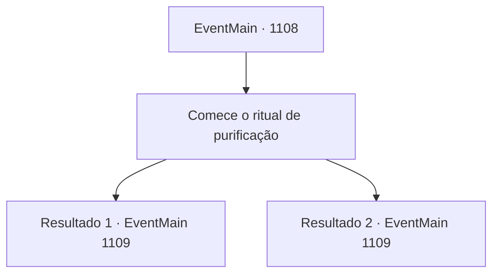

# Eventos principais · 1108

[Índice da tabela](index.md) · [Índice geral](../index.md)

ID: `pt:EventMain:1108` · Fonte: `EventMain4` · Versão: 1.2.47.

Mapeamento estático dos arquivos; a disponibilidade e a execução dependem do estado da run.

## Texto do evento

*Sem texto no arquivo.*

## Dados de entrada

```json
{
  "id": 1108,
  "grade": 1,
  "normalGoal": "",
  "required": ""
}
```

## Mapa das escolhas



## Escolhas e resultados

### Escolha 1

Comece o ritual de purificação

Requisitos e outros campos da escolha:

```json
{
  "required": ""
}
```

#### Resultado 1.1

Você tira o Tomo da Purificação. À medida que o livro se abre, uma série de instruções prolixas aparece diante de você. Você ordena aos seus homens que fiquem alerta, então começa o ritual. Primeiro, você despeja um pouco de água sobre o pó de osso próximo. Começa a espumar, misturando-se com o solo molhado. Então, você coloca as mãos no círculo de feitiço carmesim inscrito nas raízes, lendo a incantação escrita no tomo. Uma leve sensação de calor emana de suas palmas. As manchas de sangue começam a tremer. 

 "M- meu Senhor!"

 Então, um dos soldados fica pálido e chama por você, a voz tremendo. Você vira a cabeça para olhá-lo. De um canto do clareira, algo aparece entre as árvores inclinadas. A cabeça de uma criatura aparece primeiro. É a de um cervo, com sua pele retirada. Mas o corpo que a segue não é o de um cervo. Longos e magros apêndices que lembram galhos de árvore estão pendendo sem força no chão. Garras afiadas que sobressaem de suas pontas dos dedos são tão longas quanto adagas. É um Leshy — também chamado de espírito guardião das florestas. Uma espécie de aura sinistra e negra cintila ao redor de sua silhueta. Os soldados congelam de medo, a empunhadura de suas armas tremendo. Os olhos do Leshy começam a brilhar em vermelho. Então, antes mesmo de você perceber, ele investe na sua direção e na de seus homens. <link=shake>

 "Grooooo--!!"

</link>

Continuação registrada: [Evento 1109](1109.md) na mesma tabela.

```json
{
  "required": "18_902_1",
  "chance": "1",
  "nextEvent": 1109,
  "type": 2,
  "reward": "6_0_195",
  "place": 1
}
```

#### Resultado 1.2

Mathilda começa derramando água ao redor do pó do osso. Começa a espumar, misturando-se com o solo molhado. Então, ela pousa as mãos no círculo de magia carmesim inscrito nas raízes, lendo a incantação escrita no tomo. Uma leve sensação de calor emana de suas palmas. As manchas de sangue começam a tremer. 

 "M- meu Senhor!"

 Então, um dos soldados empalidece e chama por você, a voz tremendo. Você vira a cabeça para olhá-lo. De um canto do clareira, algo surge entre as árvores inclinadas. A cabeça de uma criatura aparece primeiro. É a de um cervo, com sua pele descascada. Mas o corpo que a segue não é o de um cervo. Apêndices longos e magros que se assemelham a galhos de árvore estão inutilmente pendendo no chão. Garras afiadas que sobressaem de suas pontas dos dedos são tão longas quanto adagas curtas. É um Leshy — também chamado de espírito guardião das florestas. Uma espécie de aura sinistra e negra cintila ao redor de sua silhueta. Os soldados congelam de medo, o aperto nas armas tremendo. Os olhos do Leshy começam a brilhar em vermelho. Então, antes que você perceba, ele está correndo em sua direção e da sua tropa. <link=shake>

 "Grooooo--!!"

</link>

Continuação registrada: [Evento 1109](1109.md) na mesma tabela.

```json
{
  "required": "5_902_1",
  "chance": "1",
  "nextEvent": 1109,
  "type": 2,
  "reward": "6_0_195",
  "place": 1
}
```

## Referências que chegam a este evento

- [Evento 1106 · escolha 1 · resultado 1](1106.md#escolha-1)
- [Evento 1106 · escolha 2 · resultado 1](1106.md#escolha-2)
- [Evento 1106 · escolha 3 · resultado 1](1106.md#escolha-3)
- [Evento 1107 · escolha 1 · resultado 1](1107.md#escolha-1)
- [Evento 1107 · escolha 2 · resultado 1](1107.md#escolha-2)
