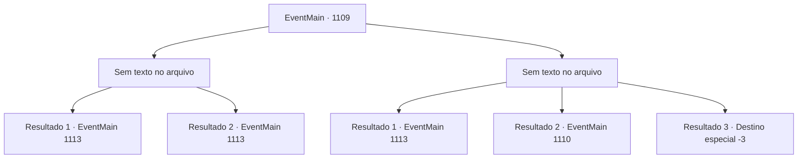

# Eventos principais · 1109

[Índice da tabela](index.md) · [Índice geral](../index.md)

ID: `pt:EventMain:1109` · Fonte: `EventMain4` · Versão: 1.2.47.

Mapeamento estático dos arquivos; a disponibilidade e a execução dependem do estado da run.

## Texto do evento

*Sem texto no arquivo.*

## Dados de entrada

```json
{
  "id": 1109,
  "grade": 1,
  "normalGoal": "",
  "required": ""
}
```

## Mapa das escolhas



## Escolhas e resultados

### Escolha 1

*Sem texto no arquivo; o papel dessa opção depende da interface do jogo.*

Requisitos e outros campos da escolha:

```json
{
  "required": ""
}
```

#### Resultado 1.1

Você e seus soldados conseguem derrubar o Leshy juntos. 

 "Scr-eeeeech...!"

 O Leshy se contorce grotescamente, resistindo a mais alguns golpes de lança, antes de finalmente parar de se mover. Após confirmar sua morte, você retorna ao ritual. À medida que o ritual prossegue, o calor na sua mão se intensifica, e o círculo mágico começa a perder a cor. Finalmente, com os últimos passos do ritual concluídos, as linhas carmesim desaparecem, e o totem se estilhaça em pedaços. Os fungos nas raízes das árvores também encolhem em resposta. O horrível fedor que enchia a clareira desaparece. O sol já está se pondo — mas ainda há um longo caminho até o Rio Shilling.

Continuação registrada: [Evento 1113](1113.md) na mesma tabela.

```json
{
  "required": "18_902_1",
  "chance": "1",
  "nextEvent": 1113,
  "type": 2,
  "reward": ""
}
```

#### Resultado 1.2

Você e seus soldados conseguem derrubar o Leshy juntos. 

 "Craaaaaaak...!"

 O Leshy se contorce grotescamente. Um dos soldados crava sua lança profundamente no corpo dele. Outro faz o mesmo com sua espada. Com um último movimento, o Leshy agarra o solo com suas garras, mas fica imóvel. Enquanto isso, Mathilda termina o ritual. Finalmente, com os últimos passos do ritual concluídos, as linhas carmesim desaparecem, o totem se estilhaçando em pedaços. Os fungos nas raízes da árvore também encolhem em resposta. O horrível fedor que enchia a clareira desaparece. O sol já está se pondo — mas ainda falta muito até o Rio Shilling. 

 "Obrigado pela proteção. Excelente trabalho, pessoal."

 Irmã Mathilda se curva para demonstrar sua gratidão.

Continuação registrada: [Evento 1113](1113.md) na mesma tabela.

```json
{
  "required": "5_902_1",
  "chance": "1",
  "nextEvent": 1113,
  "type": 2,
  "reward": ""
}
```

### Escolha 2

*Sem texto no arquivo; o papel dessa opção depende da interface do jogo.*

Requisitos e outros campos da escolha:

```json
{
  "required": ""
}
```

#### Resultado 2.1

O Leshy sacode seu corpo com os braços. Você é lançado no ar. Sua visão treme, e um forte baque é ouvido quando suas costas colidem com algo. As raízes da árvore se estilhaçam com o impacto. Um dos soldados vem em seu auxílio. Ele ergue seu escudo, cobrindo você, depois ajuda você a se levantar. 

 "Você está bem, meu senhor?!"

 Você sente gosto de sangue na boca. Desesperadamente, você acena com a cabeça para tranquilizá-lo e encara os olhos do Leshy. Ele está atacando outro soldado no centro da clareira. Suas mãos em forma de vinhas agarram o cabo da lança, com o soldado segurando a arma com todas as forças. Enquanto isso, Mathilda termina o ritual. Finalmente, com os últimos passos do ritual concluídos, as linhas carmesim desaparecem, o totem se estilhaça em pedaços. Os fungos nas raízes da árvore encolhem em resposta também. O fedor horrível que tomava a clareira desaparece. A luz carmesim que ardia nos olhos do Leshy também se apaga. O Leshy começa a petrificar, como uma árvore ressecada em um inverno rigoroso. 

 "...Está... morto?"

 Um dos soldados cutuca a monstruosidade com a ponta da lança. O Leshy petrificado cai sem forças. 

 "Obrigado pela proteção. Bom trabalho a todos."

 Irmã Mathilda se curva em sinal de gratidão. Ela pede que o grupo faça uma pausa para cuidar dos soldados feridos. O sol já está se pondo — mas ainda é um longo caminho até o Rio Shilling.

Continuação registrada: [Evento 1113](1113.md) na mesma tabela.

```json
{
  "required": "5_902_1|1_0_2|1_1_2",
  "chance": "1",
  "nextEvent": 1113,
  "type": 2,
  "reward": "0_0_-1|0_1_-1|5_903_1"
}
```

#### Resultado 2.2

O Leshy sacode seu corpo com os braços. Você é lançado para o ar. Sua visão treme, e um estrondo alto é ouvido quando suas costas colidem com algo. As raízes da árvore se estilhaçam com o impacto. Um dos soldados vem em seu socorro. Ele ergue o escudo, cobrindo você, e então ajuda você a se levantar. 

 "Você está bem, meu senhor?!"

 Você sente gosto de sangue na boca. Desesperadamente, você acena com a cabeça para assegurá-lo e encara os olhos do Leshy. Ele está derrubando outro soldado no centro da clareira. Suas mãos semelhantes a vinhas agarram o cabo da lança, enquanto o soldado se segura em sua lança com todas as forças.

Continuação registrada: [Evento 1110](1110.md) na mesma tabela.

```json
{
  "required": "18_902_1|1_0_2|1_1_2",
  "chance": "1",
  "nextEvent": 1110,
  "type": 2,
  "reward": "0_0_-1|0_1_-1|5_903_1"
}
```

#### Resultado 2.3

O Leshy sacode seu corpo com seus braços. Você é arremessado no ar. Sua visão treme, e um estrondo alto é ouvido quando suas costas colidem com algo. As raízes da árvore se quebram com o impacto. Um dos soldados vem em seu auxílio. Ele levanta seu escudo, cobrindo você, tentando ajudá-lo a se levantar. 

 "Você está bem, meu Senhor?!"

 Mas você não consegue se levantar. Sangue enche sua boca. Sua visão começa a desvanecer. 

 "Meu Senhor....!"

 A voz do soldado também se apaga.

Continuação registrada: [Destino especial `-3`](../destinos-especiais.md).

```json
{
  "required": "-1|2_0_2|2_1_2",
  "chance": "1",
  "nextEvent": -3,
  "type": 2,
  "reward": "0_0_-1|0_1_-1"
}
```

## Referências que chegam a este evento

- [Evento 1108 · escolha 1 · resultado 1](1108.md#escolha-1)
- [Evento 1108 · escolha 1 · resultado 2](1108.md#escolha-1)
