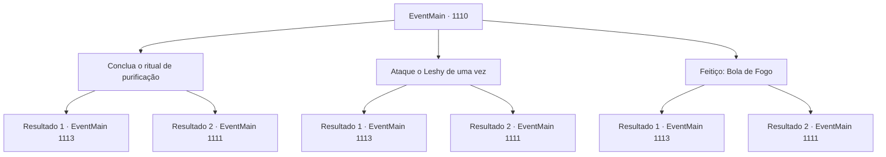

# Eventos principais · 1110

[Índice da tabela](index.md) · [Índice geral](../index.md)

ID: `pt:EventMain:1110` · Fonte: `EventMain4` · Versão: 1.2.47.

Mapeamento estático dos arquivos; a disponibilidade e a execução dependem do estado da run.

## Texto do evento

*Sem texto no arquivo.*

## Dados de entrada

```json
{
  "id": 1110,
  "grade": 1,
  "normalGoal": "",
  "required": ""
}
```

## Mapa das escolhas



## Escolhas e resultados

### Escolha 1

Conclua o ritual de purificação

Requisitos e outros campos da escolha:

```json
{
  "required": ""
}
```

#### Resultado 1.1

Enquanto os soldados mantêm o Leshy ocupado, você decide terminar o ritual de purificação ao lado da árvore. Você mantém o foco, recitando o encantamento com cuidado. Finalmente, com os últimos passos do ritual concluídos, as linhas carmesim desaparecem, o totem se estilhaçando em pedaços. Os fungos nas raízes da árvore encolhem em resposta também. O fedor horrível que preenchia a clareira desaparece. A luz carmesim que ardia nos olhos do Leshy também se vai. O Leshy começa a se petrificar, como uma árvore ressecada faria em um inverno rigoroso. 

 "...Está... morto?"

 Um dos soldados cutuca a monstruosidade com a ponta da lança. O Leshy petrificado cai sem forças. Os soldados deitam no chão, exaustos e cobertos de sangue e suor. O sol já está se pondo — mas ainda há um longo caminho até o Rio Shilling.

Continuação registrada: [Evento 1113](1113.md) na mesma tabela.

```json
{
  "required": "",
  "chance": "1|0_14_1",
  "nextEvent": 1113,
  "type": 0,
  "reward": ""
}
```

#### Resultado 1.2

Enquanto os soldados mantêm o Leshy ocupado, você decide terminar o ritual de purificação ao lado da árvore. Mas você simplesmente não consegue se concentrar no ritual, com toda a luta ocorrendo bem ao seu lado. Infelizmente, você volta para a luta, para lidar com o Leshy primeiro.

Continuação registrada: [Evento 1111](1111.md) na mesma tabela.

```json
{
  "required": "",
  "chance": "16",
  "nextEvent": 1111,
  "type": 1,
  "reward": "6_2_195",
  "place": 1
}
```

### Escolha 2

Ataque o Leshy de uma vez

Requisitos e outros campos da escolha:

```json
{
  "required": ""
}
```

#### Resultado 2.1

Você ordena que seus soldados ataquem o Leshy imediatamente. Atendendo às suas ordens, seus homens cobrem o monstro de golpes por todas as direções. Incapaz de se esquivar, o Leshy é posto de joelhos. 

 "G...ro...o...."

 A luz carmesim que ardia nos olhos do Leshy se apaga. O Leshy começa a petrificar, como uma árvore ressecada faria num inverno gelado. 

 "...Está... morto?"

 Um dos soldados cutuca a monstruosidade com a ponta da lança. O Leshy petrificado cai sem forças. Os soldados se deitam no chão, exaustos e cobertos de sangue e suor. Você passa pelo Leshy e se aproxima da árvore. Lá, você retoma o ritual de purificação. Finalmente, com os últimos passos do ritual concluídos, as linhas carmesins desaparecem, o totem se estilhaçando em pedaços. Os fungos nas raízes da árvore encolhem em resposta também. O fedor horrível que preenchia a clareira desaparece. O sol já está se pondo — mas ainda falta muito até o Rio Shilling.

Continuação registrada: [Evento 1113](1113.md) na mesma tabela.

```json
{
  "required": "",
  "chance": "1|0_12_1",
  "nextEvent": 1113,
  "type": 0,
  "reward": ""
}
```

#### Resultado 2.2

Você ordena que seus soldados ataquem o Leshy imediatamente. Mas, ao contrário do que você esperava, os movimentos dos soldados estão longe de ser ordenados. O Leshy bloqueia os ataques com seus braços e chifres. 

 "CRAAAAA!"

 Com os olhos brilhando em vermelho, o Leshy começa a debater-se ainda mais furiosamente.

Continuação registrada: [Evento 1111](1111.md) na mesma tabela.

```json
{
  "required": "",
  "chance": "16",
  "nextEvent": 1111,
  "type": 1,
  "reward": "6_2_195",
  "place": 1
}
```

### Escolha 3

Feitiço: Bola de Fogo

Requisitos e outros campos da escolha:

```json
{
  "required": "20_0_2|1_1_2"
}
```

#### Resultado 3.1

Você murmura uma incantação, conjurando uma bola de fogo. Então, você grita para o soldado desviar. Ele larga a lança e pula para longe do Leshy. Então, sua bola de fogo envolve o Leshy em chamas. Um barulho alto preenche a floresta. 

 "CA...CC...K...!"

 A luz carmesim que queimava nos olhos do Leshy desaparece. O Leshy começa a petrificar, como se uma árvore ressecada ficasse em um inverno congelante. 

 "...Está... morto?"

 Um dos soldados cutuca a monstruosidade com a ponta da lança. O Leshy petrificado cai impotente. Os soldados deitam no chão, exaustos e cobertos de sangue e suor. Você passa pelo Leshy, aproximando-se da árvore. Lá, você retoma o ritual de purificação. Finalmente, com os últimos passos do ritual concluídos, as linhas carmesim desaparecem, o totem se estilhaça em pedaços. Os fungos nas raízes da árvore encolhem em resposta também. O horrível fedor que enchia a clareira desaparece. O sol já está se pondo — mas ainda é um longo caminho até o Rio Shilling.

Continuação registrada: [Evento 1113](1113.md) na mesma tabela.

```json
{
  "required": "",
  "chance": "1|0_12_1|0_7_1",
  "nextEvent": 1113,
  "type": 0,
  "reward": "0_1_-1"
}
```

#### Resultado 3.2

Você murmura um encantamento, conjurando uma bola de fogo. Então, você grita para o soldado desviar. Ele solta sua lança e pula para longe do Leshy. Mas a bola de fogo erra, passando ao lado do Leshy. 

 "KYAHHHH!"

 Com os olhos brilhando em vermelho, o Leshy começa a se debater ainda mais furiosamente.

Continuação registrada: [Evento 1111](1111.md) na mesma tabela.

```json
{
  "required": "",
  "chance": "32",
  "nextEvent": 1111,
  "type": 1,
  "reward": "6_2_195|0_1_-1",
  "place": 1
}
```

## Referências que chegam a este evento

- [Evento 1109 · escolha 2 · resultado 2](1109.md#escolha-2)
