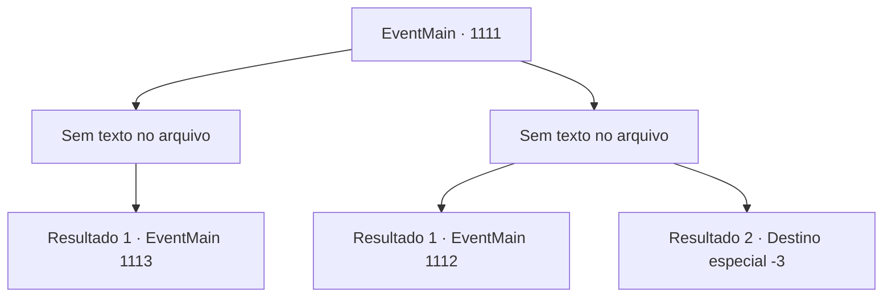

# Eventos principais · 1111

[Índice da tabela](index.md) · [Índice geral](../index.md)

ID: `pt:EventMain:1111` · Fonte: `EventMain4` · Versão: 1.2.47.

Mapeamento estático dos arquivos; a disponibilidade e a execução dependem do estado da run.

## Texto do evento

*Sem texto no arquivo.*

## Dados de entrada

```json
{
  "id": 1111,
  "grade": 1,
  "normalGoal": "",
  "required": ""
}
```

## Mapa das escolhas



## Escolhas e resultados

### Escolha 1

*Sem texto no arquivo; o papel dessa opção depende da interface do jogo.*

Requisitos e outros campos da escolha:

```json
{
  "required": ""
}
```

#### Resultado 1.1

Você se junta aos soldados e consegue derrubar o Leshy. O monstro convulsiona, solta um grito grotesco e cai. O Leshy começa a petrificar, como se uma árvore ressecada congelasse no inverno. 

 "...Ele está... morto?"

 Um dos soldados cutuca a monstruosidade com a ponta da lança. O Leshy petrificado desaba sem forças. Os soldados se deitam no chão, exaustos e cobertos de sangue e suor. Você passa pelo Leshy, aproximando-se da árvore. Lá, você retoma o ritual de purificação. Finalmente, com os últimos passos do ritual concluídos, as linhas carmesim desaparecem, o totem se estilhaçando em pedaços. Os fungos nas raízes da árvore também encolhem em resposta. O cheiro horrível que preenchia a clareira some. O sol já está se pondo — mas ainda há um longo caminho até o Rio Shilling.

Continuação registrada: [Evento 1113](1113.md) na mesma tabela.

```json
{
  "required": "",
  "chance": "1",
  "nextEvent": 1113,
  "type": 2,
  "reward": ""
}
```

### Escolha 2

*Sem texto no arquivo; o papel dessa opção depende da interface do jogo.*

Requisitos e outros campos da escolha:

```json
{
  "required": ""
}
```

#### Resultado 2.1

O Leshy golpeia seu peito com as patas traseiras. Você é lançado no ar. Você rola no chão algumas vezes, então bate em algo duro. Imediatamente perde a consciência. 

 Você abre os olhos sob um teto familiar. Sua cabeça dói, e você sente a pressão de bandagens ao redor da testa. Em uma mesa de cabeceira ao lado da cama repousa uma pequena tigela com água. Ao lado dela jaze um monte de bandagens ensanguentadas. Então, a porta se abre, enquanto Rennart entra no quarto com uma criada. 

 "Você acordou, meu Senhor. Como se sente?"

 Ele checa sua testa primeiro, então continua. 

 "Você ficou inconsciente por três dias."

 Rennart puxa uma cadeira perto da cama e se senta. Você percebe pés de galinha sob seus olhos. 

 "As aparições de mortos-vivos aumentaram ainda mais ao redor da propriedade. Até agora conseguimos contê-las, enviando soldados e contratando aventureiros, mas..."

 Ele para brevemente. A criada desfaz silenciosamente as bandagens antigas da sua cabeça, substituindo-as por uma nova. Ela pega as bandagens usadas e a tigela com água, então sai do quarto. A porta se fecha.

Continuação registrada: [Evento 1112](1112.md) na mesma tabela.

```json
{
  "required": "1_0_2|1_1_2",
  "chance": "1",
  "nextEvent": 1112,
  "type": 2,
  "reward": "0_0_-1|0_1_-1"
}
```

#### Resultado 2.2

O Leshy golpeia seu peito com as patas traseiras. Você é lançado no ar. Você rola pelo chão algumas vezes e então bate em algo duro. Você perde a consciência imediatamente.

Continuação registrada: [Destino especial `-3`](../destinos-especiais.md).

```json
{
  "required": "-1|2_0_2|2_1_2",
  "chance": "1",
  "nextEvent": -3,
  "type": 2,
  "reward": "0_0_-1|0_1_-1"
}
```

## Referências que chegam a este evento

- [Evento 1110 · escolha 1 · resultado 2](1110.md#escolha-1)
- [Evento 1110 · escolha 2 · resultado 2](1110.md#escolha-2)
- [Evento 1110 · escolha 3 · resultado 2](1110.md#escolha-3)
