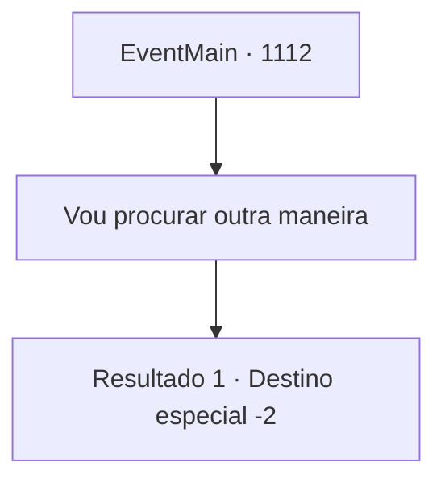

# Eventos principais · 1112

[Índice da tabela](index.md) · [Índice geral](../index.md)

ID: `pt:EventMain:1112` · Fonte: `EventMain4` · Versão: 1.2.47.

Mapeamento estático dos arquivos; a disponibilidade e a execução dependem do estado da run.

## Texto do evento

*Sem texto no arquivo.*

## Dados de entrada

```json
{
  "id": 1112,
  "grade": 1,
  "normalGoal": "",
  "required": ""
}
```

## Mapa das escolhas



## Escolhas e resultados

### Escolha 1

Vou procurar outra maneira

Requisitos e outros campos da escolha:

```json
{
  "required": ""
}
```

#### Resultado 1.1

Depois de passar alguns dias se recuperando, você arruma suas coisas. Rennart o acompanha até o portão do castelo, dá um nó na sua mochila e fala. 

 "Por favor, tenha cuidado."

 Ele coloca uma poção na sua bolsa, dizendo que espera que ela seja útil. Você acena com a cabeça. Rennart se curva. O portão se abre, e você parte para resolver a crise dos mortos-vivos. Você ouve o portão se fechando atrás de você.

Continuação registrada: [Destino especial `-2`](../destinos-especiais.md).

```json
{
  "required": "",
  "chance": "1",
  "nextEvent": -2,
  "type": 2,
  "reward": "0_0_1|3_36_1|3_37_1|13_6_6"
}
```

## Referências que chegam a este evento

- [Evento 1111 · escolha 2 · resultado 1](1111.md#escolha-2)
- [Evento 1117 · escolha 2 · resultado 1](1117.md#escolha-2)
