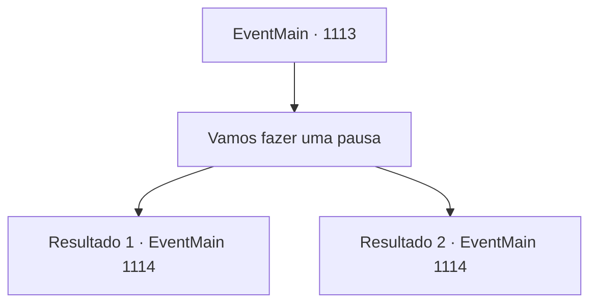

# Eventos principais · 1113

[Índice da tabela](index.md) · [Índice geral](../index.md)

ID: `pt:EventMain:1113` · Fonte: `EventMain4` · Versão: 1.2.47.

Mapeamento estático dos arquivos; a disponibilidade e a execução dependem do estado da run.

## Texto do evento

*Sem texto no arquivo.*

## Dados de entrada

```json
{
  "id": 1113,
  "grade": 1,
  "normalGoal": "",
  "required": ""
}
```

## Mapa das escolhas



## Escolhas e resultados

### Escolha 1

Vamos fazer uma pausa

Requisitos e outros campos da escolha:

```json
{
  "required": ""
}
```

#### Resultado 1.1

Você ordena aos seus homens que façam uma pausa. Os soldados colocam suas armas no chão e sentam-se. Lanças são colocadas perto das árvores, e o suor cobre as cabeças dos soldados. Um deles junta alguns gravetos secos e acende uma fogueira. Os outros começam a montar algumas barracas. Você coloca sua mochila no chão e encontra um tronco caído para se sentar.

Continuação registrada: [Evento 1114](1114.md) na mesma tabela.

```json
{
  "required": "18_902_1",
  "chance": "1",
  "nextEvent": 1114,
  "type": 2,
  "reward": ""
}
```

#### Resultado 1.2

Você ordena que seus homens façam uma pausa. Os soldados colocam suas armas no chão e se sentam. Lanças são apoiadas perto das árvores, e o suor cobre as cabeças dos soldados. Um deles junta alguns gravetos secos e acende uma fogueira. Os outros começam a montar algumas tendas. Mathilda se ajoelha no chão ali perto. Ela segura seu colar com as duas mãos. Seus olhos se fecham, e seus lábios começam a se mover silenciosamente.

Continuação registrada: [Evento 1114](1114.md) na mesma tabela.

```json
{
  "required": "5_902_1",
  "chance": "1",
  "nextEvent": 1114,
  "type": 2,
  "reward": ""
}
```

## Referências que chegam a este evento

- [Evento 1109 · escolha 1 · resultado 1](1109.md#escolha-1)
- [Evento 1109 · escolha 1 · resultado 2](1109.md#escolha-1)
- [Evento 1109 · escolha 2 · resultado 1](1109.md#escolha-2)
- [Evento 1110 · escolha 1 · resultado 1](1110.md#escolha-1)
- [Evento 1110 · escolha 2 · resultado 1](1110.md#escolha-2)
- [Evento 1110 · escolha 3 · resultado 1](1110.md#escolha-3)
- [Evento 1111 · escolha 1 · resultado 1](1111.md#escolha-1)
