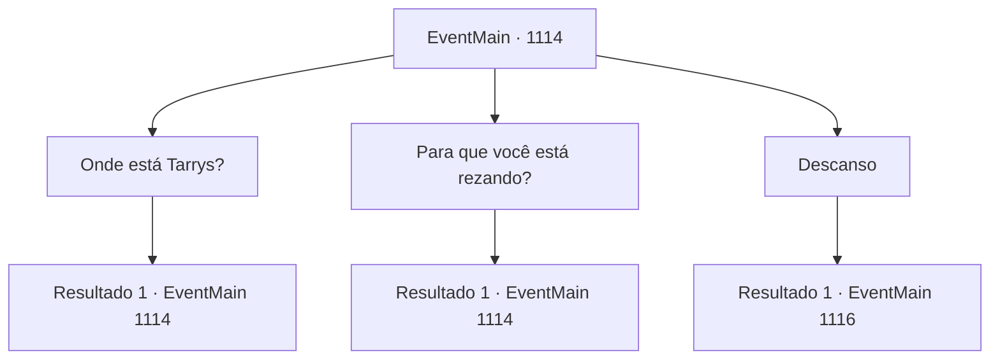

# Eventos principais · 1114

[Índice da tabela](index.md) · [Índice geral](../index.md)

ID: `pt:EventMain:1114` · Fonte: `EventMain4` · Versão: 1.2.47.

Mapeamento estático dos arquivos; a disponibilidade e a execução dependem do estado da run.

## Texto do evento

*Sem texto no arquivo.*

## Dados de entrada

```json
{
  "id": 1114,
  "grade": 1,
  "normalGoal": "",
  "required": ""
}
```

## Mapa das escolhas



## Escolhas e resultados

### Escolha 1

Onde está Tarrys?

Requisitos e outros campos da escolha:

```json
{
  "required": "18_881_1|5_904_0"
}
```

#### Resultado 1.1

Um dos soldados responde, colocando o capacete no colo. 

 "Ah, o velho Tarrys deve estar de folga hoje — ele ficou de guarda ontem à noite. Imagino que esteja bebendo em algum lugar depois de uma boa soneca."

 Outro soldado ao lado dele pega uma garrafa de água e bebe. Você nota uma leve ponta de ciúmes no rosto dos soldados.

Continuação registrada: [Evento 1114](1114.md) na mesma tabela.

```json
{
  "required": "",
  "chance": "1",
  "nextEvent": 1114,
  "type": 2,
  "reward": "5_904_1"
}
```

### Escolha 2

Para que você está rezando?

Requisitos e outros campos da escolha:

```json
{
  "required": "5_905_0|5_902_1"
}
```

#### Resultado 2.1

Você está ao lado de Mathilda, esperando. Você não consegue ouvir nada, mas os lábios dela estão se movendo. Os dedos ao redor do colar dela apertam-se com força. Logo, ela se levanta e olha para você. 

 "Ah, não foi nada de especial. Eu só... desejei a todos aqui um retorno seguro para suas casas."

 Ela sorri, parecendo um pouco cansada.

Continuação registrada: [Evento 1114](1114.md) na mesma tabela.

```json
{
  "required": "",
  "chance": "1",
  "nextEvent": 1114,
  "type": 2,
  "reward": "5_905_1"
}
```

### Escolha 3

Descanso

Requisitos e outros campos da escolha:

```json
{
  "required": ""
}
```

#### Resultado 3.1

Você entra em uma das tendas montadas pelos seus homens e deita-se. As cobertas abraçam seu corpo, e o cansaço de um dia vem à tona. Seus ombros doem, e seus joelhos gritam toda vez que você tenta dobrá-los. Você ouve a voz de um soldado do lado de fora. 

 "Pois então. Boa noite, meu senhor."

 Sussurros seguem. Os soldados discutem sobre quem deve fazer a vigília primeiro, quanto tempo será cada turno, etc. Você fecha os olhos. Os sussurros lentamente desaparecem. 

 A luz do sol banha sua tenda. Alguns raios encontram caminho até seus olhos. Você ouve alguém abrindo sua tenda. 

 "É de manhã, meu senhor. Devo lhe trazer um pouco de café da manhã?"

 Um soldado está agachado perto da tenda, olhando para baixo. Você repara em uma fogueira além dele. Uma panela de cozinhar pende sobre o fogo, algo fervendo dentro. É um amontoado de ingredientes locais, como coelho, cebola e cenoura. Você faz um aceno, e o soldado despeja um pouco em uma tigela de madeira e lhe entrega. 

 Os soldados começam a arrumar o acampamento assim que terminam a refeição. Cada soldado trabalha incansavelmente, abafando a fogueira com terra e puxando as estacas da tenda. Você conduz seus homens para fora da Floresta Brindel, tomando a estrada leste. 

 Logo, você chega a uma encosta, onde o Rio Shilling pode ser visto. Você segue pela margem do rio e encontra o moinho de água. É um prédio antigo, construído em madeira e pedra. O moinho está coberto por musgo espesso e troncos trazidos pela corrente. Parece que foi abandonado há muito tempo. Você percebe mortos-vivos e ghouls rondando a área.

Continuação registrada: [Evento 1116](1116.md) na mesma tabela.

```json
{
  "required": "",
  "chance": "1",
  "nextEvent": 1116,
  "type": 2,
  "reward": "0_0_1|0_1_1"
}
```

## Referências que chegam a este evento

- [Evento 1113 · escolha 1 · resultado 1](1113.md#escolha-1)
- [Evento 1113 · escolha 1 · resultado 2](1113.md#escolha-1)
- [Evento 1114 · escolha 1 · resultado 1](1114.md#escolha-1)
- [Evento 1114 · escolha 2 · resultado 1](1114.md#escolha-2)
