# Eventos principais · 1115

[Índice da tabela](index.md) · [Índice geral](../index.md)

ID: `pt:EventMain:1115` · Fonte: `EventMain4` · Versão: 1.2.47.

Mapeamento estático dos arquivos; a disponibilidade e a execução dependem do estado da run.

## Texto do evento

*Sem texto no arquivo.*

## Dados de entrada

```json
{
  "id": 1115,
  "grade": 1,
  "normalGoal": "",
  "required": ""
}
```

## Mapa das escolhas

```mermaid
flowchart TD
  E["EventMain · 1115"]
  C0["Examine o moinho d&#x27;água"]
  E --> C0
  R0_0["Resultado 1 · EventMain 1118"]
  C0 --> R0_0
  R0_1["Resultado 2 · EventMain 1118"]
  C0 --> R0_1
```



## Escolhas e resultados

### Escolha 1

Examine o moinho d'água

Requisitos e outros campos da escolha:

```json
{
  "required": ""
}
```

#### Resultado 1.1

Você se aproxima do moinho de água. Quanto mais chega, mais percebe que o prédio não está em bom estado. As paredes de madeira estão cheias de buracos e rachaduras, e o telhado está meio desabado. Você ordena que seus homens fiquem de vigia ao redor da área e caminha até a porta do moinho. Está entreaberta, a tranca destravada. Você empurra a porta e ela se abre com um rangido. O interior do moinho não é bem iluminado e cheira a umidade. Raios de luz atravessam alguns buracos no telhado meio desabado. |drawing_watermillTotem| No canto, há uma mó de pedras, e só restam pedaços de pano de cânhamo apodrecidos onde estariam os sacos de grãos. Você nota pó branco de osso espalhado pelo chão. No centro do círculo de pó de osso, encontra uma cabeça de cabra decepada, pintada de preto. Você eleva o olhar. Encontra linhas carmesim feitas com sangue, pintadas na parede de madeira atrás da cabeça. É um círculo mágico, desenhado com sangue. Você se lembra do que viu em Brindel Woods — e nota o mesmo padrão exato aqui, as letras inscritas, a formação dos símbolos que cercam o círculo e até a espessura das linhas.

Continuação registrada: [Evento 1118](1118.md) na mesma tabela.

```json
{
  "required": "18_902_1",
  "chance": "1",
  "nextEvent": 1118,
  "type": 2,
  "reward": ""
}
```

#### Resultado 1.2

Você se aproxima do moinho d'água. Quanto mais chega, mais percebe que o prédio não está em boas condições. As paredes de madeira estão cheias de buracos e rachaduras, e o telhado está meio desmoronado. Você ordena que seus homens fiquem de guarda ao redor da área e caminha até a porta do moinho d'água. Está entreaberta, a tranca solta. Você empurra a porta, que se abre com um rangido. O interior do moinho não é bem iluminado e cheira a umidade. Raios de luz atravessam alguns buracos no telhado meio desmoronado. |drawing_watermillTotem| No canto, há uma mó, e só restam pedaços podres de pano de cânhamo onde antes haveria sacos de grãos. Você repara em pó branco de osso espalhado pelo chão. No centro do círculo de pó de osso, encontra uma cabeça de cabra decepada, pintada de preto. Você direciona o olhar para cima. Encontra linhas carmesim feitas com sangue, pintadas na parede de madeira atrás da cabeça. É um círculo mágico, desenhado com sangue. Você lembra do que viu em Brindel Woods — e percebe o mesmo padrão exato aqui, as letras inscritas, a formação dos símbolos que cercam o círculo, e até a espessura das linhas. Mathilda vê isso e murmura. 

 "...Exatamente como vimos na floresta."


Continuação registrada: [Evento 1118](1118.md) na mesma tabela.

```json
{
  "required": "5_902_1",
  "chance": "1",
  "nextEvent": 1118,
  "type": 2,
  "reward": ""
}
```

## Referências que chegam a este evento

- [Evento 1116 · escolha 1 · resultado 1](1116.md#escolha-1)
- [Evento 1116 · escolha 1 · resultado 3](1116.md#escolha-1)
- [Evento 1116 · escolha 2 · resultado 1](1116.md#escolha-2)
- [Evento 1116 · escolha 3 · resultado 1](1116.md#escolha-3)
- [Evento 1117 · escolha 1 · resultado 1](1117.md#escolha-1)
- [Evento 1117 · escolha 2 · resultado 2](1117.md#escolha-2)
