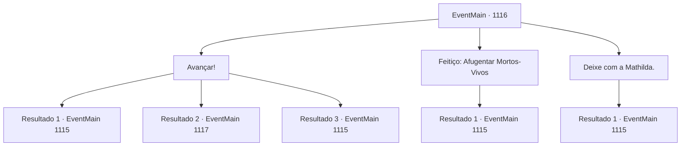

# Eventos principais · 1116

[Índice da tabela](index.md) · [Índice geral](../index.md)

ID: `pt:EventMain:1116` · Fonte: `EventMain4` · Versão: 1.2.47.

Mapeamento estático dos arquivos; a disponibilidade e a execução dependem do estado da run.

## Texto do evento

*Sem texto no arquivo.*

## Dados de entrada

```json
{
  "id": 1116,
  "grade": 1,
  "normalGoal": "",
  "required": ""
}
```

## Mapa das escolhas



## Escolhas e resultados

### Escolha 1

Avançar!

Requisitos e outros campos da escolha:

```json
{
  "required": ""
}
```

#### Resultado 1.1

Você ordena aos seus homens que ataquem, liderando a investida contra os mortos-vivos. 

 "HYAAAAAH!!"

 Os soldados abaixam suas lanças, empurram seus escudos para frente e, em seguida, seguem você com um alto grito de batalha. Você e seus homens começam a golpear os mortos-vivos com lanças e escudos. Incapazes de reagir a tempo, os mortos-vivos são lançados ao chão. Eles arranham a terra, tentando subir de volta com os braços, mas acabam não conseguindo se equilibrar. Um ghoul, que perdeu um dos braços, é esfaqueado na cabeça com uma lança. Outros soldados, reunidos, lidam com os demais em pouco tempo. O último ghoul cai, e a área fica silenciosa. Agora, apenas o som da água correndo preenche o moinho d'água. Os soldados lavam o sangue de seus corpos e equipamentos no rio.

Continuação registrada: [Evento 1115](1115.md) na mesma tabela.

```json
{
  "required": "21_60_2",
  "chance": "1|0_5_1",
  "nextEvent": 1115,
  "type": 0,
  "reward": "0_2_1"
}
```

#### Resultado 1.2

Você ordena aos seus homens que ataquem, liderando a investida contra os mortos-vivos. 

 "HYAAAAAH!!"

 Os soldados abaixam as lanças, empurram os escudos para frente e então seguem você com um grito de guerra alto. Mas sua investida não causa muito dano ao wight. Em vez disso, você ricocheteia e rola pelo chão. Dois soldados correm para te proteger. Um levanta o escudo para te proteger, e o outro te agarra pelo braço e te puxa de volta para cima. 

 "Você está bem?!"

 Quando você está prestes a responder, o wight corre em sua direção. Atrás dele, três ghouls também correm em direção aos soldados. Um deles se atira sobre um soldado que segura uma lança, e outros saltam, mostrando seus dentes afiados. O tilintar metálico e os rugidos de batalha enchem a margem do rio.

Continuação registrada: [Evento 1117](1117.md) na mesma tabela.

```json
{
  "required": "21_60_2",
  "chance": "18",
  "nextEvent": 1117,
  "type": 1,
  "reward": "6_0_89",
  "place": 0
}
```

#### Resultado 1.3

Você ordena que seus homens ataquem, liderando a investida contra os mortos-vivos. 

 "HYAAAAAH!!"

 Os soldados abaixam suas lanças, empurram seus escudos para frente e então seguem você com um alto grito de guerra. Você e seus homens começam a golpear os mortos-vivos com lanças e escudos. Incapazes de reagir a tempo, os mortos-vivos são lançados ao chão. Eles arranham a terra, tentando se arrastar de volta com os braços, mas acabam não conseguindo se equilibrar. Um ghoul, que perdeu um de seus braços, é esfaqueado na cabeça com uma lança. Outros soldados, reunidos, lidam com os demais em pouco tempo, certificando-se de que não se levantem novamente. O último ghoul cai, e a área fica em silêncio. Agora, apenas o som da água corrente preenche o moinho de água.

Continuação registrada: [Evento 1115](1115.md) na mesma tabela.

```json
{
  "required": "20_60_2",
  "chance": "1",
  "nextEvent": 1115,
  "type": 2,
  "reward": ""
}
```

### Escolha 2

Feitiço: Afugentar Mortos-Vivos

Requisitos e outros campos da escolha:

```json
{
  "required": "20_0_1|20_3_1|1_1_2"
}
```

#### Resultado 2.1

Você conjura Expulsar Mortos-Vivos. Uma onda de luz emana, engolindo os mortos-vivos. Suas carnes começam a derreter como cinzas. À medida que a luz se desvanece, apenas montes de cinzas permanecem onde os mortos-vivos estavam. Você se sente um pouco cansado, mas faz o possível para esconder.

Continuação registrada: [Evento 1115](1115.md) na mesma tabela.

```json
{
  "required": "",
  "chance": "1",
  "nextEvent": 1115,
  "type": 2,
  "reward": "0_1_-1|0_2_1"
}
```

### Escolha 3

Deixe com a Mathilda.

Requisitos e outros campos da escolha:

```json
{
  "required": "5_902_1"
}
```

#### Resultado 3.1

Você se vira para olhar Mathilda. Ela acena com a cabeça e dá um passo à frente. Os mortos-vivos a encontram, então se aproximam mancando para atacá-la. Ela começa a recitar uma incantação, sem hesitar por um segundo. Uma onda de luz emana dela, engolindo os mortos-vivos. Suas peles começam a derreter como cinzas. À medida que a luz se desvanece, apenas pilhas de cinzas permanecem onde os mortos-vivos estavam. 

 "Descansem em paz, agora."

 Ela junta as mãos e murmura uma breve oração.

Continuação registrada: [Evento 1115](1115.md) na mesma tabela.

```json
{
  "required": "",
  "chance": "1",
  "nextEvent": 1115,
  "type": 2,
  "reward": "0_2_1"
}
```

## Referências que chegam a este evento

- [Evento 1114 · escolha 3 · resultado 1](1114.md#escolha-3)
