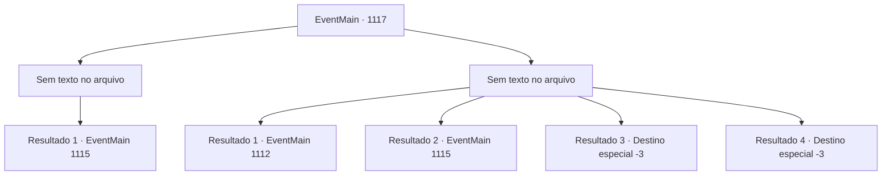

# Eventos principais · 1117

[Índice da tabela](index.md) · [Índice geral](../index.md)

ID: `pt:EventMain:1117` · Fonte: `EventMain4` · Versão: 1.2.47.

Mapeamento estático dos arquivos; a disponibilidade e a execução dependem do estado da run.

## Texto do evento

*Sem texto no arquivo.*

## Dados de entrada

```json
{
  "id": 1117,
  "grade": 1,
  "normalGoal": "",
  "required": ""
}
```

## Mapa das escolhas



## Escolhas e resultados

### Escolha 1

*Sem texto no arquivo; o papel dessa opção depende da interface do jogo.*

Requisitos e outros campos da escolha:

```json
{
  "required": ""
}
```

#### Resultado 1.1

Você e seus homens lidam com os mortos-vivos, mandando-os de volta para o além. O último necrófago cai, e a área fica em silêncio. Agora, apenas o som da água corrente preenche o moinho d'água. Os soldados lavam o sangue de seus corpos e equipamentos no rio.

Continuação registrada: [Evento 1115](1115.md) na mesma tabela.

```json
{
  "required": "",
  "chance": "1",
  "nextEvent": 1115,
  "type": 2,
  "reward": ""
}
```

### Escolha 2

*Sem texto no arquivo; o papel dessa opção depende da interface do jogo.*

Requisitos e outros campos da escolha:

```json
{
  "required": ""
}
```

#### Resultado 2.1

Um dos wights, que foi lançado ao chão, morde seus tornozelos. Você grita de dor e cai. Você bate a cabeça numa pedra. O som de algo quebrando é a última coisa que você ouve antes de perder a consciência. 

 Você abre os olhos sob um teto familiar. Sua cabeça dói, e você sente a pressão de ataduras ao redor da testa. Num criado-mudo ao lado da cama está uma tigela pequena cheia de água. Ao lado dela jaza uma pilha de ataduras ensanguentadas. Então a porta se abre, e Rennart entra no quarto com uma criada. 

 "Você está acordado, meu senhor. Como se sente?"

 Ele checa sua testa primeiro, e então continua. 

 "Você ficou inconsciente por três dias."

 Rennart puxa uma cadeira perto da cama e se senta. Você nota pés de galinha sob seus olhos. 

 "As aparições de mortos-vivos aumentaram ainda mais ao redor da propriedade. Até agora conseguimos contê-los, enviando soldados e contratando aventureiros, mas..."

 Ele faz uma pausa breve. A criada desfaz silenciosamente as ataduras velhas da sua cabeça, substituindo-as por uma nova. Ela pega as ataduras usadas e a tigela de água, e então sai do quarto. A porta se fecha.

Continuação registrada: [Evento 1112](1112.md) na mesma tabela.

```json
{
  "required": "18_902_1|1_0_2|1_1_2",
  "chance": "1",
  "nextEvent": 1112,
  "type": 2,
  "reward": "0_0_-1|0_1_-1"
}
```

#### Resultado 2.2

Você e seus homens lutam contra os mortos-vivos, presos em uma disputa. Então, uma onda de luz começa a emanar da Irmã Mathilda, engolindo os mortos-vivos. A carne deles começa a derreter como cinzas. Quando a luz se dissipa, apenas montes de cinzas permanecem onde os mortos-vivos estavam. 

 "Descansem em paz, agora."

 Ela junta as mãos e murmura uma breve oração. Seus homens ficam imóveis por um momento, atônitos, então começam a agradecê-la. 

 "Uau, ah... Como poderíamos recompensá-la por isso...?"

 A freira balança a cabeça em resposta. 

 "Não precisa. Tinha que ser feito."

 Ela se vira para você e continua. 

 "Então, vamos para o moinho d'água agora?"


Continuação registrada: [Evento 1115](1115.md) na mesma tabela.

```json
{
  "required": "5_902_1",
  "chance": "1",
  "nextEvent": 1115,
  "type": 2,
  "reward": ""
}
```

#### Resultado 2.3

Um dos wights, que foi jogado ao chão, morde seus tornozelos. Você grita de dor e cai. Você bate a cabeça contra uma pedra. O som de algo se quebrando é a última coisa que você ouve antes de perder a consciência.

Continuação registrada: [Destino especial `-3`](../destinos-especiais.md).

```json
{
  "required": "18_902_1|2_0_2",
  "chance": "1",
  "nextEvent": -3,
  "type": 2,
  "reward": "0_0_-1|0_1_-1"
}
```

#### Resultado 2.4

Um dos mortos-vivos, que foi arremessado ao chão, morde seus tornozelos. Você grita de dor e cai. Você bate a cabeça contra uma pedra. O som de algo se quebrando é a última coisa que você ouve antes de perder a consciência.

Continuação registrada: [Destino especial `-3`](../destinos-especiais.md).

```json
{
  "required": "18_902_1|2_1_2",
  "chance": "1",
  "nextEvent": -3,
  "type": 2,
  "reward": "0_0_-1|0_1_-1"
}
```

## Referências que chegam a este evento

- [Evento 1116 · escolha 1 · resultado 2](1116.md#escolha-1)
