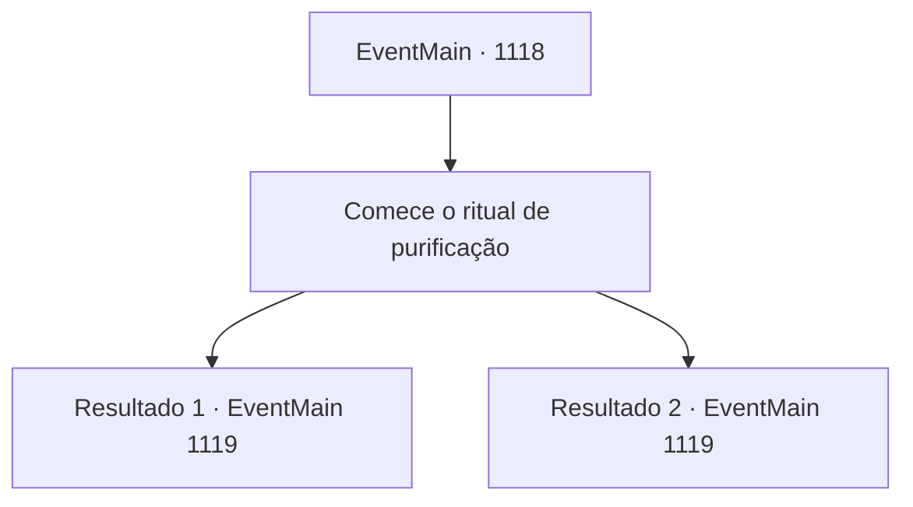

# Eventos principais · 1118

[Índice da tabela](index.md) · [Índice geral](../index.md)

ID: `pt:EventMain:1118` · Fonte: `EventMain4` · Versão: 1.2.47.

Mapeamento estático dos arquivos; a disponibilidade e a execução dependem do estado da run.

## Texto do evento

*Sem texto no arquivo.*

## Dados de entrada

```json
{
  "id": 1118,
  "grade": 1,
  "normalGoal": "",
  "required": ""
}
```

## Mapa das escolhas



## Escolhas e resultados

### Escolha 1

Comece o ritual de purificação

Requisitos e outros campos da escolha:

```json
{
  "required": ""
}
```

#### Resultado 1.1

Você abre o Tomo da Purificação, conferindo novamente as instruções do ritual. Passo um - despeje água sobre o círculo mágico feito com pó de osso. O pó de osso começa a espumar, infiltrando-se no assoalho de madeira. Passo dois - você coloca a mão sobre o símbolo carmesim na parede. Ao começar a recitar a incantação do ritual, um leve calor emana da sua palma. Os rastros de sangue começam a tremer. Logo, com o último verso concluído, as linhas carmesim se estilhaçam em pedaços. Então, o crânio de cabra no chão racha ao meio. O fedor horrível que preenchia a sala começa a desaparecer.

Continuação registrada: [Evento 1119](1119.md) na mesma tabela.

```json
{
  "required": "18_902_1",
  "chance": "1",
  "nextEvent": 1119,
  "type": 2,
  "reward": "0_2_1"
}
```

#### Resultado 1.2

Mathilda puxa um frasco de água benta e a derrama sobre o círculo mágico. O pó de ossos começa a espumar, crepitando e evaporando no ar. Então, ela coloca a mão no símbolo carmesim na parede. Ao começar a recitar a incantação ritual, as trilhas de sangue começam a tremer. Logo, com o último verso terminado, as linhas carmesim se estilhaçam em pedaços. O horrível fedor que enchia a sala começa a desaparecer. Mathilda afasta o suor da testa. 

 "...O ritual de purificação está completo."

 Ela se curva educadamente, elogiando você e seus homens por todo o trabalho duro.

Continuação registrada: [Evento 1119](1119.md) na mesma tabela.

```json
{
  "required": "5_902_1",
  "chance": "1",
  "nextEvent": 1119,
  "type": 2,
  "reward": "0_2_1"
}
```

## Referências que chegam a este evento

- [Evento 1115 · escolha 1 · resultado 1](1115.md#escolha-1)
- [Evento 1115 · escolha 1 · resultado 2](1115.md#escolha-1)
