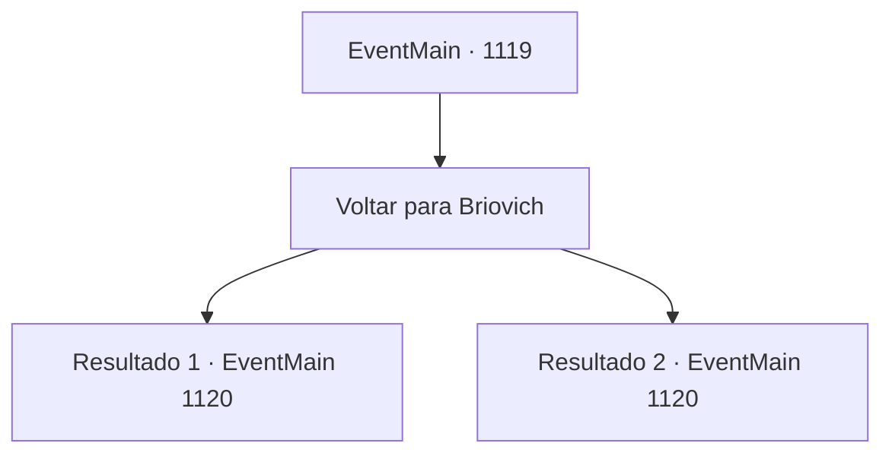

# Eventos principais · 1119

[Índice da tabela](index.md) · [Índice geral](../index.md)

ID: `pt:EventMain:1119` · Fonte: `EventMain4` · Versão: 1.2.47.

Mapeamento estático dos arquivos; a disponibilidade e a execução dependem do estado da run.

## Texto do evento

*Sem texto no arquivo.*

## Dados de entrada

```json
{
  "id": 1119,
  "grade": 1,
  "normalGoal": "",
  "required": ""
}
```

## Mapa das escolhas



## Escolhas e resultados

### Escolha 1

Voltar para Briovich

Requisitos e outros campos da escolha:

```json
{
  "required": ""
}
```

#### Resultado 1.1

Você sai do moinho d'água. Uma rajada de vento passa pelas suas roupas encharcadas de suor. O sol começa a se pôr, lançando sua sombra sobre o rio. Seus soldados voltam à formação, e você os conduz de volta ao Castelo Briovich. A jornada de volta é silenciosa e livre do cheiro horrível. 

 Conforme seu grupo se aproxima do castelo, um guardião nas muralhas agita sua tocha. Logo, o portão se abre. Seus soldados o saúdam e então retornam ao quartel. Você volta ao seu escritório e encontra Rennart. 

 "Você voltou. Espero que não tenha se machucado, minha senhoria."

 Ele coloca uma xícara de chá, presumivelmente preparada antes mesmo da sua chegada, sobre sua mesa. Você recosta na cadeira, toma um gole da xícara e conta o que aconteceu nas Brindel Woods e no moinho d'água. Os totens encontrados em ambos os lugares, os círculos mágicos desenhados com pó de osso e sangue, e o ritual de purificação. 

 "Entendo... Na verdade, verifiquei os locais onde ocorreram avistamentos de mortos-vivos, e algo chamou minha atenção."

 Ele aponta os dedos para alguns pontos no mapa. Ele percorre os lugares purificados e chega a um local chamado 'Rugarden'. 

 "Floresta de Rugarden. É uma mata que se estende por parte das nossas terras e pelo território de Greymoor. Houve um forte lá, mas está abandonado há muito tempo."

 Rennart para brevemente, e então continua. 

 "Presumo que é aí que o necromante está escondido."


Continuação registrada: [Evento 1120](1120.md) na mesma tabela.

```json
{
  "required": "18_902_1",
  "chance": "1",
  "nextEvent": 1120,
  "type": 2,
  "reward": ""
}
```

#### Resultado 1.2

Você sai do moinho. Uma rajada de vento varre suas roupas encharcadas de suor. O sol começa a se pôr, projetando sua sombra sobre o rio. Seus soldados retornam à formação, e você os conduz de volta ao Castelo Briovich. A jornada de volta é silenciosa e livre do horrível fedor. 

 À medida que seu grupo se aproxima do castelo, um guarda nas muralhas agita sua tocha. Logo, o portão se abre. Seus soldados o saúdam e então retornam ao quartel. Irmã Mathilda se curva e também se despede. 

 "Preciso voltar ao mosteiro agora. Boa sorte."

 Você lhe deseja um retorno seguro, então volta para seu escritório, onde encontra Rennart. 

 "Você voltou."

 Ele coloca uma xícara de chá, presumivelmente preparada antes mesmo de sua chegada, sobre sua mesa. Você se recosta na cadeira, toma um gole da xícara e conta o que aconteceu nos Bosques de Brindel e no moinho. Os totens encontrados em ambos os lugares, os círculos mágicos desenhados com pó de osso e sangue, e o ritual de purificação. 

 "Entendo... Na verdade, verifiquei os locais onde ocorreram aparições de mortos-vivos, e algo chamou minha atenção."

 Ele aponta alguns pontos no mapa. Ele passa pelos locais purificados e chega a um lugar chamado 'Rugarden'. 

 "Bosques de Rugarden. É uma floresta, que se estende por parte de nossa propriedade e do território de Greymoor. Houve um forte lá, mas está abandonado há muito tempo."

 Rennart para brevemente, então continua. 

 "Suponho que é onde o necromante está escondido."


Continuação registrada: [Evento 1120](1120.md) na mesma tabela.

```json
{
  "required": "5_902_1",
  "chance": "1",
  "nextEvent": 1120,
  "type": 2,
  "reward": ""
}
```

## Referências que chegam a este evento

- [Evento 1118 · escolha 1 · resultado 1](1118.md#escolha-1)
- [Evento 1118 · escolha 1 · resultado 2](1118.md#escolha-1)
