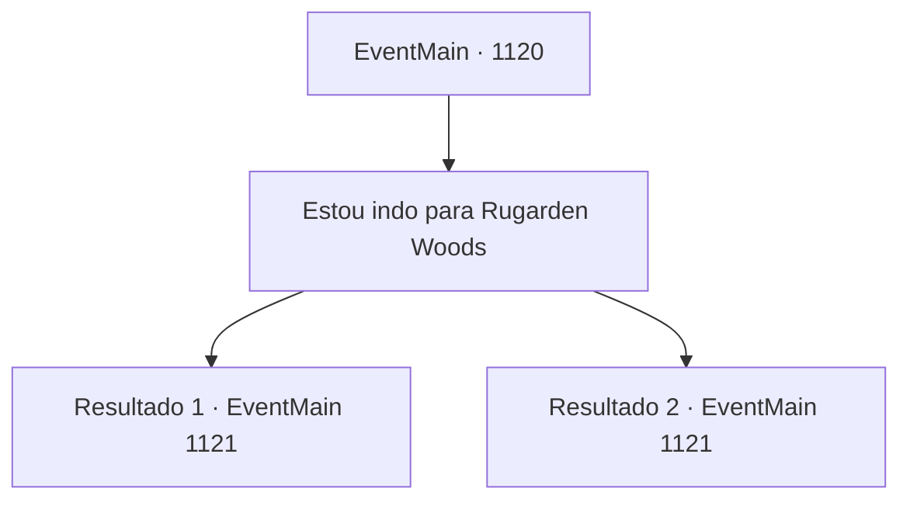

# Eventos principais · 1120

[Índice da tabela](index.md) · [Índice geral](../index.md)

ID: `pt:EventMain:1120` · Fonte: `EventMain4` · Versão: 1.2.47.

Mapeamento estático dos arquivos; a disponibilidade e a execução dependem do estado da run.

## Texto do evento

*Sem texto no arquivo.*

## Dados de entrada

```json
{
  "id": 1120,
  "grade": 1,
  "normalGoal": "",
  "required": ""
}
```

## Mapa das escolhas



## Escolhas e resultados

### Escolha 1

Estou indo para Rugarden Woods

Requisitos e outros campos da escolha:

```json
{
  "required": ""
}
```

#### Resultado 1.1

Você define Bosque de Rugarden como seu próximo destino. Rennart acena com a cabeça e começa a explicar sobre o lugar. 

 "Há algumas coisas que você deve saber antes de ir para lá."

 Ele desenha um círculo ao redor da cidadela com os dedos. 

 "O Bosque de Rugarden é uma floresta de coníferas. Você não encontrará muita luz do sol lá, nem mesmo durante o dia. Espere escuridão e alguns arrepios."

 Rennart para em uma pequena praça, desenhada no centro da floresta. 

 "No meio da floresta fica um forte abandonado. Há cerca de um século, quando a Fazenda Greymoor era a que ficava mais próxima da fronteira, ele era bastante usado. Mas desde que a Casa Briovich se instalou, aquele forte perdeu sua finalidade. Ninguém o cuida desde então."

 Ele desvia o olhar do mapa e pega sua mochila. Sobre a mesa há uma lista de itens. Uma lanterna cheia de lanterna, uma corda e uma besta forjada na ferraria. Rennart coloca os itens na mochila um a um e continua. 

 "Certeza de descansar bem antes de embarcar, meu senhor."

 Após terminar os preparativos, Rennart se curva e deixa o escritório. Você desprende sua capa e a coloca em uma cadeira. Você segue para seu quarto. Seus passos parecem pesados. Ao tirar os sapatos e deitar-se, você nota algumas rachaduras no teto de pedra. Mas não demora até que o cansaço o domine e abaixe suas sobrancelhas.

Continuação registrada: [Evento 1121](1121.md) na mesma tabela.

```json
{
  "required": "5_887_1",
  "chance": "1",
  "nextEvent": 1121,
  "type": 2,
  "reward": "3_39_1|3_42_1|3_228_1|13_6_5"
}
```

#### Resultado 1.2

Você define Rugarden Woods como seu próximo destino. Rennart acena com a cabeça e começa uma explicação sobre o lugar. 

 "Há algumas coisas que você deve saber, antes de ir lá."

 Ele desenha um círculo ao redor da cidadela com os dedos. 

 "Rugarden Woods é uma floresta de coníferas. Você não encontrará muita luz solar lá, nem mesmo durante o dia. Espere escuridão e alguns arrepios."

 Rennart para em um pequeno quadrado, desenhado no centro da floresta. 

 "No meio da floresta fica um forte abandonado. Cerca de um século atrás, quando a Fazenda Greymoor era a que ficava mais próxima da fronteira, ele era bastante utilizado. Mas desde que a Casa Briovich se estabeleceu, aquele forte perdeu sua finalidade. Ninguém cuida dele desde então."

 Ele olha para longe do mapa e pega sua mochila. Sobre a mesa há uma lista de itens. Uma lanterna com combustível, uma corda e uma bolsa de couro cheia de ouro. Rennart coloca os itens na mochila um por um e continua. 

 "Certe-se de descansar bem antes de partir, meu Senhor."

 Depois de terminar os preparativos, Rennart se curva e sai do escritório. Você desamarra sua capa e a coloca em uma cadeira. Você vai para seu quarto. Seus passos parecem pesados. Ao tirar os sapatos e se deitar, você percebe algumas rachaduras no teto de pedra. Mas não demora até que o cansaço te domine e faça suas sobrancelhas caírem.

Continuação registrada: [Evento 1121](1121.md) na mesma tabela.

```json
{
  "required": "5_888_1",
  "chance": "1",
  "nextEvent": 1121,
  "type": 2,
  "reward": "3_39_1|3_42_1|0_4_200|13_6_5"
}
```

## Referências que chegam a este evento

- [Evento 1119 · escolha 1 · resultado 1](1119.md#escolha-1)
- [Evento 1119 · escolha 1 · resultado 2](1119.md#escolha-1)
