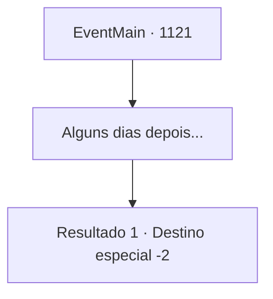

# Eventos principais · 1121

[Índice da tabela](index.md) · [Índice geral](../index.md)

ID: `pt:EventMain:1121` · Fonte: `EventMain4` · Versão: 1.2.47.

Mapeamento estático dos arquivos; a disponibilidade e a execução dependem do estado da run.

## Texto do evento

*Sem texto no arquivo.*

## Dados de entrada

```json
{
  "id": 1121,
  "grade": 1,
  "normalGoal": "",
  "required": ""
}
```

## Mapa das escolhas



## Escolhas e resultados

### Escolha 1

Alguns dias depois...

Requisitos e outros campos da escolha:

```json
{
  "required": ""
}
```

#### Resultado 1.1

Você descansa por alguns dias, sentindo o cansaço desaparecer. Enquanto isso, Rennart se mantém ocupado. Ele analisa documentos financeiros, conferindo e assinando-os, participa de reuniões de negócios com mercadores nos mercados, e até atua como magistrado em um conflito entre moradores da propriedade. 

 Cerca de dez dias se passam. Raios de sol atravessam as janelas. Você abre os olhos. Você lava o rosto, veste algumas roupas e segue para o escritório. Rennart já está lá, organizando montes de documentos sobre a mesa. 

 "Você acordou, meu Senhor."

 Rennart vê você e se levanta. Você pega sua mochila e coloca sua capa. 

 "Cuide-se, meu Senhor."

 Ele se despede de você, tomado por um sentimento de preocupação. Você retribui a saudação, partindo em sua jornada.

Continuação registrada: [Destino especial `-2`](../destinos-especiais.md).

```json
{
  "required": "",
  "chance": "1",
  "nextEvent": -2,
  "type": 2,
  "reward": "0_0_1|0_1_1"
}
```

## Referências que chegam a este evento

- [Evento 1120 · escolha 1 · resultado 1](1120.md#escolha-1)
- [Evento 1120 · escolha 1 · resultado 2](1120.md#escolha-1)
