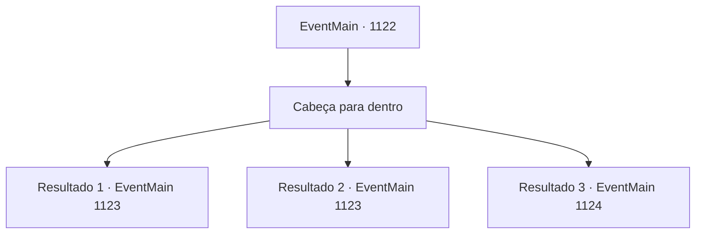

# Eventos principais · 1122

[Índice da tabela](index.md) · [Índice geral](../index.md)

ID: `pt:EventMain:1122` · Fonte: `EventMain4` · Versão: 1.2.47.

Mapeamento estático dos arquivos; a disponibilidade e a execução dependem do estado da run.

## Texto do evento

Você chega aos Bosques de Rugarden. O lugar é coberto por árvores coníferas, seus galhos entrelaçados formando uma barreira semelhante a uma cúpula. Ela cobre o céu, deixando o lugar tão escuro quanto o crepúsculo, mesmo durante um dia claro. Fracos raios de sol mal conseguem atravessar, iluminando aqui e ali. Você segue em frente, passando pelas árvores. A cada passo, você sente as folhas molhadas estremecerem. Mas, fora isso, a floresta está silenciosa. Nenhum som de pássaros cantando, insetos zumbindo ou animais rosnando. Nada. Depois de uma longa caminhada, você nota que a trilha está ficando mais larga. Através das coníferas, você descobre algo. |drawing_rugarden| Você percebe que é uma muralha de castelo. Uma muralha de pedra cinzenta, coberta de vinhas secas e mofo preto. Uma torre de vigia teve seu topo desmoronado, com uma pilha de pedras embaixo simbolizando sua destruição. O portão da frente também está quebrado, com apenas uma parte das duas portas funcionando corretamente. Você passa pela bagunça, seguindo para o forte central. Os pátios estão cobertos por grama alta, aparentemente sem ser aparada há eras, e o que você presume que um dia foi um arsenal está com o telhado desprendido no chão. Para onde quer que olhe, mais você tem a impressão de que este lugar está abandonado. Você se aproxima do edifício principal e ouve algo batendo no chão. Vem de baixo — o som de aço se chocando contra outro, e alguém gritando, embora você não consiga distinguir bem as palavras.

## Dados de entrada

```json
{
  "id": 1122,
  "grade": 1,
  "normalGoal": "",
  "required": "13_6_5|1_2_60"
}
```

## Mapa das escolhas



## Escolhas e resultados

### Escolha 1

Cabeça para dentro

Requisitos e outros campos da escolha:

```json
{
  "required": ""
}
```

#### Resultado 1.1

Você abre a porta da frente e entra no prédio principal. Teias de aranha secas te recebem, esvoaçando ao vento, e você é coberto de poeira. Trilhas de sangue enegrecido cruzam as paredes, com fragmentos de osso espalhados pelo chão. Você passa por elas e chega a uma escadaria que parece levar ao subsolo. Os degraus de pedra estão cobertos de poeira, e você distingue pegadas de várias pessoas neles. O caminho está sem iluminação — não se vê uma única tocha ou lanterna. Você tira sua lanterna e começa a descer cuidadosamente. Quanto mais desce, mais nítidos ficam os sons. Mais ou menos na metade, você para. É um cadáver — seus ferimentos ainda estão recentes, com sangue ainda pingando pela escada. Ele segura um escudo estilhaçado, gravado com o sigilo de um grifo segurando uma espada — o sigilo da Casa Greymoor.

Continuação registrada: [Evento 1123](1123.md) na mesma tabela.

```json
{
  "required": "-1|23_3_1|20_0_1",
  "chance": "1",
  "nextEvent": 1123,
  "type": 2,
  "reward": ""
}
```

#### Resultado 1.2

Você abre a porta da frente e entra no edifício principal. Teias de aranha secas recebem você, esvoaçando ao vento, e você é coberto de pó. Rastros de sangue enegrecido percorrem as paredes, com fragmentos de ossos espalhados pelo chão. Você passa por eles e chega a uma escadaria que parece levar para o subsolo. Os degraus de pedra estão cobertos de poeira, e você distingue pegadas de várias pessoas neles. O caminho está sem iluminação — não há uma única tocha ou lamparina à vista. Mas isso não te incomoda nem um pouco. Quanto mais você desce, mais nítidos ficam os sons. Mais ou menos na metade, você para. É um cadáver — suas feridas ainda estão recentes, com sangue ainda pingando pela escada. Ele segura um escudo estilhaçado, inscrito com o sigilo de um grifo empunhando uma espada — o sigilo da Casa Greymoor.

Continuação registrada: [Evento 1123](1123.md) na mesma tabela.

```json
{
  "required": "-1|20_26_1|20_27_1",
  "chance": "1",
  "nextEvent": 1123,
  "type": 2,
  "reward": ""
}
```

#### Resultado 1.3

Você abre a porta da frente e entra no edifício principal. Teias secas te recebem, tremulando ao vento, e você é coberto por poeira. Trilhas de sangue enegrecido cruzam as paredes, com fragmentos de osso espalhados pelo chão. Você passa por elas e chega a uma escada que parece levar ao subsolo. Os degraus de pedra estão cobertos de poeira, e você distingue pegadas de várias pessoas neles. O caminho está sem iluminação - nem uma tocha ou lanterna à vista. Você desce com muito cuidado e lentamente. Quanto mais baixo você vai, mais nítidos ficam os sons. Mais ou menos na metade, você pisa em algo e tropeça. Você perde o equilíbrio e cai para frente.

Continuação registrada: [Evento 1124](1124.md) na mesma tabela.

```json
{
  "required": "24_3_1|21_0_1|21_26_1|21_27_1",
  "chance": "1",
  "nextEvent": 1124,
  "type": 2,
  "reward": ""
}
```

## Referências que chegam a este evento

Nenhum `nextEvent` positivo da mesma tabela aponta para este nó. Isso não prova que seja inacessível: sorteio e estado de história podem selecioná-lo.

