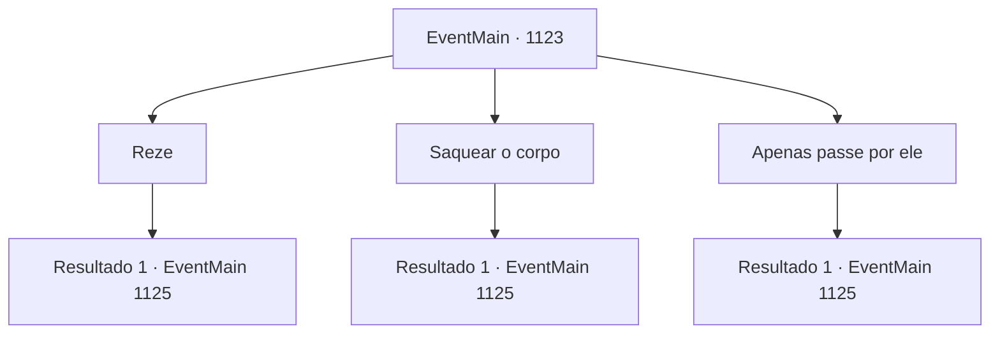

# Eventos principais · 1123

[Índice da tabela](index.md) · [Índice geral](../index.md)

ID: `pt:EventMain:1123` · Fonte: `EventMain4` · Versão: 1.2.47.

Mapeamento estático dos arquivos; a disponibilidade e a execução dependem do estado da run.

## Texto do evento

*Sem texto no arquivo.*

## Dados de entrada

```json
{
  "id": 1123,
  "grade": 1,
  "normalGoal": "",
  "required": ""
}
```

## Mapa das escolhas



## Escolhas e resultados

### Escolha 1

Reze

Requisitos e outros campos da escolha:

```json
{
  "required": ""
}
```

#### Resultado 1.1

Você junta as mãos para uma rápida oração. Depois de um momento de silêncio, você continua descendo. As escadas chegam ao fim, e você chega a uma sala ampla. Um teto em forma oval se ergue acima de você, com pilares de pedra o sustentando. No chão, você percebe um círculo mágico - idêntico em padrão àqueles que viu no Bosque Brindel e no moinho d'água, mas incomparavelmente maior. Você caminha por um corredor largo, seguindo os ruídos. As estátuas enfileiradas nas paredes estão todas corroídas além do reconhecimento. No fim do corredor, você se depara com outra sala. Você encontra prateleiras de livros encostadas nas paredes. No canto, há um suporte de ervas e alguns frascos medicinais. Você também encontra um grupo de soldados e um cavaleiro da Casa Greymoor, espalhados pela sala. 

 "A...argh....!"

 Um dos cavaleiros alcança sua arma. Mas então, um homem usando um robe pisa em sua mão. Você ouve o som de ossos se partindo. O cavaleiro não se move mais. A figura de robe recua lentamente. Então, ele vira a cabeça para olhar para você. 

 "Ah... Uma face familiar aparece."


Continuação registrada: [Evento 1125](1125.md) na mesma tabela.

```json
{
  "required": "",
  "chance": "1",
  "nextEvent": 1125,
  "type": 2,
  "reward": "0_3_1"
}
```

### Escolha 2

Saquear o corpo

Requisitos e outros campos da escolha:

```json
{
  "required": ""
}
```

#### Resultado 2.1

Você revira rapidamente o cadáver e encontra um pouco de ouro. Em seguida, você continua descendo as escadas. As escadas chegam ao fim e você chega a uma sala ampla. Um teto em forma oval se ergue acima de você, sustentado por pilares de pedra. No chão, você nota um círculo mágico — idêntico no padrão aos que viu em Brindel Woods e no moinho d'água, mas incomparavelmente maior. Você caminha por um corredor largo, seguindo os ruídos. As estátuas alinhadas nas paredes estão todas corroídas além do reconhecimento. No fim do corredor, você encontra outra sala. Você encontra estantes encostadas nas paredes. No canto, há um suporte de poções e alguns frascos medicinais. Você também encontra um grupo de soldados e um cavaleiro da Casa Greymoor, espalhados pela sala. 

 "A...argh....!"

 Um dos cavaleiros alcança sua arma. Mas então, um homem trajando um robe pisa em sua mão. Você ouve o som de ossos se partindo. O cavaleiro não se move mais. A figura de robe recua lentamente. Então, ele vira a cabeça para olhar para você. 

 "Ah... Um rosto familiar aparece."


Continuação registrada: [Evento 1125](1125.md) na mesma tabela.

```json
{
  "required": "",
  "chance": "1",
  "nextEvent": 1125,
  "type": 2,
  "reward": "0_4_20|0_3_-1"
}
```

### Escolha 3

Apenas passe por ele

Requisitos e outros campos da escolha:

```json
{
  "required": ""
}
```

#### Resultado 3.1

Você ignora o corpo morto e continua descendo. As escadas chegam ao fim, e você chega a uma sala ampla. Um teto em forma oval se ergue acima de você, com pilares de pedra o sustentando. No chão, você nota um círculo mágico — idêntico no padrão aos que você viu em Brindel Woods e no moinho d'água, mas incomparavelmente maior em tamanho. Você caminha por um corredor largo, seguindo os ruídos. As estátuas alinhadas nas paredes estão todas corroídas além do reconhecimento. No fim do corredor, você encontra outra sala. Você encontra estantes alinhadas contra as paredes. No canto, há um suporte para preparo de poções e alguns frascos medicinais. Você também encontra um grupo de soldados e um cavaleiro da Casa Greymoor, espalhados pela sala. 

 "A...ck....!"

 Um dos cavaleiros alcança sua arma. Mas então, um homem usando um robe pisa em sua mão. Você ouve o som de ossos se partindo. O cavaleiro não se move mais. A figura de robe recua lentamente. Então, ele vira a cabeça para olhar para você. 

 "Ah... Um rosto familiar visita."


Continuação registrada: [Evento 1125](1125.md) na mesma tabela.

```json
{
  "required": "",
  "chance": "1",
  "nextEvent": 1125,
  "type": 2,
  "reward": ""
}
```

## Referências que chegam a este evento

- [Evento 1122 · escolha 1 · resultado 1](1122.md#escolha-1)
- [Evento 1122 · escolha 1 · resultado 2](1122.md#escolha-1)
