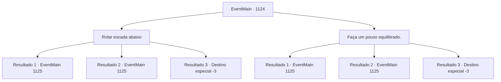

# Eventos principais · 1124

[Índice da tabela](index.md) · [Índice geral](../index.md)

ID: `pt:EventMain:1124` · Fonte: `EventMain4` · Versão: 1.2.47.

Mapeamento estático dos arquivos; a disponibilidade e a execução dependem do estado da run.

## Texto do evento

*Sem texto no arquivo.*

## Dados de entrada

```json
{
  "id": 1124,
  "grade": 1,
  "normalGoal": "",
  "required": ""
}
```

## Mapa das escolhas



## Escolhas e resultados

### Escolha 1

Rolar escada abaixo

Requisitos e outros campos da escolha:

```json
{
  "required": ""
}
```

#### Resultado 1.1

Você se enrola em uma bola e desce. Normalmente, isso resultaria em alguns ossos quebrados e trauma por força contundente, mas para seu corpo resistente não foi um problema. As escadas chegam ao fim, e você chega a uma sala ampla. Um teto em forma oval se ergue acima de você, com pilares de pedra o sustentando. No chão, você nota um círculo mágico — idêntico no padrão àqueles que viu em Brindel Woods e no moinho d'água, mas incomparavelmente maior. Você caminha por um corredor amplo, seguindo os ruídos. As estátuas alinhadas nas paredes estão todas corroídas além do reconhecimento. Ao fim do corredor, você encontra outra sala. Você encontra estantes alinhadas contra as paredes. No canto, há um suporte de alquimia e alguns frascos medicinais. Você também encontra um grupo de soldados e um cavaleiro da Casa Greymoor, espalhados pela sala. 

 "A...aah....!"

 Um dos cavaleiros alcança sua arma. Mas então, um homem com uma túnica pisa em sua mão. Você ouve o som de ossos se partindo. O cavaleiro não se move mais. A figura de túnica recua lentamente. Então, ele vira a cabeça para olhar para você. 

 "Ah... um rosto familiar nos visita."


Continuação registrada: [Evento 1125](1125.md) na mesma tabela.

```json
{
  "required": "",
  "chance": "1|0_13_1",
  "nextEvent": 1125,
  "type": 0,
  "reward": ""
}
```

#### Resultado 1.2

Você se encolhe em uma bola e desce. Você só para de girar quando a escada termina. A dor se espalha — você sente como se tivesse sido espancado com um porrete. Você mal consegue se levantar e cambaleia para frente. A escada termina, e você chega a uma sala ampla. Um teto em forma oval se ergue acima de você, sustentado por pilares de pedra. No chão, você percebe um círculo mágico — idêntico no padrão aos que viu nos Bosques de Brindel e no moinho d'água, mas incomparavelmente maior. Você caminha por um corredor largo, seguindo os ruídos. As estátuas alinhadas nas paredes estão todas corroídas além do reconhecimento. Ao fim do corredor, você encontra outra sala. Você encontra estantes encostadas nas paredes. No canto, há um suporte de alquimia e alguns frascos medicinais. Você também encontra um grupo de soldados e um cavaleiro da Casa Greymoor, espalhados pela sala. 

 "A...argh...!"

 Um dos cavaleiros alcança sua arma. Mas então, um homem vestido com um manto pisa em sua mão. Você ouve o som de ossos se rachando. O cavaleiro não se mexe mais. A figura de manto recua lentamente. Então, ele vira a cabeça para olhar para você. 

 "Ah... Uma face familiar aparece."


Continuação registrada: [Evento 1125](1125.md) na mesma tabela.

```json
{
  "required": "1_0_2",
  "chance": "14",
  "nextEvent": 1125,
  "type": 1,
  "reward": "0_0_-1"
}
```

#### Resultado 1.3

Você se enrola em uma bola e desce. Mas então você bate a cabeça em uma parede próxima. Você perde a consciência com um estrondo alto.

Continuação registrada: [Destino especial `-3`](../destinos-especiais.md).

```json
{
  "required": "2_0_2",
  "chance": "14",
  "nextEvent": -3,
  "type": 1,
  "reward": "0_0_-1"
}
```

### Escolha 2

Faça um pouso equilibrado.

Requisitos e outros campos da escolha:

```json
{
  "required": ""
}
```

#### Resultado 2.1

Você rapidamente se posiciona para um pouso seguro. Normalmente, isso faria você rolar escada abaixo, mas para seu corpo ágil não foi um problema. Você continua descendo as escadas. As escadas terminam e você chega a uma sala ampla. Um teto em formato oval se ergue acima de você, com pilares de pedra o sustentando. No chão, você nota um círculo mágico — idêntico no padrão aos que viu em Brindel Woods e no moinho d'água, mas incomparavelmente maior. Você atravessa um corredor largo, seguindo os ruídos. As estátuas alinhadas nas paredes estão todas corroídas além do reconhecimento. No fim do corredor, você encontra outra sala. Você vê estantes encostadas nas paredes. No canto, há um suporte para preparação de poções e alguns frascos medicinais. Você também encontra um grupo de soldados e um cavaleiro da Casa Greymoor espalhados pela sala. 

 "A...ck....!"

 Um dos cavaleiros alcança sua arma. Mas então, um homem usando um robe pisa em sua mão. Você ouve o som de ossos se partindo. O cavaleiro não se mexe mais. A figura de robe recua lentamente. Então, ele vira a cabeça para olhar para você. 

 "Ah... Um rosto familiar vem nos visitar."


Continuação registrada: [Evento 1125](1125.md) na mesma tabela.

```json
{
  "required": "",
  "chance": "1|0_6_1",
  "nextEvent": 1125,
  "type": 0,
  "reward": ""
}
```

#### Resultado 2.2

Você tenta se manobrar para um pouso seguro. Mas você perde um degrau, rolando ainda mais rápido pela escada. A dor se espalha - você sente como se tivesse sido espancado com um porrete. Você mal consegue se recompor e cambaleia para frente. A escada chega ao fim, e você chega a uma sala ampla. Um teto em forma oval se ergue acima de você, com pilares de pedra o sustentando. No chão, você nota um círculo mágico - idêntico em padrão aos que viu nas Brindel Woods e no moinho d'água, mas incomparavelmente maior. Você atravessa um corredor largo, seguindo os ruídos. As estátuas alinhadas nas paredes estão todas corroídas além do reconhecimento. No final do corredor, você encontra outra sala. Você vê estantes de livros encostadas nas paredes. No canto, há um caldeirão de alquimia e algumas frascos medicinais. Você também encontra um grupo de soldados e um cavaleiro da Casa Greymoor, espalhados pela sala. 

 "A...ck....!"

 Um dos cavaleiros alcança sua arma. Mas então, um homem usando um manto pisa em sua mão. Você ouve o som de ossos quebrando. O cavaleiro não se move mais. A figura encapuzada recua lentamente. Então, ele vira a cabeça e olha para você. 

 "Ah... Uma face familiar nos visita."


Continuação registrada: [Evento 1125](1125.md) na mesma tabela.

```json
{
  "required": "1_0_2",
  "chance": "14",
  "nextEvent": 1125,
  "type": 1,
  "reward": "0_0_-1"
}
```

#### Resultado 2.3

Você tenta se manobrar para um pouso seguro. Mas você erra um degrau, rolando escada abaixo ainda mais rápido. Você bate a cabeça numa parede próxima. Você perde a consciência com um estrondo alto.

Continuação registrada: [Destino especial `-3`](../destinos-especiais.md).

```json
{
  "required": "2_0_2",
  "chance": "14",
  "nextEvent": -3,
  "type": 1,
  "reward": "0_0_-1"
}
```

## Referências que chegam a este evento

- [Evento 1122 · escolha 1 · resultado 3](1122.md#escolha-1)
