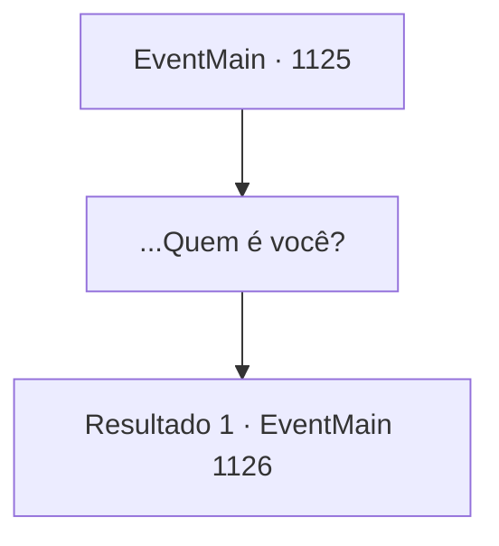

# Eventos principais · 1125

[Índice da tabela](index.md) · [Índice geral](../index.md)

ID: `pt:EventMain:1125` · Fonte: `EventMain4` · Versão: 1.2.47.

Mapeamento estático dos arquivos; a disponibilidade e a execução dependem do estado da run.

## Texto do evento

*Sem texto no arquivo.*

## Dados de entrada

```json
{
  "id": 1125,
  "grade": 1,
  "normalGoal": "",
  "required": ""
}
```

## Mapa das escolhas



## Escolhas e resultados

### Escolha 1

...Quem é você?

Requisitos e outros campos da escolha:

```json
{
  "required": ""
}
```

#### Resultado 1.1

A figura de manto não responde. Parecendo exausto, ele senta-se em uma cadeira próxima, que parece estar à beira do colapso. Então, ele puxa o capuz com as mãos. |drawing_kalman| Metade do rosto dele está desfigurada. Uma cicatriz áspera atravessa sua pele queimada, cobrindo a área do topo da orelha até a linha do maxilar. Seu cabelo negro como breu está bagunçado, espalhando-se caoticamente. Seus olhos encaram você. 

 "...fui informado de nada."

 Os lábios do homem se contraem. Ele passa as mãos pelo cabelo. Você sente o poder em sua mão. 

 "...Kalman. Kalman Briovich. Sou o irmão mais velho do seu pai."


Continuação registrada: [Evento 1126](1126.md) na mesma tabela.

```json
{
  "required": "",
  "chance": "1",
  "nextEvent": 1126,
  "type": 2,
  "reward": ""
}
```

## Referências que chegam a este evento

- [Evento 1123 · escolha 1 · resultado 1](1123.md#escolha-1)
- [Evento 1123 · escolha 2 · resultado 1](1123.md#escolha-2)
- [Evento 1123 · escolha 3 · resultado 1](1123.md#escolha-3)
- [Evento 1124 · escolha 1 · resultado 1](1124.md#escolha-1)
- [Evento 1124 · escolha 1 · resultado 2](1124.md#escolha-1)
- [Evento 1124 · escolha 2 · resultado 1](1124.md#escolha-2)
- [Evento 1124 · escolha 2 · resultado 2](1124.md#escolha-2)
