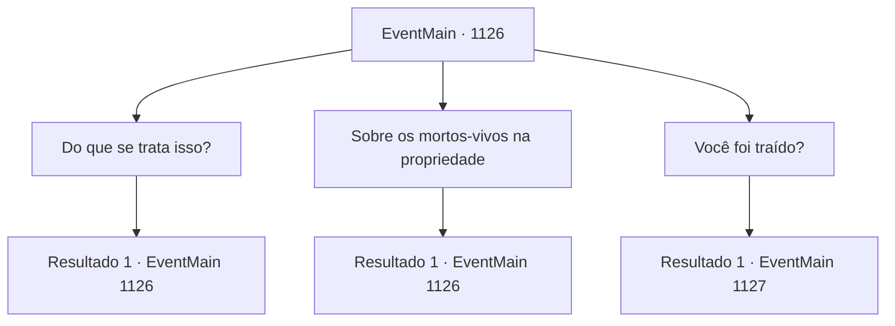

# Eventos principais · 1126

[Índice da tabela](index.md) · [Índice geral](../index.md)

ID: `pt:EventMain:1126` · Fonte: `EventMain4` · Versão: 1.2.47.

Mapeamento estático dos arquivos; a disponibilidade e a execução dependem do estado da run.

## Texto do evento

*Sem texto no arquivo.*

## Dados de entrada

```json
{
  "id": 1126,
  "grade": 1,
  "normalGoal": "",
  "required": ""
}
```

## Mapa das escolhas



## Escolhas e resultados

### Escolha 1

Do que se trata isso?

Requisitos e outros campos da escolha:

```json
{
  "required": "5_906_0"
}
```

#### Resultado 1.1

Kalman exibe um sorriso torto.  

 "Ah, estes? Uma matilha de cães enviada atrás do meu pescoço."

  Ele empurra o cavaleiro morto de Greymoor para longe com os pés.  Você ouve a armadura arranhar o chão.  Kalman ofega.  

 "Casa Greymoor. Esse é o nosso inimigo."

  Os lábios de Kalman tremem novamente.  

 "Eu... uma vez os ajudei."

  Kalman se recosta em sua cadeira.  

 "Eles me procuraram primeiro. Imploraram para que eu salvasse suas vidas - dizendo que ainda não era hora de perecerem."

  Ele bate os dedos sobre a escrivaninha.  

 "Eles me prometeram Briovich em troca."

  As mãos de Kalman se cerram. Você percebe suas veias saltando.  Seus olhos começam a arder de raiva.  

 "Mas eles nunca tiveram intenção de cumprir essa promessa."

  Seu olhar agora se volta para os soldados mortos de Greymoor.

Continuação registrada: [Evento 1126](1126.md) na mesma tabela.

```json
{
  "required": "",
  "chance": "1",
  "nextEvent": 1126,
  "type": 2,
  "reward": "5_906_1"
}
```

### Escolha 2

Sobre os mortos-vivos na propriedade

Requisitos e outros campos da escolha:

```json
{
  "required": "5_907_0"
}
```

#### Resultado 2.1

Você o questiona sobre os mortos-vivos na propriedade Briovich. Kalman olha para você por um segundo e acena com a cabeça. 

 "Sim. Eu os criei."

 Ele passa a mão pelo cabelo. 

 "Pensei que... se eu te desestabilizasse, te afastasse do poder, eu seria capaz de conseguir o que quero."


Continuação registrada: [Evento 1126](1126.md) na mesma tabela.

```json
{
  "required": "",
  "chance": "1",
  "nextEvent": 1126,
  "type": 2,
  "reward": "5_907_1"
}
```

### Escolha 3

Você foi traído?

Requisitos e outros campos da escolha:

```json
{
  "required": "5_906_1|5_907_1"
}
```

#### Resultado 3.1

Você o questiona sobre a promessa não cumprida. Ele olha para você com os olhos injetados de sangue. 

 "Sim."

 Ele se levanta. A túnica ensanguentada roça o chão. A voz dele treme de ira. 

 "Os mortos-vivos, a luta contra os orcs... Tudo isso são jogos, tramados pelos Greymoors."

 Ele se aproxima de você, lentamente. 

 "Eles são astutos e implacáveis. Esta não é uma batalha que você — nem eu — podemos vencer sozinho."

 Ele baixa a voz. 

 "Pegue minha mão."

 Ele estende a mão para você.

Continuação registrada: [Evento 1127](1127.md) na mesma tabela.

```json
{
  "required": "",
  "chance": "1",
  "nextEvent": 1127,
  "type": 2,
  "reward": ""
}
```

## Referências que chegam a este evento

- [Evento 1125 · escolha 1 · resultado 1](1125.md#escolha-1)
- [Evento 1126 · escolha 1 · resultado 1](1126.md#escolha-1)
- [Evento 1126 · escolha 2 · resultado 1](1126.md#escolha-2)
