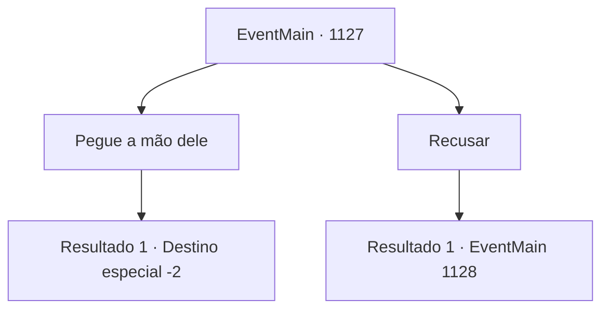

# Eventos principais · 1127

[Índice da tabela](index.md) · [Índice geral](../index.md)

ID: `pt:EventMain:1127` · Fonte: `EventMain4` · Versão: 1.2.47.

Mapeamento estático dos arquivos; a disponibilidade e a execução dependem do estado da run.

## Texto do evento

*Sem texto no arquivo.*

## Dados de entrada

```json
{
  "id": 1127,
  "grade": 1,
  "normalGoal": "",
  "required": ""
}
```

## Mapa das escolhas



## Escolhas e resultados

### Escolha 1

Pegue a mão dele

Requisitos e outros campos da escolha:

```json
{
  "required": ""
}
```

#### Resultado 1.1

Você segura a mão dele. Kalman acena com a cabeça e sorri. 

 "Uma escolha sábia."

 Ele solta sua mão e vai até sua estação de trabalho. Lá, ele enche sua mochila, enchendo-a com tudo o que consegue encontrar. 

 "Vou lançar um ataque à propriedade Greymoor. Mas preciso fazer alguns preparativos. Vou precisar de um tempo."

 Kalman se vira para olhar para você. 

 "Deixe seus homens no Castelo Briovich. Venha sozinho — os fracos só nos atrasarão."

 Ele se afasta, rumo à escuridão. Seus passos ecoam através do círculo mágico, depois desaparecem completamente além das colunas. Você passa pelo monte de corpos no corredor e sobe de volta as escadas. saindo pelo portão quebrado, você retorna para a floresta sombria. O sol está se pondo — você decide passar a noite dentro de um dos prédios abandonados. 

 No dia seguinte, você acorda com o nascer do sol. Você guarda suas coisas e parte de volta para Briovich.

Continuação registrada: [Destino especial `-2`](../destinos-especiais.md).

```json
{
  "required": "",
  "chance": "1",
  "nextEvent": -2,
  "type": 2,
  "reward": "13_6_9|5_908_1"
}
```

### Escolha 2

Recusar

Requisitos e outros campos da escolha:

```json
{
  "required": ""
}
```

#### Resultado 2.1

Você recusa a mão de Kalman. Ele afasta a mão. 

 "...Entendo."

 Ele murmura para si mesmo. Um raio púrpura de chama salta das pontas dos seus dedos. 

 "Então termina aqui."

 Ele imediatamente dispara o raio em sua direção.

Continuação registrada: [Evento 1128](1128.md) na mesma tabela.

```json
{
  "required": "",
  "chance": "1",
  "nextEvent": 1128,
  "type": 2,
  "reward": "6_0_196",
  "place": 7
}
```

## Referências que chegam a este evento

- [Evento 1126 · escolha 3 · resultado 1](1126.md#escolha-3)
