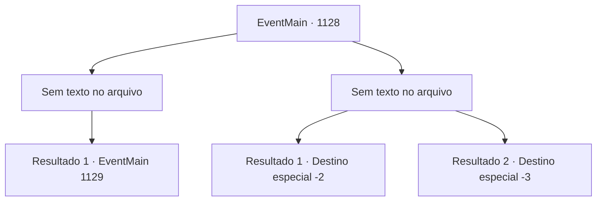

# Eventos principais · 1128

[Índice da tabela](index.md) · [Índice geral](../index.md)

ID: `pt:EventMain:1128` · Fonte: `EventMain4` · Versão: 1.2.47.

Mapeamento estático dos arquivos; a disponibilidade e a execução dependem do estado da run.

## Texto do evento

*Sem texto no arquivo.*

## Dados de entrada

```json
{
  "id": 1128,
  "grade": 1,
  "normalGoal": "",
  "required": ""
}
```

## Mapa das escolhas



## Escolhas e resultados

### Escolha 1

*Sem texto no arquivo; o papel dessa opção depende da interface do jogo.*

Requisitos e outros campos da escolha:

```json
{
  "required": ""
}
```

#### Resultado 1.1

O raio roxo de Kalman voa na sua direção. Você consegue bloquear o ataque, avançar e derrubá-lo com o joelho. Com um estrondo alto, o corpo de Kalman é empurrado para trás. Um curto gemido de dor escapa dele. 

 "Nada mal, nada mal."

 Kalman recua, pressionando um candelabro contra a parede. Então, das paredes e do chão, sai uma fumaça preta que enche a sala. A fumaça sulfúrica te cega e tira seu olfato. Quando a fumaça finalmente se dissipa, você é o único ali em pé.

Continuação registrada: [Evento 1129](1129.md) na mesma tabela.

```json
{
  "required": "",
  "chance": "1",
  "nextEvent": 1129,
  "type": 2,
  "reward": ""
}
```

### Escolha 2

*Sem texto no arquivo; o papel dessa opção depende da interface do jogo.*

Requisitos e outros campos da escolha:

```json
{
  "required": ""
}
```

#### Resultado 2.1

O ataque de Kalman atinge seu peito. O raio roxo de força arcana explode com um estrondo alto, te lançando para longe. O mundo vira de cabeça para baixo. Quando você bate nas paredes, destroços de pedra caem sobre você. Você ouve um escárnio ecoando pelo teto. 

 "...Isso é tudo? Que patético."

 Através da poeira, você vê Kalman erguer as mãos. Algo branco começa a subir — lascas de osso, afiadas como lâminas. A chuva de lascas de osso voa em sua direção. Você mal consegue rolar para longe. Você pega uma espada próxima, que pertencia a um dos soldados de Greymoor, e a arremessa em Kalman. A espada gira em sua direção, acertando seu ombro. 

 "Argh...! SEU IMUNDO!"

 Kalman recua, pressionando um candelabro contra as paredes. Então, das paredes e do chão, sai uma fumaça negra que preenche a sala. A fumaça sulfúrica te cega e tira seu olfato. Você cobre o rosto com as mãos, afasta-se rapidamente e corre para as escadas. Apressadamente, você sobe as escadas e escapa pelo portão quebrado do castelo. O sol já está se pondo — mas você não pode se dar ao luxo de descansar agora. Você segue de volta para Briovich, acelerando o passo.

Continuação registrada: [Destino especial `-2`](../destinos-especiais.md).

```json
{
  "required": "1_0_2|1_1_2",
  "chance": "1",
  "nextEvent": -2,
  "type": 2,
  "reward": "0_0_-1|0_1_-1|13_6_9|5_912_1"
}
```

#### Resultado 2.2

O ataque de Kalman atinge seu peito. O raio roxo de força arcana explode com um estrondo alto, lançando você para longe. O mundo vira de cabeça para baixo. Quando você bate nas paredes, escombros de pedra caem sobre você. Você ouve um escárnio ecoando pelo teto. 

 "…Isso é tudo? Que patético."

 Através da poeira, você vê Kalman erguer as mãos. Algo branco começa a subir — fragmentos de osso, afiados como lâminas. A chuva de fragmentos de osso atinge você. Você tenta desviar, mas é tarde demais. Os fragmentos de osso perfuram sua cabeça, pescoço e peito. Sangue jorra de todos os lados, borbulhando. Kalman coloca um sorriso distorcido, observando seus últimos momentos. Por fim, você perde a consciência, ouvindo Kalman dizer algo, mas sem conseguir entender.

Continuação registrada: [Destino especial `-3`](../destinos-especiais.md).

```json
{
  "required": "-1|2_0_2|2_1_2",
  "chance": "1",
  "nextEvent": -3,
  "type": 2,
  "reward": "0_0_-1|0_1_-1"
}
```

## Referências que chegam a este evento

- [Evento 1127 · escolha 2 · resultado 1](1127.md#escolha-2)
