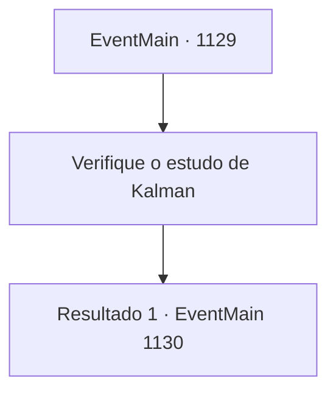

# Eventos principais · 1129

[Índice da tabela](index.md) · [Índice geral](../index.md)

ID: `pt:EventMain:1129` · Fonte: `EventMain4` · Versão: 1.2.47.

Mapeamento estático dos arquivos; a disponibilidade e a execução dependem do estado da run.

## Texto do evento

*Sem texto no arquivo.*

## Dados de entrada

```json
{
  "id": 1129,
  "grade": 1,
  "normalGoal": "",
  "required": ""
}
```

## Mapa das escolhas



## Escolhas e resultados

### Escolha 1

Verifique o estudo de Kalman

Requisitos e outros campos da escolha:

```json
{
  "required": ""
}
```

#### Resultado 1.1

Você decide examinar este lugar — o estudo de Kalman. Há sinais de batalha aqui e ali. Um dos pilares de pedra tem uma fissura, sem contar o sangue e os estilhaços de frascos quebrados espalhados sobre o círculo mágico. Uma pilha de soldados caídos de Greymoor jaz entre os pilares. Você volta o olhar e encontra estantes cobrindo as paredes, com alguns livros no chão. Em um canto da sala há uma estação de trabalho bagunçada, que você supõe ter sido usada por Kalman, e em outra parte da parede encontra uma vitrine cheia de itens decorativos. A vitrine é feita de vidro transparente, permitindo ver o interior, e exibe um estilo luxuoso, de aparência cara.

Continuação registrada: [Evento 1130](1130.md) na mesma tabela.

```json
{
  "required": "",
  "chance": "1",
  "nextEvent": 1130,
  "type": 2,
  "reward": ""
}
```

## Referências que chegam a este evento

- [Evento 1128 · escolha 1 · resultado 1](1128.md#escolha-1)
