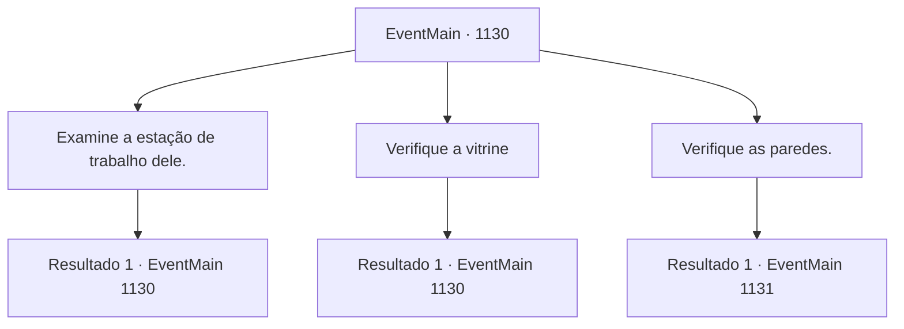

# Eventos principais · 1130

[Índice da tabela](index.md) · [Índice geral](../index.md)

ID: `pt:EventMain:1130` · Fonte: `EventMain4` · Versão: 1.2.47.

Mapeamento estático dos arquivos; a disponibilidade e a execução dependem do estado da run.

## Texto do evento

*Sem texto no arquivo.*

## Dados de entrada

```json
{
  "id": 1130,
  "grade": 1,
  "normalGoal": "",
  "required": ""
}
```

## Mapa das escolhas



## Escolhas e resultados

### Escolha 1

Examine a estação de trabalho dele.

Requisitos e outros campos da escolha:

```json
{
  "required": "5_909_0"
}
```

#### Resultado 1.1

Você examina a estação de trabalho de Kalman. Frascos alinhados um após o outro, alguns com tampas abertas, meio vazios. O túnel de vidro do suporte de poções atravessa a bancada, restos enegrecidos cobrindo a estrutura principal. Você observa mais de perto e encontra uma pequena poção de cura, mas nada mais de valor.

Continuação registrada: [Evento 1130](1130.md) na mesma tabela.

```json
{
  "required": "",
  "chance": "1",
  "nextEvent": 1130,
  "type": 2,
  "reward": "5_909_1|3_190_1"
}
```

### Escolha 2

Verifique a vitrine

Requisitos e outros campos da escolha:

```json
{
  "required": "5_910_0"
}
```

#### Resultado 2.1

Você abre a porta da luxuosa vitrine. Você encontra alguns itens em exibição, alinhados ordenadamente — um crânio de animal, um pedaço de obsidiana, um cálice de prata lascado e uma garrafa cheia de líquido misterioso. No fundo da vitrine há um pequeno retrato, encostado na parede. O retrato é de duas pessoas. Um é seu pai e o ex-conde, Laszlo Briovich, e o outro é Kalman. O retrato de Laszlo está rasgado, aparentemente cortado com algo afiado. O retrato de Kalman não mostra seu rosto mutilado — ele parece perfeitamente normal aqui.

Continuação registrada: [Evento 1130](1130.md) na mesma tabela.

```json
{
  "required": "",
  "chance": "1",
  "nextEvent": 1130,
  "type": 2,
  "reward": "5_910_1"
}
```

### Escolha 3

Verifique as paredes.

Requisitos e outros campos da escolha:

```json
{
  "required": "5_911_0"
}
```

#### Resultado 3.1

Você examina uma das estantes nas paredes. Mesmo em meio ao quarto bagunçado, esta estante chama sua atenção — porque você sente o vento passando por ela. Você agarra e puxa a estante. A estante cede, livros caindo no chão, e revela um espaço oculto além dela. Você passa pela estante, entrando no espaço oculto. Lá dentro, você encontra ainda mais estantes. Você verifica suas entradas e encontra títulos chocantes — Serviçal Morto-vivo, Transferência de Alma, Convergência da Carne e Aceleração da Decomposição — todos nomes de feitiços proibidos. No centro está uma escrivaninha, feita de uma rocha negra esculpida. Você nota que a escrivaninha está bem polida e encontra uma pilha de pergaminhos espalhados sobre ela. Alguns ainda têm tinta fresca.

Continuação registrada: [Evento 1131](1131.md) na mesma tabela.

```json
{
  "required": "",
  "chance": "1",
  "nextEvent": 1131,
  "type": 2,
  "reward": "3_380_1|5_911_1"
}
```

## Referências que chegam a este evento

- [Evento 1129 · escolha 1 · resultado 1](1129.md#escolha-1)
- [Evento 1130 · escolha 1 · resultado 1](1130.md#escolha-1)
- [Evento 1130 · escolha 2 · resultado 1](1130.md#escolha-2)
