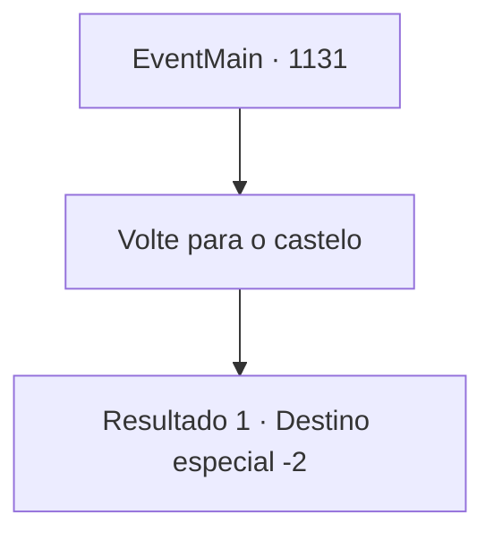

# Eventos principais · 1131

[Índice da tabela](index.md) · [Índice geral](../index.md)

ID: `pt:EventMain:1131` · Fonte: `EventMain4` · Versão: 1.2.47.

Mapeamento estático dos arquivos; a disponibilidade e a execução dependem do estado da run.

## Texto do evento

*Sem texto no arquivo.*

## Dados de entrada

```json
{
  "id": 1131,
  "grade": 1,
  "normalGoal": "",
  "required": ""
}
```

## Mapa das escolhas



## Escolhas e resultados

### Escolha 1

Volte para o castelo

Requisitos e outros campos da escolha:

```json
{
  "required": ""
}
```

#### Resultado 1.1

Você passa pela pilha de corpos no corredor e sobe as escadas. Saindo pelo portão quebrado, você volta para a floresta sombria. O sol está se pondo — você decide passar a noite dentro de um dos prédios abandonados. 

 No dia seguinte, você acorda com o sol nascendo. Você arruma suas coisas e parte de volta para Briovich.

Continuação registrada: [Destino especial `-2`](../destinos-especiais.md).

```json
{
  "required": "",
  "chance": "1",
  "nextEvent": -2,
  "type": 2,
  "reward": "13_6_9|5_912_1"
}
```

## Referências que chegam a este evento

- [Evento 1130 · escolha 3 · resultado 1](1130.md#escolha-3)
