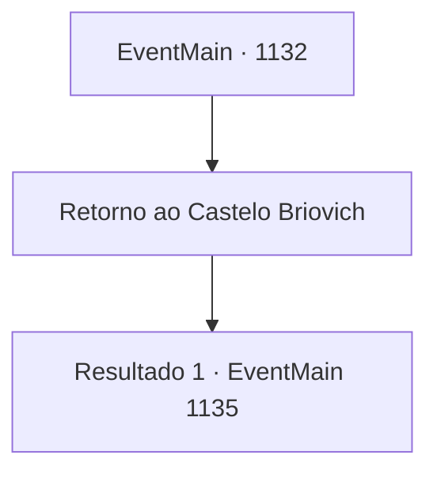

# Eventos principais · 1132

[Índice da tabela](index.md) · [Índice geral](../index.md)

ID: `pt:EventMain:1132` · Fonte: `EventMain4` · Versão: 1.2.47.

Mapeamento estático dos arquivos; a disponibilidade e a execução dependem do estado da run.

## Texto do evento

Você está caminhando por uma planície gramada, onde acabou de parar de chover. O cheiro de grama molhada permanece no seu nariz. O chão lamacento dificulta que você caminhe em linha reta. Você para para recuperar o fôlego e dá uma olhada no horizonte. Mais quatro dias a pé, e você terá chegado ao Castelo Greymoor. Então, você ouve o som de cavalos vindo de trás. Você se vira e encontra um mensageiro de aparência familiar em seu cavalo. Ele ordena que seu cavalo pare, salta e se ajoelha diante de você. 

 "*ofegante*.... *ofegante*...! Uma mensagem urgente do administrador da propriedade, meu Liege. O- os orcs Zaraid estão lançando um ataque total ao Castelo Briovich! Ele... ele me ordenou que encontrasse você e o escoltasse de volta o mais rápido possível...! *ofegante*"


## Dados de entrada

```json
{
  "id": 1132,
  "grade": 1,
  "normalGoal": "",
  "required": "13_6_6|1_2_80"
}
```

## Mapa das escolhas



## Escolhas e resultados

### Escolha 1

Retorno ao Castelo Briovich

Requisitos e outros campos da escolha:

```json
{
  "required": ""
}
```

#### Resultado 1.1

Você sobe no cavalo do mensageiro e retorna ao Castelo Briovich. 

 Alguns dias depois, você finalmente chega ao Castelo Briovich e procura Rennart. O castelo parece diferente - aparentemente, o boato já se espalhou. Rennart está lá como sempre, comandando os soldados e preparando-se para a guerra. Ele percebe você e se aproxima com uma expressão severa. 

 "Você voltou, meu senhor, e bem a tempo também. Sei que os mortos-vivos têm nos ocupado, mas agora... os orcs estão se aproximando do nosso castelo, com um enorme contingente."

 Você pergunta a Rennart sobre o estado atual. Rennart olha para os soldados, movimentando suprimentos às pressas. Ajusta os óculos e responde. 

 "Espero que o ataque comece no melhor dos casos em quatro dias - dois dias se eles conseguirem chegar mais rápido. Reunimos todos os homens aptos ao redor da propriedade e começamos o treinamento. Mas... precisaremos de alguns preparativos adicionais."


Continuação registrada: [Evento 1135](1135.md) na mesma tabela.

```json
{
  "required": "",
  "chance": "1",
  "nextEvent": 1135,
  "type": 2,
  "reward": ""
}
```

## Referências que chegam a este evento

Nenhum `nextEvent` positivo da mesma tabela aponta para este nó. Isso não prova que seja inacessível: sorteio e estado de história podem selecioná-lo.

