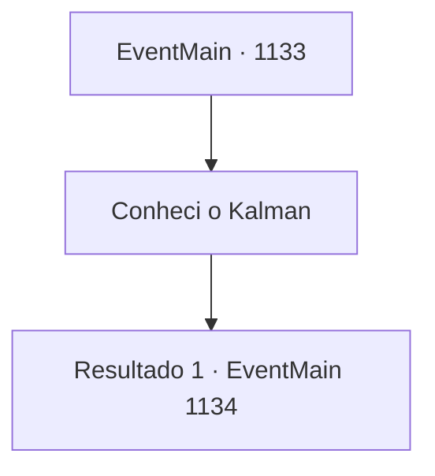

# Eventos principais · 1133

[Índice da tabela](index.md) · [Índice geral](../index.md)

ID: `pt:EventMain:1133` · Fonte: `EventMain4` · Versão: 1.2.47.

Mapeamento estático dos arquivos; a disponibilidade e a execução dependem do estado da run.

## Texto do evento

Você volta para o Castelo Briovich. O castelo parece um pouco diferente. Você nota um número muito maior de soldados posicionados nas muralhas do castelo. Você também percebe que seus rostos estão cheios de tensão. 

 "B- Bem-vindo de volta, meu Soberano!"

 Um dos soldados percebe você e abre o portão. O pátio está cheio de soldados realizando exercícios de treinamento. Você passa pelo portão, atravessa o pátio diretamente e entra no seu escritório. Alguns de seus servos notam você correndo pelo corredor e se curvam. Seus rostos, também, estão cheios de uma mistura de preocupação e alívio. Você abre a porta do seu escritório. Rennart está sentado na sua cadeira, examinando documentos. Ele ergue o olhar e vê você. 

 "Meu Soberano! Você está aqui."

 Ele imediatamente se levanta e se aproxima de você. Você nota olheiras profundas sob seus olhos. 

 "Você... encontrou o necromante?"


## Dados de entrada

```json
{
  "id": 1133,
  "grade": 1,
  "normalGoal": "",
  "required": "13_6_9|1_2_85"
}
```

## Mapa das escolhas



## Escolhas e resultados

### Escolha 1

Conheci o Kalman

Requisitos e outros campos da escolha:

```json
{
  "required": ""
}
```

#### Resultado 1.1

Você conta a ele sobre seu encontro com Kalman em Rugarden Woods. 

 "Kalman..."

 Rennart ouve esse nome e responde como se estivesse recordando um nome que não lembrava há muito tempo. 

 "Kalman Briovich. Depois de perder o direito de sucessão para Laszlo Briovich, ele desapareceu."

 Rennart tira as mãos da mesa e caminha até as janelas. Fecha os olhos e continua. 

 "Sir Laszlo era um guerreiro nato. Kalman, por outro lado, era mais próximo de um estudioso. Ele amava ler e tinha aptidão para a magia. Frequentemente passava dias trancado em seu estudo."

 Você sente um leve tom de desapontamento na voz de Rennart. 

 "Mas ele começou a ansiar por conhecimentos proibidos. No fim, conseguiu desafiar a própria morte. Foi por isso que foi exilado da linhagem Briovich."


Continuação registrada: [Evento 1134](1134.md) na mesma tabela.

```json
{
  "required": "",
  "chance": "1",
  "nextEvent": 1134,
  "type": 2,
  "reward": ""
}
```

## Referências que chegam a este evento

Nenhum `nextEvent` positivo da mesma tabela aponta para este nó. Isso não prova que seja inacessível: sorteio e estado de história podem selecioná-lo.

