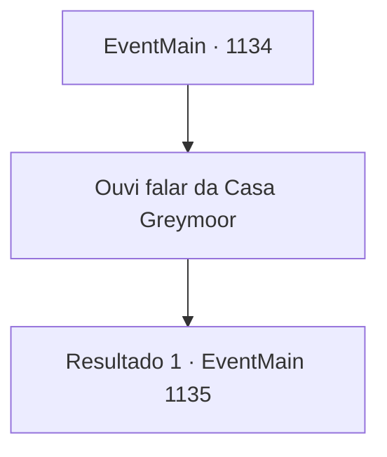

# Eventos principais · 1134

[Índice da tabela](index.md) · [Índice geral](../index.md)

ID: `pt:EventMain:1134` · Fonte: `EventMain4` · Versão: 1.2.47.

Mapeamento estático dos arquivos; a disponibilidade e a execução dependem do estado da run.

## Texto do evento

*Sem texto no arquivo.*

## Dados de entrada

```json
{
  "id": 1134,
  "grade": 1,
  "normalGoal": "",
  "required": ""
}
```

## Mapa das escolhas



## Escolhas e resultados

### Escolha 1

Ouvi falar da Casa Greymoor

Requisitos e outros campos da escolha:

```json
{
  "required": ""
}
```

#### Resultado 1.1

Você continua a contar tudo a ele. A cooperação de Kalman com a Casa Greymoor, a traição dos Greymoor e como eles tentaram matar Kalman, e, por fim, o fato de que a Casa Greymoor está secretamente enviando armas e suprimentos para a tribo Zaraid. O rosto de Rennart contrai. Ele morde os lábios, tentando conter a fúria, e respira fundo. 

 "...Eu vejo."

 A voz dele fica mais fria. 

 "Eu simplesmente não conseguia entender por que os orcs não paravam de invadir. A propriedade tem um histórico contra eles, mas agora vejo por quê."

 Um breve silêncio ocorre antes de Rennart olhar para você e continuar. 

 "Recebi um relatório de um batedor não faz muito tempo. Uma força enorme de orcs está marchando em direção ao nosso castelo."

 Seus olhos ficam firmes. 

 "Espero que o ataque comece, na melhor das hipóteses, em quatro dias — dois dias se conseguirem chegar mais rápido. Reunimos todos os homens aptos ao redor da propriedade e começamos o treinamento. Mas... precisaremos de alguns preparativos adicionais."


Continuação registrada: [Evento 1135](1135.md) na mesma tabela.

```json
{
  "required": "",
  "chance": "1",
  "nextEvent": 1135,
  "type": 2,
  "reward": ""
}
```

## Referências que chegam a este evento

- [Evento 1133 · escolha 1 · resultado 1](1133.md#escolha-1)
