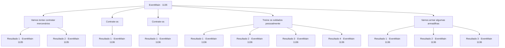

# Eventos principais · 1135

[Índice da tabela](index.md) · [Índice geral](../index.md)

ID: `pt:EventMain:1135` · Fonte: `EventMain4` · Versão: 1.2.47.

Mapeamento estático dos arquivos; a disponibilidade e a execução dependem do estado da run.

## Texto do evento

*Sem texto no arquivo.*

## Dados de entrada

```json
{
  "id": 1135,
  "grade": 1,
  "normalGoal": "",
  "required": ""
}
```

## Mapa das escolhas



## Escolhas e resultados

### Escolha 1

Vamos tentar contratar mercenários

Requisitos e outros campos da escolha:

```json
{
  "required": "5_913_0"
}
```

#### Resultado 1.1

Você pergunta a Rennart se há uma banda de mercenários por perto. Ele levanta o olhar, pensativo. 

 "Um dos relatórios mencionou um grupo de mercenários nômades. ...'Garras dos Pavões' era o nome, creio, e cerca de cem em número."

 Rennart olha de volta para você e continua. 

 "Eles têm bastante experiência de campo de batalha, então espero que sejam melhores que nossos recrutados da propriedade, ao menos."

 Rennart remexe a pilha de documentos, puxando um papel que traz informações sobre as Garras dos Pavões. 

 "Aqui. Normalmente cobram 200 de ouro por mês, mas em tempos de guerra, o dobro."

 Seus dedos descem. 

 "...E com a condição de que vinte por cento dos despojos de batalha lhes sejam distribuídos, caso saiam vitoriosos."


Continuação registrada: [Evento 1135](1135.md) na mesma tabela.

```json
{
  "required": "18_888_1",
  "chance": "1",
  "nextEvent": 1135,
  "type": 2,
  "reward": "5_913_1"
}
```

#### Resultado 1.2

Você pergunta a Rennart se há uma companhia de mercenários por perto. Ele ergue o olhar, pensativo. 

 "Um dos relatórios mencionou um grupo de mercenários nômades. ...'Peafowls' Talons' era o nome, creio, e cerca de cem em número."

 Rennart volta a olhar para você e continua. 

 "Eles têm bastante experiência em campo de batalha, então espero que sejam melhores que os recrutas da nossa propriedade, pelo menos."

 Rennart remexe a pilha de documentos, puxando um papel que tem informações sobre os Peafowls' Talons. 

 "Aqui. Normalmente cobram 200 de ouro por mês, mas em tempos de guerra, o dobro."

 Os dedos dele caem. 

 "...E sob a condição de que vinte por cento dos despojos de batalha lhes sejam distribuídos, caso saiam vitoriosos."

 Rennart pensa por alguns segundos e acrescenta. 

 "Temos alguma prata restante das minas. Deveríamos poder usá-la para contratar os mercenários."


Continuação registrada: [Evento 1135](1135.md) na mesma tabela.

```json
{
  "required": "5_888_1",
  "chance": "1",
  "nextEvent": 1135,
  "type": 2,
  "reward": "5_913_2"
}
```

### Escolha 2

Contrate-os

Requisitos e outros campos da escolha:

```json
{
  "required": "5_913_1|1_4_400"
}
```

#### Resultado 2.1

Você coloca um saco de couro cheio de ouro, dizendo a Rennart para pagar os mercenários com ele. Rennart pega e sai do escritório. 

 Algumas horas depois, um guarda em sentinela grita. 

 "Um grupo de pessoas se aproximando do sul! Parece que são mercenários!"

 O portão do castelo se abre, e as Garras do Pavão entram. A primeira coisa que você percebe são as cores — vermelho carmesim, amarelo dourado, até roxo. Os mercenários vestem roupas deliberadamente coloridas, visíveis mesmo nos campos de batalha. Alguns até adicionaram tecido tingido em suas armaduras de couro, ou decoraram suas ombreiras com penas de pavão. O líder da companhia mercenária avança. Ele veste um casaco vermelho e usa um brinco dourado em uma das orelhas. Ele bate no peito com a mão e se curva. 

 "Obrigado por nos convidarem a Briovich. Protegemos seu castelo desses malditos orcs."

 Terminando a saudação, ele se vira para seus mercenários e assobia. Todos começam a se espalhar. Lanceiros vão direto ao portão da frente, bestas montadas se posicionam nas muralhas do castelo, e espadachins ficam ao lado do portão, checando suas lâminas.

Continuação registrada: [Evento 1136](1136.md) na mesma tabela.

```json
{
  "required": "",
  "chance": "1",
  "nextEvent": 1136,
  "type": 2,
  "reward": "0_4_-400|5_914_1"
}
```

### Escolha 3

Contrate-os

Requisitos e outros campos da escolha:

```json
{
  "required": "5_913_2"
}
```

#### Resultado 3.1

Você diz a Rennart para contratar os mercenários. Ele se curva e sai do escritório. 

 Algumas horas depois, um guarda de vigia grita. 

 "Um grupo de pessoas se aproximando do sul! Parece que são mercenários!"

 O portão do castelo se abre, e entram as Garras dos Pavões. A primeira coisa que você repara são as cores — vermelho carmesim, amarelo dourado, até roxo. Os mercenários vestem roupas deliberadamente coloridas, visíveis mesmo nos campos de batalha. Alguns até adicionaram tecido tingido às suas armaduras de couro, ou decoraram as ombreiras com penas de pavão. O líder da banda de mercenários avança. Ele usa um sobretudo vermelho e usa um brinco dourado em uma das orelhas. Ele bate no peito com a mão e se curva. 

 "Obrigado por nos convidar a Briovich. Protegemos seu castelo desses malditos orcs."

 Ao terminar a saudação, ele se vira para seus mercenários e assobia. Todos começam a se espalhar. Os lanceiros vão direto para o portão principal, os besteiros montam formações nas paredes do castelo, e os espadachins ficam ao lado do portão, conferindo suas lâminas.

Continuação registrada: [Evento 1136](1136.md) na mesma tabela.

```json
{
  "required": "",
  "chance": "1",
  "nextEvent": 1136,
  "type": 2,
  "reward": "5_914_1"
}
```

### Escolha 4

Treine os soldados pessoalmente

Requisitos e outros campos da escolha:

```json
{
  "required": ""
}
```

#### Resultado 4.1

Você reúne seus soldados no campo de treinamento. Rennart fica ao seu lado e fala. 

 "Graças aos nossos ferreiros que trabalham incansavelmente, temos equipamento adequado."

 Rennart estava certo. Centenas de soldados estão equipados com novas cotas de malha, peitorais e capacetes. Até suas lanças e espadas brilham intensamente. Você está com pouco tempo, mas aproveita ao máximo e começa a treiná-los em formações de combate em grupo. Você certifica-se de que eles estão preparados para ambos os cenários - um, onde o portão do castelo é forçado e outro, onde abrimos deliberadamente o portão e saímos. Os soldados seguem seu comando, brandindo suas armas e se cobrindo de suor.

Continuação registrada: [Evento 1136](1136.md) na mesma tabela.

```json
{
  "required": "5_887_1",
  "chance": "1",
  "nextEvent": 1136,
  "type": 2,
  "reward": "5_915_1"
}
```

#### Resultado 4.2

Você reúne seus soldados no campo de treinamento. Você percebe que cada soldado é único em seu equipamento — um tem uma lança com espinhos apoiada no ombro, e o que está ao lado carrega uma alabarda enferrujada. Um porrete com espinhos aqui, uma maça embotada ali — é um caos total. Rennart examina os soldados e fala desapontado. 

 "Se ao menos pudéssemos equipá-los adequadamente..."

 Enfim, você começa a treiná-los em formações de combate em grupo. Você garante que estejam preparados para ambos os cenários — um, em que o portão do castelo é arrombado, e outro, em que abrimos deliberadamente o portão e saímos. Os soldados seguem suas ordens, brandindo suas armas e se cobrindo de suor.

Continuação registrada: [Evento 1136](1136.md) na mesma tabela.

```json
{
  "required": "18_887_1|21_48_1",
  "chance": "1|0_7_1|0_12_1",
  "nextEvent": 1136,
  "type": 0,
  "reward": "5_915_1"
}
```

#### Resultado 4.3

Você reúne seus soldados no campo de treinamento. Você percebe que cada soldado é único em seu equipamento - um tem uma lança com pontas apoiada no ombro, e o ao lado carrega uma alabarda enferrujada. Uma maça com espinhos aqui, uma maça romba ali - é um caos total. Rennart examina os soldados e fala desapontado. 

 "Se ao menos pudéssemos equipá-los adequadamente..."

 De qualquer forma, você começa a treiná-los em formações de combate em grupo. Você se certifica de que estejam preparados para ambos os cenários - um, em que o portão do castelo é arrombado, e outro, em que nós deliberadamente abrimos o portão e saímos. Mas mesmo após horas, o treinamento não parece muito eficaz com esses soldados.

Continuação registrada: [Evento 1136](1136.md) na mesma tabela.

```json
{
  "required": "18_887_1|21_48_1",
  "chance": "40",
  "nextEvent": 1136,
  "type": 1,
  "reward": ""
}
```

#### Resultado 4.4

Você reúne seus soldados no campo de treinamento. Você percebe que cada soldado é único em seu equipamento — um tem uma lança com espinhos apoiada no ombro, e o que está ao lado carrega uma alabarda enferrujada. Um porrete com espinhos aqui, uma maça embotada ali — é um caos total. Rennart examina os soldados e fala desapontado. 

 "Se ao menos pudéssemos equipá-los adequadamente..."

 Enfim, você começa a treiná-los em formações de combate em grupo. Você garante que estejam preparados para ambos os cenários — um, em que o portão do castelo é arrombado, e outro, em que abrimos deliberadamente o portão e saímos. Os soldados seguem suas ordens, brandindo suas armas e se cobrindo de suor.

Continuação registrada: [Evento 1136](1136.md) na mesma tabela.

```json
{
  "required": "18_887_1|20_48_1",
  "chance": "1",
  "nextEvent": 1136,
  "type": 2,
  "reward": "5_915_1"
}
```

### Escolha 5

Vamos armar algumas armadilhas

Requisitos e outros campos da escolha:

```json
{
  "required": ""
}
```

#### Resultado 5.1

Você sobe as muralhas do castelo com Rennart. Lá, você vigia o caminho que os orcs poderiam usar para chegar ao castelo. Você anda pela área em frente ao portão, marcando pontos no chão. Em seguida, ordena aos seus homens que montem armadilhas ao redor das marcas. Os soldados saem, cada um com uma pá na mão, e começam a cavar. Você lhes ordena cavar cerca de meia pessoa de profundidade e umas três ou quatro passadas de largura. Você também posiciona os buracos em padrão de ziguezague, para que as tropas atrás não consigam prever onde estão as armadilhas. O fundo dos buracos é armado com estacas de madeira afiadas. Depois, os soldados cobrem cada buraco com tábuas finas de madeira. Cada armadilha é coberta com terra fofa, com grama cortada ao redor como a cereja do bolo.

Continuação registrada: [Evento 1136](1136.md) na mesma tabela.

```json
{
  "required": "5_881_1",
  "chance": "1|0_7_1",
  "nextEvent": 1136,
  "type": 0,
  "reward": "5_916_1"
}
```

#### Resultado 5.2

Você sobe as muralhas do castelo com Rennart. Lá, você vigia o caminho que os orcs poderiam usar para chegar ao castelo. Você anda pela área em frente ao portão, marcando pontos no chão. Em seguida, ordena aos seus homens que montem armadilhas ao redor das marcas. Os soldados saem, cada um com uma pá na mão, e começam a cavar. Você lhes ordena cavar cerca de meia pessoa de profundidade e umas três ou quatro passadas de largura. Você também posiciona os buracos em padrão de ziguezague, para que as tropas atrás não consigam prever onde estão as armadilhas. O fundo dos buracos é armado com estacas de madeira afiadas. Depois, os soldados cobrem cada buraco com tábuas finas de madeira. Cada armadilha é coberta com terra fofa, com grama cortada ao redor como a cereja do bolo.

Continuação registrada: [Evento 1136](1136.md) na mesma tabela.

```json
{
  "required": "5_881_1",
  "chance": "20",
  "nextEvent": 1136,
  "type": 1,
  "reward": "5_916_9"
}
```

#### Resultado 5.3

Você sobe nas muralhas do castelo com Rennart. Lá, você vigia o caminho que os orcs poderiam seguir até o castelo. Então, Tarrys, o Marechal, se aproxima de você. 

 "Pensando em armar armadilhas, meu Senhor? Pode deixar isso comigo."

 Ele bate na cabeça com suas mãos enrugadas. 

 "Vou dar aos orcs algo com que se preocupar."

 Você deixa Tarrys encarregado de montar as armadilhas. Ele sorri maliciosamente, então começa a cavar com seus soldados. Tarrys ordena aos homens que cavem os buracos em tamanhos aleatórios, em um padrão em ziguezague, para que as tropas atrás não possam prever onde estão as armadilhas. O fundo dos buracos é preenchido com estacas de madeira afiadas, lâminas quebradas, pregos e muitos outros objetos aterrorizantes. Montes de estrume de gado são espirrados sobre cada buraco. Então, Tarrys coloca tábuas finas de madeira sobre os buracos, cobre-as com terra macia e as disfarça com grama cortada ao redor. 

 "Uou... ufa... Tudo pronto agora."

 Tarrys se aproxima de você com um sorriso, sem perceber que agora cheira a fertilizante. Rennart tampa o nariz, e só então Tarrys percebe o próprio cheiro. 

 "*sniff* *sniff*... Droga! Este não é um cheiro digno do meu Senhor."

 Tarrys resmunga consigo mesmo, correndo de volta para o quartel.

Continuação registrada: [Evento 1136](1136.md) na mesma tabela.

```json
{
  "required": "18_881_1",
  "chance": "1",
  "nextEvent": 1136,
  "type": 2,
  "reward": "5_916_1"
}
```

## Referências que chegam a este evento

- [Evento 1132 · escolha 1 · resultado 1](1132.md#escolha-1)
- [Evento 1134 · escolha 1 · resultado 1](1134.md#escolha-1)
- [Evento 1135 · escolha 1 · resultado 1](1135.md#escolha-1)
- [Evento 1135 · escolha 1 · resultado 2](1135.md#escolha-1)
