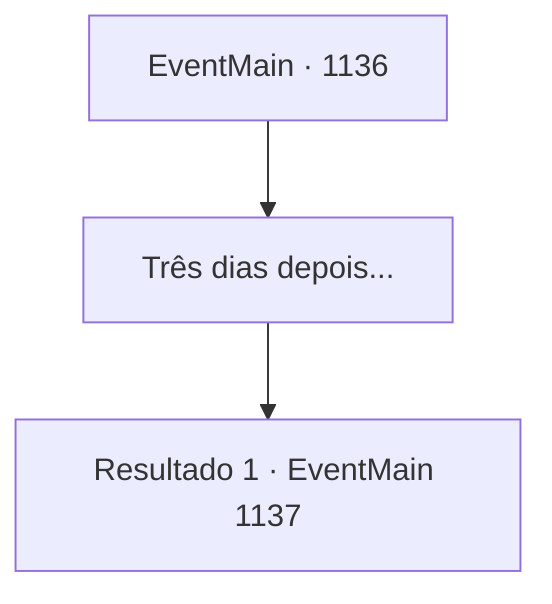

# Eventos principais · 1136

[Índice da tabela](index.md) · [Índice geral](../index.md)

ID: `pt:EventMain:1136` · Fonte: `EventMain4` · Versão: 1.2.47.

Mapeamento estático dos arquivos; a disponibilidade e a execução dependem do estado da run.

## Texto do evento

*Sem texto no arquivo.*

## Dados de entrada

```json
{
  "id": 1136,
  "grade": 1,
  "normalGoal": "",
  "required": ""
}
```

## Mapa das escolhas



## Escolhas e resultados

### Escolha 1

Três dias depois...

Requisitos e outros campos da escolha:

```json
{
  "required": ""
}
```

#### Resultado 1.1

<link=shake>

 "INIMIGOS À VISTA!"

</link> Um grito ecoa do posto de vigia. Todo soldado nas proximidades se vira para olhar. Os soldados que estavam afiando suas armas se levantam imediatamente. Até aqueles que estavam consertando cercas largam as ferramentas e pegam suas armas. Arqueiros se agrupam nas muralhas, aljavas nas costas. Você grita ordens, às quais os soldados obedecem na hora. 

 "TODOS, PREPAREM-SE PARA A BATALHA!!"

 Lanceiros formam uma barricada em frente ao portão do castelo, com escudeiros preenchendo as lacunas. Você observa além das muralhas do castelo. Além da poeira, nota uma horda de orcs montados em javalis se aproximando. Isto não é uma mera incursão — é um ataque total. Os orcs chegam, formando fileiras voltadas para as muralhas do castelo. Mais atrás estão suas tendas móveis. Então, um enorme orc vestindo pele de urso avança. 

 "Briovich! EU, GRIZZLY DE ZARAID, VENHO RECLAMAR A TERRA DE NOSSOS ANCESTRAIS!"

 Atrás dele, você vê um aríete gigante. O rosto de Rennart fica sério e preocupado. 

 "Eles se prepararam bem."

 Grizzly levanta o braço e depois o abaixa. Com isso, os exércitos de orcs começam a avançar de uma vez, levantando uma tempestade de poeira.

Continuação registrada: [Evento 1137](1137.md) na mesma tabela.

```json
{
  "required": "",
  "chance": "1",
  "nextEvent": 1137,
  "type": 2,
  "reward": ""
}
```

## Referências que chegam a este evento

- [Evento 1135 · escolha 2 · resultado 1](1135.md#escolha-2)
- [Evento 1135 · escolha 3 · resultado 1](1135.md#escolha-3)
- [Evento 1135 · escolha 4 · resultado 1](1135.md#escolha-4)
- [Evento 1135 · escolha 4 · resultado 2](1135.md#escolha-4)
- [Evento 1135 · escolha 4 · resultado 3](1135.md#escolha-4)
- [Evento 1135 · escolha 4 · resultado 4](1135.md#escolha-4)
- [Evento 1135 · escolha 5 · resultado 1](1135.md#escolha-5)
- [Evento 1135 · escolha 5 · resultado 2](1135.md#escolha-5)
- [Evento 1135 · escolha 5 · resultado 3](1135.md#escolha-5)
