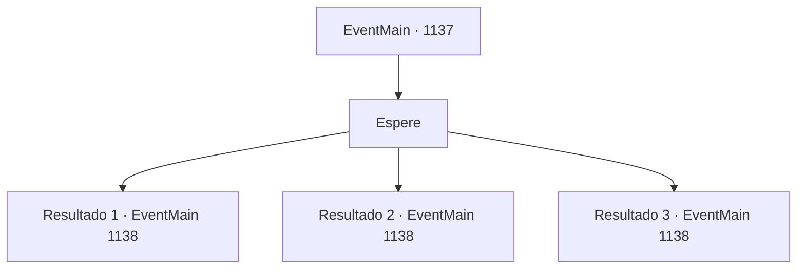

# Eventos principais · 1137

[Índice da tabela](index.md) · [Índice geral](../index.md)

ID: `pt:EventMain:1137` · Fonte: `EventMain4` · Versão: 1.2.47.

Mapeamento estático dos arquivos; a disponibilidade e a execução dependem do estado da run.

## Texto do evento

*Sem texto no arquivo.*

## Dados de entrada

```json
{
  "id": 1137,
  "grade": 1,
  "normalGoal": "",
  "required": ""
}
```

## Mapa das escolhas



## Escolhas e resultados

### Escolha 1

Espere

Requisitos e outros campos da escolha:

```json
{
  "required": ""
}
```

#### Resultado 1.1

Cavaleiros orcs montados em javalis lideram a investida, rugindo ferozmente. Com altos estalos, eles caem nas fossas. 

 "ARGH! *guincho*"

 Os cavaleiros de trás tentam saltar por cima das armadilhas. Mas os locais onde aterrissam cedem também, fazendo-os cair direto nelas. 

 "Parece que as armadilhas foram eficazes."

 Rennart resmunga. Mas os orcs não param. Eles saltam sobre os corpos dos seus mortos, se amontoando no portão do castelo. Você ordena aos arqueiros que atirem. O som de cordas de arco sendo tensionadas enche as muralhas. As flechas chovem sobre os orcs. Acertam em cheio, fincando-se nas cabeças, ombros e pernas dos orcs. Outro grupo de orcs cai. Mas eles são implacáveis — agora avançam contra o portão do castelo, escudos erguidos para se protegerem dos arqueiros. Ao chegarem, começam a golpeá-lo com suas enormes machadas. As vigas de aço do portão começam a tremer. Enquanto isso, alguns orcs encostam escadas nas paredes. |drawing_attackedCastle|

Continuação registrada: [Evento 1138](1138.md) na mesma tabela.

```json
{
  "required": "5_916_1",
  "chance": "1",
  "nextEvent": 1138,
  "type": 2,
  "reward": "5_916_2"
}
```

#### Resultado 1.2

Cavaleiros orcs montados em javalis lideram a investida, rugindo ferozmente. Eles se aproximam cada vez mais. Nenhum deles cai nas armadilhas. Eles contornam as armadilhas, como zombando de sua péssima qualidade. Você ordena aos arqueiros que atirem. Sons de cordas de arco sendo tensionadas ecoam pelas muralhas. As flechas caem como chuva sobre os orcs. Acertam em cheio, cravando-se nas cabeças, ombros e pernas dos orcs. Outro grupo de orcs cai. Mas eles são implacáveis — agora avançam contra o portão do castelo, escudos erguidos para se proteger dos arqueiros. Ao chegarem, começam a golpear o portão com seus enormes machados. As vigas de aço do portão começam a tremer. Enquanto isso, alguns orcs encostam escadas nas muralhas. |drawing_attackedCastle|

Continuação registrada: [Evento 1138](1138.md) na mesma tabela.

```json
{
  "required": "5_916_9",
  "chance": "1",
  "nextEvent": 1138,
  "type": 2,
  "reward": ""
}
```

#### Resultado 1.3

Líderes orcs montados em javalis conduzem a investida, rugindo ferozmente. Eles se aproximam cada vez mais. Assim que entram no alcance dos arqueiros, você ordena que atirem. O som de cordas de arco sendo puxadas enche as muralhas. As flechas chovem sobre os orcs. Elas acertam em cheio, cravando-se nas cabeças, ombros e pernas dos orcs. Outro grupo de orcs cai. Mas eles são implacáveis — agora estão avançando contra o portão do castelo, com escudos erguidos para se protegerem dos arqueiros. Quando chegam, começam a golpear o portão com seus enormes machados. As vigas de aço do portão começam a tremer. Enquanto isso, alguns orcs encostam escadas nas muralhas. |drawing_attackedCastle|

Continuação registrada: [Evento 1138](1138.md) na mesma tabela.

```json
{
  "required": "18_916_1|18_916_9",
  "chance": "1",
  "nextEvent": 1138,
  "type": 2,
  "reward": ""
}
```

## Referências que chegam a este evento

- [Evento 1136 · escolha 1 · resultado 1](1136.md#escolha-1)
