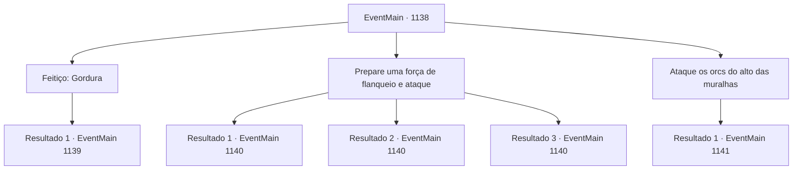

# Eventos principais · 1138

[Índice da tabela](index.md) · [Índice geral](../index.md)

ID: `pt:EventMain:1138` · Fonte: `EventMain4` · Versão: 1.2.47.

Mapeamento estático dos arquivos; a disponibilidade e a execução dependem do estado da run.

## Texto do evento

*Sem texto no arquivo.*

## Dados de entrada

```json
{
  "id": 1138,
  "grade": 1,
  "normalGoal": "",
  "required": ""
}
```

## Mapa das escolhas



## Escolhas e resultados

### Escolha 1

Feitiço: Gordura

Requisitos e outros campos da escolha:

```json
{
  "required": "20_0_1|1_1_2"
}
```

#### Resultado 1.1

Você lança um feitiço para cobrir os orcs com óleo negro. Eles começam a escorregar um a um, tropeçando uns nos outros. Rennart vê isso e então ordena aos arqueiros. 

 "Arqueiros! FOGO! TRAGAM AS SETAS INCENDIÁRIAS!"

 Os arqueiros ouvem suas ordens e prontamente preparam as setas incendiárias, cobrindo os orcs com elas. A chama se espalha imediatamente, liberando um inferno em chamas sobre a horda. 

 "GRAAAAAAHHH---!"

 Orcs que tentavam subir as paredes do castelo perdem a aderência e caem da escada. Os porcos começam a fugir do fogo, desfazendo as formações dos orcs. Então, você nota uma orc fêmea em meio às tropas, coberta de colares feitos de ossos de animais. Ela começa a balançar seu cajado longo, e nuvens escuras aparecem do nada, derramando chuva. A chuva começa a apagar o fogo aos poucos, e os orcs aproveitam a oportunidade para voltar à formação.

Continuação registrada: [Evento 1139](1139.md) na mesma tabela.

```json
{
  "required": "",
  "chance": "1",
  "nextEvent": 1139,
  "type": 2,
  "reward": "0_1_-1"
}
```

### Escolha 2

Prepare uma força de flanqueio e ataque

Requisitos e outros campos da escolha:

```json
{
  "required": ""
}
```

#### Resultado 2.1

Você pede a Rennart que prepare um grupo com dez dos soldados mais ágeis. Rennart olha para você por um segundo após ouvir sua ordem. 

 "Você está tentando descer aí você mesmo...?"

 Ele respira fundo e então acena com a cabeça. Ele atravessa os soldados, escolhe dez deles e volta até você. Você reúne os dez soldados e os conduz até o portão oeste. Enquanto isso, os orcs continuam o ataque. Os mercenários despejam flechas sobre os orcs das muralhas do castelo, alguns deles fazendo barulho alto com as gaitas de foles. Cuidadosamente, você sai pelo portão oeste. Mantendo-se nas sombras, sua equipe se move pelas colinas. Os orcs estão fixados nas muralhas do castelo — você se prepara para um flanqueamento. Eles estão todos alheios à sua presença. Você lidera a investida. O flanqueamento é bem-sucedido — os orcs começam a entrar em pânico. 

 "AGORA! ABRAM OS PORTÕES!"

 Enquanto os orcs entram em pânico, Rennart conduz os soldados pelos portões, iniciando outra investida ofensiva.

Continuação registrada: [Evento 1140](1140.md) na mesma tabela.

```json
{
  "required": "5_914_1",
  "chance": "1",
  "nextEvent": 1140,
  "type": 2,
  "reward": "6_2_198",
  "place": 0
}
```

#### Resultado 2.2

Você pede a Rennart que prepare um grupo com dez soldados mais ágeis. Rennart olha para você por um segundo depois de ouvir sua ordem. 

 "Você está tentando descer lá você mesmo...?"

 Ele respira fundo, então acena com a cabeça. Ele atravessa os soldados, escolhe dez deles e volta até você. Você reúne os dez soldados e os conduz até o portão oeste. Enquanto isso, os orcs continuam seu ataque. Os mercenários chovem flechas sobre os orcs das muralhas do castelo, alguns deles fazendo barulho alto com suas gaitas de foles. Cuidadosamente, você sai pelo portão oeste. Permanecendo nas sombras, sua equipe atravessa as colinas. Os orcs estão fixados nas muralhas do castelo - você se prepara para um flanqueio. Eles estão todos alheios à sua presença. Você lidera a investida. O flanqueio é bem-sucedido - os orcs começam a entrar em pânico. 

 "AGORA! ABRAM OS PORTÕES!"

 Enquanto os orcs entram em pânico, Rennart conduz os soldados para fora dos portões, iniciando outra investida ofensiva.

Continuação registrada: [Evento 1140](1140.md) na mesma tabela.

```json
{
  "required": "18_914_1",
  "chance": "1|0_6_1",
  "nextEvent": 1140,
  "type": 0,
  "reward": "6_2_198",
  "place": 0
}
```

#### Resultado 2.3

Você pede a Rennart que prepare um grupo de dez dos soldados mais ágeis. Rennart olha para você por um segundo depois de ouvir sua ordem. 

 "Você está tentando ir lá embaixo sozinho...?"

 Ele respira, então acena com a cabeça. Ele passa pelos soldados, escolhe dez deles e volta para você. Você reúne os dez soldados e os conduz até o portão oeste. Enquanto isso, os orcs continuam seu ataque. Os mercenários chovem flechas sobre os orcs a partir das muralhas do castelo, alguns deles fazendo muito barulho com suas gaitas de fole. Cuidadosamente, você sai pelo portão oeste. Mantendo-se nas sombras, sua equipe atravessa as colinas. Os orcs estão fixados nas muralhas do castelo - você se prepara para um flanqueamento. Mas então, um dos orcs ergue a cabeça e avista vocês. 

 "Grrrrr...! D'AIXAN!! DOFTLO!!"

 Ele grita para os outros para avisá-los sobre o seu grupo. Infelizmente, a emboscada falha. Soldados orcs avançam em sua direção. Então, os gritos desesperados de Rennart ecoam pelo castelo. 

 "ABRAM OS PORTÕES! PROTEJAM NOSSO SENHOR!"

 O portão do castelo é escancarado, e Rennart sai à frente, liderando os soldados.

Continuação registrada: [Evento 1140](1140.md) na mesma tabela.

```json
{
  "required": "18_914_1",
  "chance": "32",
  "nextEvent": 1140,
  "type": 1,
  "reward": "6_0_198",
  "place": 0
}
```

### Escolha 3

Ataque os orcs do alto das muralhas

Requisitos e outros campos da escolha:

```json
{
  "required": ""
}
```

#### Resultado 3.1

Do alto das muralhas do castelo, você lança uma lança em um orc que sobe uma escada. Ela cai pela escada, a lança cravada em seu peito. Mas então outro orc arremessa um machado em você. Você mal consegue se abaixar para escapar do perigo. Enquanto isso, outro orc já conseguiu chegar ao topo das muralhas. 

 "GRAAAAH!!"

 Ele solta um grito feroz de batalha e investe contra você.

Continuação registrada: [Evento 1141](1141.md) na mesma tabela.

```json
{
  "required": "",
  "chance": "1",
  "nextEvent": 1141,
  "type": 2,
  "reward": "6_0_105",
  "place": 0
}
```

## Referências que chegam a este evento

- [Evento 1137 · escolha 1 · resultado 1](1137.md#escolha-1)
- [Evento 1137 · escolha 1 · resultado 2](1137.md#escolha-1)
- [Evento 1137 · escolha 1 · resultado 3](1137.md#escolha-1)
