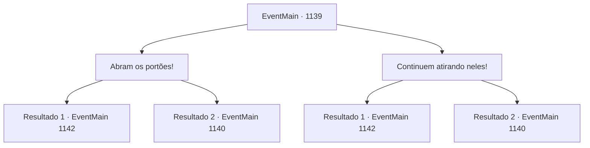

# Eventos principais · 1139

[Índice da tabela](index.md) · [Índice geral](../index.md)

ID: `pt:EventMain:1139` · Fonte: `EventMain4` · Versão: 1.2.47.

Mapeamento estático dos arquivos; a disponibilidade e a execução dependem do estado da run.

## Texto do evento

*Sem texto no arquivo.*

## Dados de entrada

```json
{
  "id": 1139,
  "grade": 1,
  "normalGoal": "",
  "required": ""
}
```

## Mapa das escolhas



## Escolhas e resultados

### Escolha 1

Abram os portões!

Requisitos e outros campos da escolha:

```json
{
  "required": ""
}
```

#### Resultado 1.1

Você se aproxima do portão do castelo, gritando para os soldados abrirem. Lentamente, as correntes são recolhidas, e os portões se abrem. O fogo eventualmente se dissipa, e o cheiro de carne de orc queimada fede por toda parte. O líder dos mercenários se coloca à sua frente. 

 "Deixem as linhas de frente conosco. Afinal, é para isso que vivemos."

 Paramentados em armaduras coloridas, os mercenários distraem os orcs, lesando-os um por um. Você lidera seus soldados e avança contra os orcs em fuga. 

 "CHARGE--!!"

 Seus homens cravam suas lanças simultaneamente. Logo, o destino da batalha está decidido. Os poucos orcs sobreviventes estão ocupados fugindo para seu posto avançado. Rennart os observa, aproxima-se de você e fala. 

 "Ufa... conseguimos expulsá-los, meu senhor."

 Ele recupera o fôlego e olha ao redor. 

 "Já... usamos metade de nossas flechas."

 Em seguida, ele se volta para o posto avançado orc. 

 "Conseguimos passar por eles desta vez, mas... se esse impasse continuar, não vamos aguentar por muito tempo."


Continuação registrada: [Evento 1142](1142.md) na mesma tabela.

```json
{
  "required": "5_914_1",
  "chance": "1",
  "nextEvent": 1142,
  "type": 2,
  "reward": "0_2_1"
}
```

#### Resultado 1.2

Você se aproxima do portão do castelo, gritando com os soldados para abri-lo. Devagar, as correntes são recolhidas, e os portões se abrem. O fogo eventualmente se dissipa, e o cheiro de carne de orc queimada fede por toda parte. Você lidera seus soldados e investe contra os orcs em fuga. 

 "INVESTIDA--!!"

 Seus homens cravam suas lanças simultaneamente.

Continuação registrada: [Evento 1140](1140.md) na mesma tabela.

```json
{
  "required": "18_914_1",
  "chance": "1",
  "nextEvent": 1140,
  "type": 2,
  "reward": "6_2_198",
  "place": 0
}
```

### Escolha 2

Continuem atirando neles!

Requisitos e outros campos da escolha:

```json
{
  "required": ""
}
```

#### Resultado 2.1

Você ordena que seus arqueiros continuem atirando. Eles chovem flechas sobre os orcs, ouvindo suas ordens. Uma grande porção dos orcs é abatida por flechas. Os poucos orcs sobreviventes estão ocupados fugindo para seu destacamento. Rennart olha para eles, aproxima-se de você e fala. 

 "Phew... conseguimos afugentá‑los, meu Senhor."

 Ele recupera o fôlego e olha ao redor. 

 "Já... usamos metade das nossas flechas."

 Ele então se volta para o destacamento orc. 

 "Conseguimos passar por eles desta vez, mas... se esse impasse continuar, não vamos durar muito."


Continuação registrada: [Evento 1142](1142.md) na mesma tabela.

```json
{
  "required": "",
  "chance": "1|0_12_1",
  "nextEvent": 1142,
  "type": 0,
  "reward": "0_2_1"
}
```

#### Resultado 2.2

Você ordena aos arqueiros que continuem a disparar. Mas você não consegue controlar suas ações o suficiente. Os arqueiros disparam à vontade, sem coordenação. Então, com um estrondo alto, uma aríete atinge o portão do castelo. O portão range de dor. Com outro golpe, o portão é arremessado para dentro, abrindo-se de par em par. Com a brecha feita, os orcs começam a invadir por enxame. 

 "FECHAR OS PORTÕES!"

 Os portadores de escudo atendem ao seu chamado e avançam à frente, com os lanceiros seguindo atrás. O combate corpo a corpo entre os soldados e os orcs começa.

Continuação registrada: [Evento 1140](1140.md) na mesma tabela.

```json
{
  "required": "",
  "chance": "26",
  "nextEvent": 1140,
  "type": 1,
  "reward": "6_2_198",
  "place": 0
}
```

## Referências que chegam a este evento

- [Evento 1138 · escolha 1 · resultado 1](1138.md#escolha-1)
