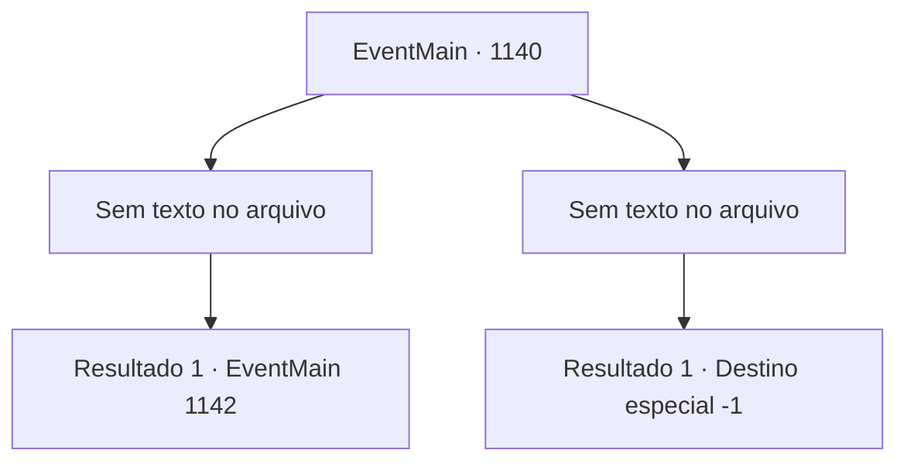

# Eventos principais · 1140

[Índice da tabela](index.md) · [Índice geral](../index.md)

ID: `pt:EventMain:1140` · Fonte: `EventMain4` · Versão: 1.2.47.

Mapeamento estático dos arquivos; a disponibilidade e a execução dependem do estado da run.

## Texto do evento

*Sem texto no arquivo.*

## Dados de entrada

```json
{
  "id": 1140,
  "grade": 1,
  "normalGoal": "",
  "required": ""
}
```

## Mapa das escolhas



## Escolhas e resultados

### Escolha 1

*Sem texto no arquivo; o papel dessa opção depende da interface do jogo.*

Requisitos e outros campos da escolha:

```json
{
  "required": ""
}
```

#### Resultado 1.1

Com uma destreza de combate impressionante, você derrota os orcs um por um. Reanimados pelas suas habilidades, os soldados começam a dominar os orcs também. 

 Ao pôr do sol, pilhas de orcs mortos cobrem o chão. O sangue escorre como cachoeiras pelas paredes do castelo. Os orcs sobreviventes finalmente se viram e fogem de volta para seu posto avançado, jogando seus escudos e machados e deixando para trás o aríete. Flechas os perseguem, mas até seus arqueiros já estão exaustos agora. 

 "*ofeg*... *ofeg*....!"

 Rennart se aproxima de você, pisando sobre alguns orcs mortos. Você pode ver quantos tiros ele teve que disparar. Suas luvas estão todas gastas, e seus dedos estão sangrando. 

 "Con... conseguimos expulsá‑los, meu senhor."

 Ele recupera o fôlego e olha ao redor. 

 "Alguns dos nossos soldados estão gravemente feridos, e já usamos mais da metade das nossas flechas."

 Em seguida ele se vira para o posto avançado dos orcs. 

 "Conseguimos passar por eles desta vez, mas... se esse impasse continuar, não vamos durar muito."


Continuação registrada: [Evento 1142](1142.md) na mesma tabela.

```json
{
  "required": "",
  "chance": "1",
  "nextEvent": 1142,
  "type": 2,
  "reward": ""
}
```

### Escolha 2

*Sem texto no arquivo; o papel dessa opção depende da interface do jogo.*

Requisitos e outros campos da escolha:

```json
{
  "required": ""
}
```

#### Resultado 2.1

Um machado arremessado atinge seu ombro. Uma dor imensa se espalha, e seu joelho se rompe. Rennart vê isso, então abre caminho entre os orcs para protegê-lo. 

 "PROTEJAM NOSSO SUSERANO!!"

 Alguns soldados circulam ao seu redor. Mas a resistência não dura muito. Seus soldados caem um a um, e até Rennart é lançado ao ar por um golpe. 

 "Argh...! Ugh..."

 Rennart faz o possível para se levantar, mas após alguns golpes, fica imóvel. 

 "ISSO. ACABE. AGORA!"

 Golpes implacáveis de um orc caem sobre você. Ai de você, é reduzido a um monte de pedaços de carne em questão de segundos.

Continuação registrada: [Destino especial `-1`](../destinos-especiais.md).

```json
{
  "required": "",
  "chance": "1",
  "nextEvent": -1,
  "type": 2,
  "reward": "0_0_-1|0_1_-1|15_7_16|25_8_1"
}
```

## Referências que chegam a este evento

- [Evento 1138 · escolha 2 · resultado 1](1138.md#escolha-2)
- [Evento 1138 · escolha 2 · resultado 2](1138.md#escolha-2)
- [Evento 1138 · escolha 2 · resultado 3](1138.md#escolha-2)
- [Evento 1139 · escolha 1 · resultado 2](1139.md#escolha-1)
- [Evento 1139 · escolha 2 · resultado 2](1139.md#escolha-2)
- [Evento 1141 · escolha 1 · resultado 1](1141.md#escolha-1)
- [Evento 1141 · escolha 1 · resultado 2](1141.md#escolha-1)
- [Evento 1141 · escolha 1 · resultado 3](1141.md#escolha-1)
- [Evento 1141 · escolha 2 · resultado 1](1141.md#escolha-2)
