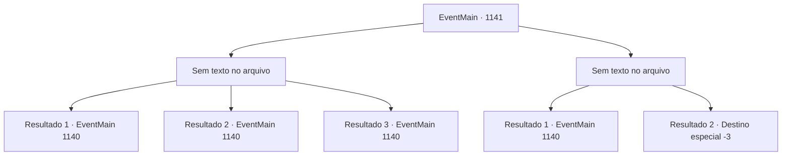

# Eventos principais · 1141

[Índice da tabela](index.md) · [Índice geral](../index.md)

ID: `pt:EventMain:1141` · Fonte: `EventMain4` · Versão: 1.2.47.

Mapeamento estático dos arquivos; a disponibilidade e a execução dependem do estado da run.

## Texto do evento

*Sem texto no arquivo.*

## Dados de entrada

```json
{
  "id": 1141,
  "grade": 1,
  "normalGoal": "",
  "required": ""
}
```

## Mapa das escolhas



## Escolhas e resultados

### Escolha 1

*Sem texto no arquivo; o papel dessa opção depende da interface do jogo.*

Requisitos e outros campos da escolha:

```json
{
  "required": ""
}
```

#### Resultado 1.1

Você enfrenta o orc nas muralhas do castelo. Então, com um estrondo, um aríete atinge o portão do castelo. O portão range de dor. Com outro golpe, o portão se abre escancarado. Com a brecha formada, os orcs começam a invadir em massa. 

 "FECHEM OS PORTÕES!"

 Os portadores de escudo atendem ao seu chamado e avançam à frente, com os lanceiros seguindo atrás. Os mercenários se movem rapidamente para preencher as lacunas. 

 "RÁPIDO! EMPURREM-NOS DE VOLTA!"

 Mantêm a formação, abatendo os orcs um a um.

Continuação registrada: [Evento 1140](1140.md) na mesma tabela.

```json
{
  "required": "5_914_1",
  "chance": "1",
  "nextEvent": 1140,
  "type": 2,
  "reward": "6_2_198",
  "place": 0
}
```

#### Resultado 1.2

Você lida com o orc nas muralhas do castelo. Então, com um estrondo alto, uma aríete atinge o portão do castelo. O portão range de dor. Com outro golpe, o portão se abre escancarado. Com uma brecha aberta, os orcs começam a invadir. 

 "FECHEM OS PORTÕES!"

 Os portadores de escudo atendem ao seu chamado e avançam à frente, com os lanceiros seguindo atrás. Os soldados mantêm pacientemente sua formação, rechaçando os orcs para trás.

Continuação registrada: [Evento 1140](1140.md) na mesma tabela.

```json
{
  "required": "18_914_1|5_915_1",
  "chance": "1",
  "nextEvent": 1140,
  "type": 2,
  "reward": "6_2_198",
  "place": 0
}
```

#### Resultado 1.3

Você lida com o orc nas muralhas do castelo. Então, com um estrondo, um aríete atinge o portão do castelo. O portão range de dor. Com outro golpe, o portão se abre de par em par. Com a brecha aberta, os orcs começam a invadir. 

 "FECHEM OS PORTÕES!"

 Portadores de escudo atendem ao seu chamado e avançam à frente, com os lanceiros seguindo atrás. O combate corpo a corpo entre os soldados e os orcs começa.

Continuação registrada: [Evento 1140](1140.md) na mesma tabela.

```json
{
  "required": "18_914_1|18_915_1",
  "chance": "1",
  "nextEvent": 1140,
  "type": 2,
  "reward": "6_0_198",
  "place": 0
}
```

### Escolha 2

*Sem texto no arquivo; o papel dessa opção depende da interface do jogo.*

Requisitos e outros campos da escolha:

```json
{
  "required": ""
}
```

#### Resultado 2.1

O orc atinge você com sua clava. Seus ouvidos zumbem e sua visão fica turva. Então, Rennart crava uma flecha no crânio do orc. Ele ajuda você a se levantar e grita. 

 "PROTEJAM NOSSO SENHOR!"

 Alguns soldados circulam ao seu redor. Então, com um forte estrondo, um aríete atinge o portão do castelo. O portão range de dor. Com outro golpe, o portão é arremessado e se abre completamente. Com a brecha feita, os orcs começam a invadir em massa. 

 "FECHEM OS PORTÕES!"

 Portadores de escudo atendem ao seu chamado e avançam à frente, com lanceiros seguindo atrás. Começa o combate corpo a corpo entre os soldados e os orcs.

Continuação registrada: [Evento 1140](1140.md) na mesma tabela.

```json
{
  "required": "1_0_2|1_1_2",
  "chance": "1",
  "nextEvent": 1140,
  "type": 2,
  "reward": "0_0_-1|0_1_-1|6_3_198",
  "place": 0
}
```

#### Resultado 2.2

Apesar de você mesmo ter entrado na luta, a maré da batalha está se voltando contra você. Assim que você derrota um orc e vira o corpo, algo te atinge vindo de fora do seu campo de visão. Uma clava enorme atinge seu peito. Um forte baque ecoa pelo seu corpo, e você sente sua respiração escapando. Você sente uma dor ardente nas costelas, e seu joelho se parte. Infelizmente, você cai no chão e perde a consciência.

Continuação registrada: [Destino especial `-3`](../destinos-especiais.md).

```json
{
  "required": "-1|2_0_2|2_1_2",
  "chance": "1",
  "nextEvent": -3,
  "type": 2,
  "reward": "0_0_-1|0_1_-1"
}
```

## Referências que chegam a este evento

- [Evento 1138 · escolha 3 · resultado 1](1138.md#escolha-3)
