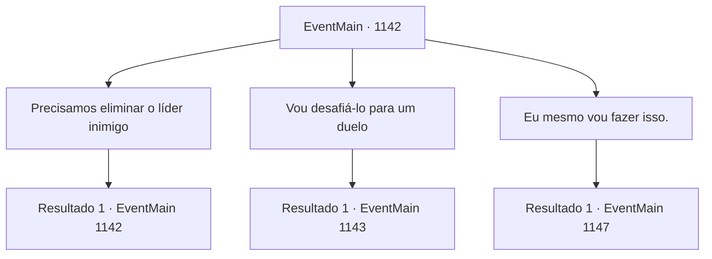

# Eventos principais · 1142

[Índice da tabela](index.md) · [Índice geral](../index.md)

ID: `pt:EventMain:1142` · Fonte: `EventMain4` · Versão: 1.2.47.

Mapeamento estático dos arquivos; a disponibilidade e a execução dependem do estado da run.

## Texto do evento

*Sem texto no arquivo.*

## Dados de entrada

```json
{
  "id": 1142,
  "grade": 1,
  "normalGoal": "",
  "required": ""
}
```

## Mapa das escolhas



## Escolhas e resultados

### Escolha 1

Precisamos eliminar o líder inimigo

Requisitos e outros campos da escolha:

```json
{
  "required": "5_917_0"
}
```

#### Resultado 1.1

Você diz que o líder da tribo precisa ser tratado para realmente terminar com isso. Rennart responde. 

 "Aquele que se chama Grizzly, o líder deles, está sempre acompanhado por seus guardas. Mesmo durante o sono, os guardas ficam de serviço, e eu até o vi comendo com quatro ou cinco guardas mantendo vigília."

 Ele franze a testa. 

 "Suponho que sua tenda esteja localizada no centro do acampamento deles, então... simplesmente aproximar-se dele vai ser muito difícil."

 Ele hesita por um momento antes de continuar. 

 "...Nossos soldados não são capazes de uma missão assim, receio."


Continuação registrada: [Evento 1142](1142.md) na mesma tabela.

```json
{
  "required": "",
  "chance": "1",
  "nextEvent": 1142,
  "type": 2,
  "reward": "5_917_1"
}
```

### Escolha 2

Vou desafiá-lo para um duelo

Requisitos e outros campos da escolha:

```json
{
  "required": ""
}
```

#### Resultado 2.1

Você diz a ele que o desafiará para um duelo. A sala fica em silêncio. Rennart olha nos seus olhos. 

 "...Uma escolha muito perigosa."

 Em vez de uma resposta verbal, você coloca um pedaço de pergaminho sobre a escrivaninha. Então, você começa a escrever. É uma carta oficial de desafio, do Chefe da Casa Briovich ao líder da tribo Zaraid. Você entrega a carta pronta a um soldado. 

 "Aqui, leve isto para Zaraid."

 O soldado pega a carta nervosamente e parte. 

 Algumas horas se passam. Pouco antes do pôr do sol, um guarda exclama. 

 "O mensageiro — ele voltou!"

 O portão se abre, deixando o soldado entrar novamente. Seu rosto está coberto de sujeira e suas roupas estão amassadas, mas você não nota ferimentos graves nele. O soldado se aproxima de você e cuidadosamente se curva em genuflexão. Então, ele tira algo dos bolsos e lhe apresenta, segurando com as duas mãos. É um pedaço de couro de animal, com algo escrito nele.
 Venha para Crimson Hill.


Continuação registrada: [Evento 1143](1143.md) na mesma tabela.

```json
{
  "required": "",
  "chance": "1",
  "nextEvent": 1143,
  "type": 2,
  "reward": ""
}
```

### Escolha 3

Eu mesmo vou fazer isso.

Requisitos e outros campos da escolha:

```json
{
  "required": "5_917_1"
}
```

#### Resultado 3.1

Você lhe diz que vai se infiltrar no posto avançado deles e assassinar o líder. Rennart olha para você e continua. 

 "...Tudo bem. Mas, se ficar perigoso, prometa que vai fugir."

 Ele tira um mapa e aponta para a parte sul do posto avançado. 

 "Aqui mesmo — se você amarrar seu cavalo aqui, morro abaixo, será mais fácil escapar."

 Ele então aponta para o norte, além das colinas. 

 "E quando você passar por esta colina, verá o posto avançado imediatamente. Você vai reconhecer o Grizzly quando o vir — ele sempre usa pele de urso e é bem maior que os outros orcs."

 Rennart desvia o olhar do mapa e volta a olhar para você. 

 "...Certifique-se de voltar."

 Com um apelo desesperado, ele lhe entrega uma adaga para usar no assassinato.

Continuação registrada: [Evento 1147](1147.md) na mesma tabela.

```json
{
  "required": "",
  "chance": "1",
  "nextEvent": 1147,
  "type": 2,
  "reward": "3_382_1"
}
```

## Referências que chegam a este evento

- [Evento 1139 · escolha 1 · resultado 1](1139.md#escolha-1)
- [Evento 1139 · escolha 2 · resultado 1](1139.md#escolha-2)
- [Evento 1140 · escolha 1 · resultado 1](1140.md#escolha-1)
- [Evento 1142 · escolha 1 · resultado 1](1142.md#escolha-1)
