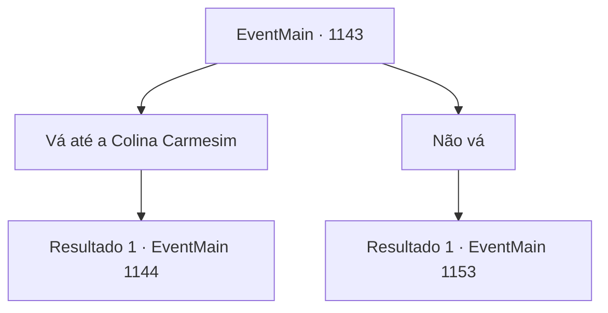

# Eventos principais · 1143

[Índice da tabela](index.md) · [Índice geral](../index.md)

ID: `pt:EventMain:1143` · Fonte: `EventMain4` · Versão: 1.2.47.

Mapeamento estático dos arquivos; a disponibilidade e a execução dependem do estado da run.

## Texto do evento

*Sem texto no arquivo.*

## Dados de entrada

```json
{
  "id": 1143,
  "grade": 1,
  "normalGoal": "",
  "required": ""
}
```

## Mapa das escolhas



## Escolhas e resultados

### Escolha 1

Vá até a Colina Carmesim

Requisitos e outros campos da escolha:

```json
{
  "required": ""
}
```

#### Resultado 1.1

Você se dirige à Colina Carmesim. 

 No dia seguinte, você reúne seis soldados e sai. A estrada pelas planícies áridas é constantemente ventosa e coberta por gramíneas baixas. Quando o sol está prestes a se pôr, uma suave inclinação aparece à sua frente. Ladeira abaixo, você vê uma fileira de orcs armados. Um com um machado nas costas, outro com uma lança, e um sentado em um javali — é bem diversificado. No centro, uma cerca rústica foi construída, que você supõe ser a arena. É uma área circular simples, cercada por estacas de madeira e corda vermelha. Além das cercas, você encontra cinco chefes tribais orcs, sentados. O que veste pele de urso chama sua atenção. Ele é muito mais alto e maior que os outros. 

 "Pelo menos você tem coragem, Briovich. Como seu papai."

 Grizzly pega o copo na mesa, dá um gole e o coloca de volta. 

 "Você ganha, nós vamos embora."

 Os outros chefes tribais acenam em concordância. 

 "Eu ganho, eu tomo as Planícies do Vento Branco. Eu tomo... a terra dos meus ancestrais."


Continuação registrada: [Evento 1144](1144.md) na mesma tabela.

```json
{
  "required": "",
  "chance": "1",
  "nextEvent": 1144,
  "type": 2,
  "reward": ""
}
```

### Escolha 2

Não vá

Requisitos e outros campos da escolha:

```json
{
  "required": ""
}
```

#### Resultado 2.1

Você decide não ir para a Colina Carmesim. Rennart inclina-se. 

 "...Entendo."

 Ele muda imediatamente de assunto, virando-se para olhar as muralhas do castelo. Parte da muralha leste está destruída - três homens já trabalham para repará-la. Rennart se abre. 

 "Ainda temos muitos suprimentos... mas nossos soldados estão exaustos."


Continuação registrada: [Evento 1153](1153.md) na mesma tabela.

```json
{
  "required": "",
  "chance": "1",
  "nextEvent": 1153,
  "type": 2,
  "reward": ""
}
```

## Referências que chegam a este evento

- [Evento 1142 · escolha 2 · resultado 1](1142.md#escolha-2)
