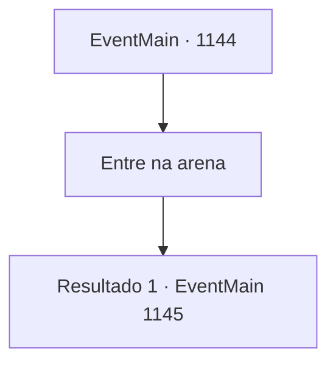

# Eventos principais · 1144

[Índice da tabela](index.md) · [Índice geral](../index.md)

ID: `pt:EventMain:1144` · Fonte: `EventMain4` · Versão: 1.2.47.

Mapeamento estático dos arquivos; a disponibilidade e a execução dependem do estado da run.

## Texto do evento

*Sem texto no arquivo.*

## Dados de entrada

```json
{
  "id": 1144,
  "grade": 1,
  "normalGoal": "",
  "required": ""
}
```

## Mapa das escolhas



## Escolhas e resultados

### Escolha 1

Entre na arena

Requisitos e outros campos da escolha:

```json
{
  "required": ""
}
```

#### Resultado 1.1

Seus soldados olham para você nervosamente, enquanto os orcs zombam alto. Grizzly pega seu grande machado. É uma arma robusta e rústica — o sol reflete tenuemente na lâmina. Grizzly gira o machado com uma mão, alongando os ombros. 

 "Os deuses assistirão a este duelo."

 Ele entra na arena, arma em punho. 

 "WOOOO--!!"

 Os orcs torcem pelo seu chefe. Suas vozes ecoam pelas planícies. Grizzly gesticula para você com confiança.

Continuação registrada: [Evento 1145](1145.md) na mesma tabela.

```json
{
  "required": "",
  "chance": "1",
  "nextEvent": 1145,
  "type": 2,
  "reward": "6_0_199",
  "place": 5
}
```

## Referências que chegam a este evento

- [Evento 1143 · escolha 1 · resultado 1](1143.md#escolha-1)
