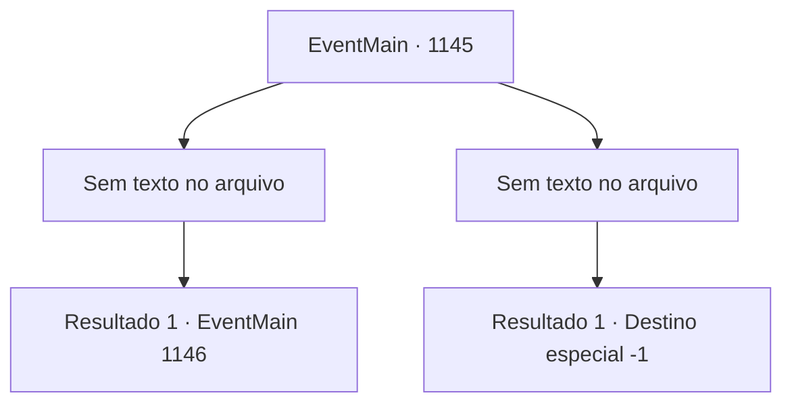

# Eventos principais · 1145

[Índice da tabela](index.md) · [Índice geral](../index.md)

ID: `pt:EventMain:1145` · Fonte: `EventMain4` · Versão: 1.2.47.

Mapeamento estático dos arquivos; a disponibilidade e a execução dependem do estado da run.

## Texto do evento

*Sem texto no arquivo.*

## Dados de entrada

```json
{
  "id": 1145,
  "grade": 1,
  "normalGoal": "",
  "required": ""
}
```

## Mapa das escolhas



## Escolhas e resultados

### Escolha 1

*Sem texto no arquivo; o papel dessa opção depende da interface do jogo.*

Requisitos e outros campos da escolha:

```json
{
  "required": ""
}
```

#### Resultado 1.1

Após uma longa e temível batalha, o vencedor é decidido. Grizzly ajoelha-se no chão, incapaz de aguentar mais seus golpes. 

 "Grrr...!!"

 Os orcs ficam em silêncio. Seus soldados começam a aplaudir em vez disso. 

 "WHOOOOAAA--!!"

 Grizzly respira pesadamente, tentando se levantar novamente. Mas, infelizmente, ele cai no chão. Seu corpo gigantesco atinge a terra e levanta uma nuvem de poeira. Você pega o grande machado de Grizzly. Coberto de sangue de orc, você olha ao redor. Os outros orcs começam a se afastar lentamente, com medo de você.

Continuação registrada: [Evento 1146](1146.md) na mesma tabela.

```json
{
  "required": "",
  "chance": "1",
  "nextEvent": 1146,
  "type": 2,
  "reward": "3_383_1"
}
```

### Escolha 2

*Sem texto no arquivo; o papel dessa opção depende da interface do jogo.*

Requisitos e outros campos da escolha:

```json
{
  "required": ""
}
```

#### Resultado 2.1

O machado enorme de Grizzly atinge seu ombro e eventualmente atravessa seu peito. Sangue respinga do seu corpo, e você cai. Grizzly sorri, banhando-se no seu sangue. 

 "GYAHAHA! Contorça-se mais, humano!"

 Isso é a última coisa que você ouve antes de perder a consciência.

Continuação registrada: [Destino especial `-1`](../destinos-especiais.md).

```json
{
  "required": "",
  "chance": "1",
  "nextEvent": -1,
  "type": 2,
  "reward": "0_0_-1|0_1_-1|15_7_16|25_8_1"
}
```

## Referências que chegam a este evento

- [Evento 1144 · escolha 1 · resultado 1](1144.md#escolha-1)
