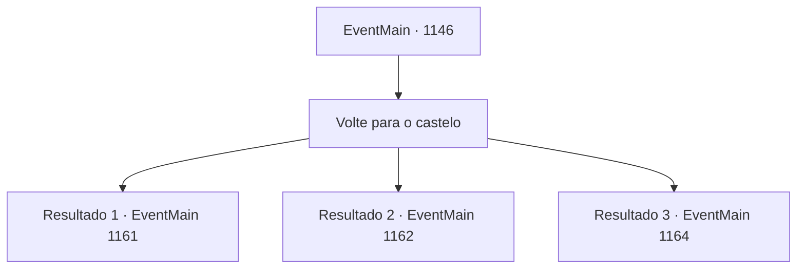

# Eventos principais · 1146

[Índice da tabela](index.md) · [Índice geral](../index.md)

ID: `pt:EventMain:1146` · Fonte: `EventMain4` · Versão: 1.2.47.

Mapeamento estático dos arquivos; a disponibilidade e a execução dependem do estado da run.

## Texto do evento

*Sem texto no arquivo.*

## Dados de entrada

```json
{
  "id": 1146,
  "grade": 1,
  "normalGoal": "",
  "required": ""
}
```

## Mapa das escolhas



## Escolhas e resultados

### Escolha 1

Volte para o castelo

Requisitos e outros campos da escolha:

```json
{
  "required": ""
}
```

#### Resultado 1.1

Você conduz seus homens morro abaixo, rumo ao Crimson Hill. Quando chegam ao castelo, a lua já está alta. Seus escoltas partem para os quartéis um a um. Todos estão visivelmente exaustos, mas parecem seguros de que voltaram em segurança. Então, Rennart se aproxima apressadamente da sede. 

 "Como foi, meu senhor?!"

 Você diz a ele que venceu o duelo e que a guerra contra os orcs chegou ao fim. Rennart respira fundo. 

 "Que sorte. Finalmente, nossa propriedade pode ter um pouco de folga."

 Ele se volta para contemplar a vista além das muralhas do castelo. A fumaça continua a subir do local onde estavam os postos orcs. Ela brilha sob a luz da lua em um brilho prateado. 

 "Ficaremos em alerta redobrado por enquanto. Você foi incrível, meu senhor."

 Passam-se alguns dias. Os orcs cumprem sua palavra — removem seus postos e retornam às planícies áridas. Enquanto isso, o castelo passa por reparos e os soldados feridos recebem tratamento. Você percorre a propriedade, certificando-se de que tudo está em ordem. Quando retorna ao seu escritório, Rennart levanta-se e fala. 

 "As operações pós-batalha estão em andamento. As brechas nas muralhas foram em sua maioria reparadas, e reabastecemos cerca de setenta por cento das flechas que usamos."

 Ele organiza alguns documentos cuidadosamente e os coloca sobre a escrivaninha. 

 "De acordo com os relatórios, parece haver caos entre os orcs. Aparentemente, eles estão divididos sobre quem deve suceder Grizzly."

 Rennart puxa um pedaço de pergaminho e entrega a você. 

 "E aqui — um registro de negociações entre Zaraid e Greymoor. Eu o encontrei nos destroços do posto deles."

 O rosto de Rennart fica vermelho de raiva. 

 "Esta é uma prova física e indiscutível de que a Casa Greymoor está pagando os orcs."


Continuação registrada: [Evento 1161](1161.md) na mesma tabela.

```json
{
  "required": "5_912_1",
  "chance": "1",
  "nextEvent": 1161,
  "type": 2,
  "reward": "13_6_10"
}
```

#### Resultado 1.2

Você conduz seus homens pela Colina Carmesim. Quando você chega ao castelo, a lua já está alta. Seus acompanhantes partem para os quartéis um a um. Todos estão visivelmente exaustos, mas parecem confiantes de que voltaram em segurança. Então, Rennart aproxima-se apressadamente da sede. 

 "Como foi, meu senhor?!"

 Você lhe diz que venceu o duelo e que a guerra contra os orcs chegou ao fim. Rennart respira fundo. 

 "Que sorte. Finalmente, nossa propriedade poderá ter um pouco de respiro."

 Ele se vira para contemplar a cena além das muralhas do castelo. A fumaça continua a subir de onde estão os postos avançados orcs. Ela brilha sob o luar com um cintilar prateado. 

 "Ficaremos em alerta redobrado por enquanto. O senhor foi incrível, meu senhor."

 Passam-se alguns dias. Os orcs cumprem sua palavra — retiram seus postos avançados e retornam às planícies estéreis. Enquanto isso, o castelo passa por reparos e os soldados feridos são tratados. Você percorre a propriedade, certificando-se de que tudo está em ordem. Quando você retorna ao seu escritório, Rennart levanta-se e fala. 

 "As operações pós-batalha estão bem encaminhadas. As brechas nas muralhas estão em sua maioria reparadas, e reabastecemos cerca de setenta por cento das flechas que usamos."

 Ele organiza alguns documentos com cuidado e os coloca sobre a mesa. 

 "Segundo os relatórios, parece haver caos entre os orcs. Aparentemente estão divididos sobre quem deve suceder Grizzly."


Continuação registrada: [Evento 1162](1162.md) na mesma tabela.

```json
{
  "required": "13_6_6",
  "chance": "1",
  "nextEvent": 1162,
  "type": 2,
  "reward": ""
}
```

#### Resultado 1.3

Você conduz seus homens pela Colina Carmesim. Quando você chega ao castelo, a lua já está alta. Seus acompanhantes partem para os quartéis um a um. Todos estão visivelmente exaustos, mas parecem confiantes de que voltaram em segurança. Então, Rennart aproxima-se apressadamente da sede. 

 "Como foi, meu senhor?!"

 Você lhe diz que venceu o duelo e que a guerra contra os orcs chegou ao fim. Rennart respira fundo. 

 "Que sorte. Finalmente, nossa propriedade poderá ter um pouco de respiro."

 Ele se vira para contemplar a cena além das muralhas do castelo. A fumaça continua a subir de onde estão os postos avançados orcs. Ela brilha sob o luar com um cintilar prateado. 

 "Ficaremos em alerta redobrado por enquanto. O senhor foi incrível, meu senhor."

 Passam-se alguns dias. Os orcs cumprem sua palavra — retiram seus postos avançados e retornam às planícies estéreis. Enquanto isso, o castelo passa por reparos e os soldados feridos são tratados. Você percorre a propriedade, certificando-se de que tudo está em ordem. Quando você retorna ao seu escritório, Rennart levanta-se e fala. 

 "As operações pós-batalha estão bem encaminhadas. As brechas nas muralhas estão em sua maioria reparadas, e reabastecemos cerca de setenta por cento das flechas que usamos."

 Ele organiza alguns documentos com cuidado e os coloca sobre a mesa. 

 "Segundo os relatórios, parece haver caos entre os orcs. Aparentemente estão divididos sobre quem deve suceder Grizzly."


Continuação registrada: [Evento 1164](1164.md) na mesma tabela.

```json
{
  "required": "5_908_1",
  "chance": "1",
  "nextEvent": 1164,
  "type": 2,
  "reward": ""
}
```

## Referências que chegam a este evento

- [Evento 1145 · escolha 1 · resultado 1](1145.md#escolha-1)
