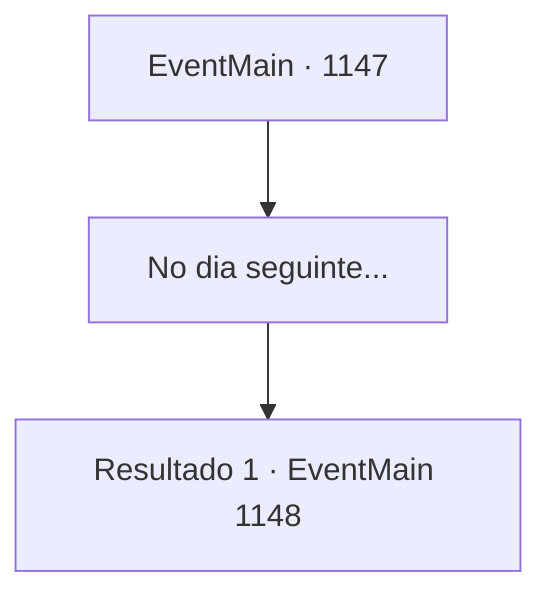

# Eventos principais · 1147

[Índice da tabela](index.md) · [Índice geral](../index.md)

ID: `pt:EventMain:1147` · Fonte: `EventMain4` · Versão: 1.2.47.

Mapeamento estático dos arquivos; a disponibilidade e a execução dependem do estado da run.

## Texto do evento

*Sem texto no arquivo.*

## Dados de entrada

```json
{
  "id": 1147,
  "grade": 1,
  "normalGoal": "",
  "required": ""
}
```

## Mapa das escolhas



## Escolhas e resultados

### Escolha 1

No dia seguinte...

Requisitos e outros campos da escolha:

```json
{
  "required": ""
}
```

#### Resultado 1.1

Outro dia começa. O céu está coberto de escuridão, e até o luar está encoberto por nuvens. Está sombrio por toda parte. Você abaixa o capuz e prende a adaga no cinturão. Então, monta em um cavalo e segue para o posto avançado dos orcs. Você cobriu os cascos do cavalo com pano — eles pressionam o solo suavemente e, o mais importante, silenciosamente. 

 Logo, você chega a uma pequena colina, de onde pode ver a totalidade do posto avançado dos orcs. É um lugar chamado Colina Carmesim. Várias histórias explicam como recebeu esse nome — talvez pela cor do solo, ou pela quantidade de batalhas que ali ocorreram e pelo sangue derramado naquela área. É também exatamente o lugar onde seu antecessor encontrou seu fim em uma batalha contra os orcs. Você salta do cavalo e se agacha. Em seguida, dirige-se à beira da colina para vigiar a área. Os orcs alojam-se em tendas circulares, com um buraco no centro para deixar sair a fumaça do fogo. Entre as muitas tendas, orcs fazem guarda, patrulhando ao redor. Você nota uma tenda muito maior que as outras. Ela é cercada por um trecho de paliçada de madeira, feita com estacas afiadas, com cada canto do perímetro guardado por uma torre de vigia.

Continuação registrada: [Evento 1148](1148.md) na mesma tabela.

```json
{
  "required": "",
  "chance": "1",
  "nextEvent": 1148,
  "type": 2,
  "reward": ""
}
```

## Referências que chegam a este evento

- [Evento 1142 · escolha 3 · resultado 1](1142.md#escolha-3)
