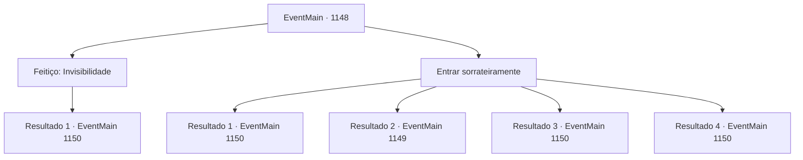

# Eventos principais · 1148

[Índice da tabela](index.md) · [Índice geral](../index.md)

ID: `pt:EventMain:1148` · Fonte: `EventMain4` · Versão: 1.2.47.

Mapeamento estático dos arquivos; a disponibilidade e a execução dependem do estado da run.

## Texto do evento

*Sem texto no arquivo.*

## Dados de entrada

```json
{
  "id": 1148,
  "grade": 1,
  "normalGoal": "",
  "required": ""
}
```

## Mapa das escolhas



## Escolhas e resultados

### Escolha 1

Feitiço: Invisibilidade

Requisitos e outros campos da escolha:

```json
{
  "required": "20_0_2|1_1_2"
}
```

#### Resultado 1.1

Você conjura um feitiço para se tornar invisível. Você atravessa confiante os portões dianteiros do posto avançado, mas os guardas estão alheios à sua presença. Você passa pelos guardas em patrulha e chega à maior tenda que consegue encontrar. Há mais guardas fazendo vigília, mas nenhum deles nota você. Você espera a troca de turno, então se esgueira para dentro da tenda. 

 "*ronco*.... Ufa...."

 Roncos altos e respiração pesada preenchem a tenda. Num canto jaze 'Grizzly', o orc gigantesco, dormindo profundamente em uma cama de couro. Em vez de um cobertor, ele está coberto com pele de urso, com um par de machados bem ao lado dele.

Continuação registrada: [Evento 1150](1150.md) na mesma tabela.

```json
{
  "required": "",
  "chance": "1",
  "nextEvent": 1150,
  "type": 2,
  "reward": "0_1_-1"
}
```

### Escolha 2

Entrar sorrateiramente

Requisitos e outros campos da escolha:

```json
{
  "required": ""
}
```

#### Resultado 2.1

Você se esgueira pelos guardas e pula a cerca de madeira. Os guardas estão alheios à sua presença. Você se esconde além das barracas e consegue chegar à maior tenda que encontra. Há mais guardas de plantão, mas nenhum deles percebe você. Você espera que eles troquem de turno, então se esgueira para dentro da tenda. 

 "*ronco*.... Ufa...."

 Roncados potentes e respiração pesada enchem a tenda. Em um canto jaze 'Grizzly', o orc gigantesco, dormindo profundamente em uma cama de couro. Em vez de um cobertor, ele está coberto por pele de urso, com um par de machados bem ao lado dele.

Continuação registrada: [Evento 1150](1150.md) na mesma tabela.

```json
{
  "required": "21_43_1|21_5_4",
  "chance": "1|0_6_1",
  "nextEvent": 1150,
  "type": 0,
  "reward": ""
}
```

#### Resultado 2.2

Você se esgueira pelos guardas e pula sobre a cerca de madeira. Mas no momento em que pula, você fica cara a cara com um orc de guarda. 

 "CHAMAIK ALNA!"

 O orc grita algo e puxa seu machado. Então ele investe contra você sem hesitação.

Continuação registrada: [Evento 1149](1149.md) na mesma tabela.

```json
{
  "required": "21_43_1|21_5_4",
  "chance": "25",
  "nextEvent": 1149,
  "type": 1,
  "reward": "6_0_104",
  "place": 5
}
```

#### Resultado 2.3

Você se esgueira pelos guardas e pula a cerca de madeira. Os guardas estão alheios à sua presença. Você se esconde além das barracas e consegue chegar à maior tenda que encontra. Há mais guardas de plantão, mas nenhum deles percebe você. Você espera que eles troquem de turno, então se esgueira para dentro da tenda. 

 "*ronco*.... Ufa...."

 Roncados potentes e respiração pesada enchem a tenda. Em um canto jaze 'Grizzly', o orc gigantesco, dormindo profundamente em uma cama de couro. Em vez de um cobertor, ele está coberto por pele de urso, com um par de machados bem ao lado dele.

Continuação registrada: [Evento 1150](1150.md) na mesma tabela.

```json
{
  "required": "20_5_4",
  "chance": "1",
  "nextEvent": 1150,
  "type": 2,
  "reward": ""
}
```

#### Resultado 2.4

Você se torna invisível. Você atravessa confiantemente os portões frontais do posto avançado, mas os guardas não percebem sua presença. Você passa pelos guardas em patrulha e chega à maior tenda que consegue encontrar. Há mais guardas de sentinela, mas nenhum deles repara em você. Você espera que eles troquem de turno, então entra furtivamente na tenda. 

 "*ronco*.... Ufa...."

 Roncos fortes e respiração pesada enchem a tenda. Em um canto está 'Grizzly', o orc gigantesco, dormindo profundamente em uma cama de couro. Em vez de um cobertor, ele está coberto por pele de urso, com um par de machados bem ao lado dele.

Continuação registrada: [Evento 1150](1150.md) na mesma tabela.

```json
{
  "required": "20_43_1",
  "chance": "1",
  "nextEvent": 1150,
  "type": 2,
  "reward": ""
}
```

## Referências que chegam a este evento

- [Evento 1147 · escolha 1 · resultado 1](1147.md#escolha-1)
