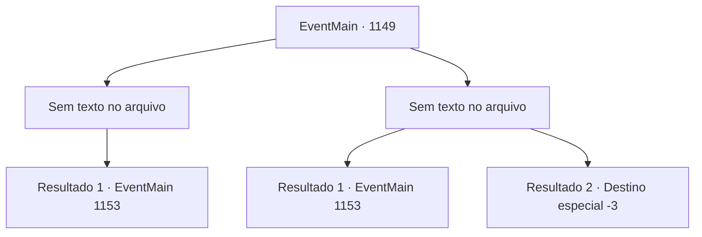

# Eventos principais · 1149

[Índice da tabela](index.md) · [Índice geral](../index.md)

ID: `pt:EventMain:1149` · Fonte: `EventMain4` · Versão: 1.2.47.

Mapeamento estático dos arquivos; a disponibilidade e a execução dependem do estado da run.

## Texto do evento

*Sem texto no arquivo.*

## Dados de entrada

```json
{
  "id": 1149,
  "grade": 1,
  "normalGoal": "",
  "required": ""
}
```

## Mapa das escolhas



## Escolhas e resultados

### Escolha 1

*Sem texto no arquivo; o papel dessa opção depende da interface do jogo.*

Requisitos e outros campos da escolha:

```json
{
  "required": ""
}
```

#### Resultado 1.1

Você passa raspando pelo guarda orc e pula novamente a cerca. Então, você corre imediatamente para Crimson Hill. Os orcs já estão em sua perseguição, tocando suas cornetas de guerra. Você sobe a colina rapidamente e salta no seu cavalo, ofegante. 

 "*prrrr*"

 O cavalo cheira e então começa a correr. Os orcs enfurecidos ficam menores à medida que você se afasta deles. 

 Você chega de volta ao castelo ao nascer do sol. O portão se abre, e Rennart corre para fora para recebê-lo. 

 "Como foi?"

 Você balança a cabeça, comunicando a ele seu fracasso. 

 "Bem, o fato de você ter voltado em uma peça já é suficiente. Bem-vindo de volta, meu senhor."

 Ele se vira para olhar as muralhas do castelo. Parte da muralha leste está destruída - três homens já estão trabalhando para repará-la. Rennart abre a boca. 

 "Ainda temos muitos suprimentos... mas nossos soldados estão exaustos."


Continuação registrada: [Evento 1153](1153.md) na mesma tabela.

```json
{
  "required": "",
  "chance": "1",
  "nextEvent": 1153,
  "type": 2,
  "reward": "5_970_9"
}
```

### Escolha 2

*Sem texto no arquivo; o papel dessa opção depende da interface do jogo.*

Requisitos e outros campos da escolha:

```json
{
  "required": ""
}
```

#### Resultado 2.1

Você passa raspando pelo guarda orc e pula a cerca novamente. A ferida que ele lhe deu dói. Mas você sabe que não pode parar. Você corre rumo à Colina Carmesim. Os orcs já estão em seu encalço, tocando suas trompas de guerra. Você sobe a colina depressa e monta em seu cavalo, ofegante. 

 "*prrrr*"

 O cavalo fareja, depois começa a galopar. Os orcs enfurecidos ficam cada vez menores enquanto você se afasta. 

 Você chega de volta ao castelo ao amanhecer. O portão se abre, e Rennart sai correndo para recebê-lo. 

 "Como foi?"

 Você balança a cabeça, informando-o de seu fracasso. 

 "Bem, o fato de você ter voltado inteiro já é o bastante. Bem-vindo de volta, meu Senhor."

 Ele se vira para olhar as muralhas do castelo. Parte da muralha leste está destruída - três homens já estão trabalhando para repará-la. Rennart abre a boca. 

 "Ainda temos muitos suprimentos... mas nossos soldados estão exaustos."


Continuação registrada: [Evento 1153](1153.md) na mesma tabela.

```json
{
  "required": "1_0_2|1_1_2",
  "chance": "1",
  "nextEvent": 1153,
  "type": 2,
  "reward": "0_0_-1|0_1_-1|5_970_9"
}
```

#### Resultado 2.2

O orc crava seu machado no seu ombro. Uma dor imensa se espalha quando você sente o joelho estalar. Então, mais orcs chegam, cobrindo você de azagaias e flechas. Os ataques implacáveis o derrubam, deixando você inconsciente no chão frio.

Continuação registrada: [Destino especial `-3`](../destinos-especiais.md).

```json
{
  "required": "-1|2_0_2|2_1_2",
  "chance": "1",
  "nextEvent": -3,
  "type": 2,
  "reward": "0_0_-1|0_1_-1"
}
```

## Referências que chegam a este evento

- [Evento 1148 · escolha 2 · resultado 2](1148.md#escolha-2)
- [Evento 1151 · escolha 2 · resultado 2](1151.md#escolha-2)
