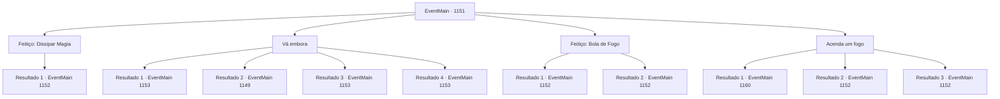

# Eventos principais · 1151

[Índice da tabela](index.md) · [Índice geral](../index.md)

ID: `pt:EventMain:1151` · Fonte: `EventMain4` · Versão: 1.2.47.

Mapeamento estático dos arquivos; a disponibilidade e a execução dependem do estado da run.

## Texto do evento

*Sem texto no arquivo.*

## Dados de entrada

```json
{
  "id": 1151,
  "grade": 1,
  "normalGoal": "",
  "required": ""
}
```

## Mapa das escolhas



## Escolhas e resultados

### Escolha 1

Feitiço: Dissipar Magia

Requisitos e outros campos da escolha:

```json
{
  "required": "20_0_2|1_1_2"
}
```

#### Resultado 1.1

Você conjura uma magia para quebrar a ilusão. Com um guincho agudo, a ilusão se estilhaça. O orc na cama desapareceu — resta apenas um saco de farinha. O par de machados ao lado da cama eram cabos de vassoura. O que parecia ser uma cama de couro revela-se uma prateleira de madeira. Então, você ouve uma voz ecoando por trás. 

 "Um intruso."

 Você se vira e encontra um orc gigantesco vestindo pele de urso, empunhando uma machadão e olhando para você. Ao lado dele está uma orc feminina coberta por colares feitos de ossos de animais e vários amuletos. Você supõe que ela é uma xamã orc. O orc vestido com pele de urso investe contra você com sua machadão.

Continuação registrada: [Evento 1152](1152.md) na mesma tabela.

```json
{
  "required": "",
  "chance": "1",
  "nextEvent": 1152,
  "type": 2,
  "reward": "6_0_199|0_1_-1",
  "place": 5
}
```

### Escolha 2

Vá embora

Requisitos e outros campos da escolha:

```json
{
  "required": ""
}
```

#### Resultado 2.1

Você olha ao redor, então aproveita a oportunidade perfeita para rastejar para fora da barraca. Os orcs que fazem a guarda não percebem sua presença. Você pula a cerca de novo e corre em direção à Colina Carmesim. Você sobe a colina rapidamente e pula no seu cavalo, ofegante. 

 "*prrrr*"

 O cavalo cheira o ar, então começa a correr. 

 Você chega de volta ao castelo ao nascer do sol. O portão se abre, e Rennart corre para fora para lhe dar as boas-vindas. 

 "Como foi?"

 Você balança a cabeça, informando-o de seu fracasso. 

 "Bom, o fato de você ter voltado inteiro já é suficiente. Bem-vindo de volta, meu senhor."

 Ele se vira para olhar as muralhas do castelo. Parte da muralha leste está destruída — três homens já estão trabalhando para repará-la. Rennart abre a boca. 

 "Ainda temos muitos suprimentos... mas nossos soldados estão exaustos."


Continuação registrada: [Evento 1153](1153.md) na mesma tabela.

```json
{
  "required": "21_43_1|21_5_4",
  "chance": "1|0_6_1",
  "nextEvent": 1153,
  "type": 0,
  "reward": "5_970_9"
}
```

#### Resultado 2.2

Você olha ao redor, então aproveita a oportunidade perfeita para rastejar para fora da barraca. Mas então você fica frente a frente com um guarda orc. 

 "CHAMAIK ALNA!"

 O orc grita algo e puxa seu machado. Em seguida, ele investe contra você sem hesitar.

Continuação registrada: [Evento 1149](1149.md) na mesma tabela.

```json
{
  "required": "21_43_1|21_5_4",
  "chance": "25",
  "nextEvent": 1149,
  "type": 1,
  "reward": "6_0_104",
  "place": 5
}
```

#### Resultado 2.3

Você olha ao redor, então aproveita a oportunidade perfeita para rastejar para fora da barraca. Os orcs que fazem a guarda não percebem sua presença. Você pula a cerca de novo e corre em direção à Colina Carmesim. Você sobe a colina rapidamente e pula no seu cavalo, ofegante. 

 "*prrrr*"

 O cavalo cheira o ar, então começa a correr. 

 Você chega de volta ao castelo ao nascer do sol. O portão se abre, e Rennart corre para fora para lhe dar as boas-vindas. 

 "Como foi?"

 Você balança a cabeça, informando-o de seu fracasso. 

 "Bom, o fato de você ter voltado inteiro já é suficiente. Bem-vindo de volta, meu senhor."

 Ele se vira para olhar as muralhas do castelo. Parte da muralha leste está destruída — três homens já estão trabalhando para repará-la. Rennart abre a boca. 

 "Ainda temos muitos suprimentos... mas nossos soldados estão exaustos."


Continuação registrada: [Evento 1153](1153.md) na mesma tabela.

```json
{
  "required": "20_5_4",
  "chance": "1",
  "nextEvent": 1153,
  "type": 2,
  "reward": "5_970_9"
}
```

#### Resultado 2.4

Você olha ao redor, então aproveita a oportunidade perfeita para rastejar para fora da barraca. Os orcs que fazem a guarda não percebem sua presença. Você pula a cerca de novo e corre em direção à Colina Carmesim. Você sobe a colina rapidamente e pula no seu cavalo, ofegante. 

 "*prrrr*"

 O cavalo cheira o ar, então começa a correr. 

 Você chega de volta ao castelo ao nascer do sol. O portão se abre, e Rennart corre para fora para lhe dar as boas-vindas. 

 "Como foi?"

 Você balança a cabeça, informando-o de seu fracasso. 

 "Bom, o fato de você ter voltado inteiro já é suficiente. Bem-vindo de volta, meu senhor."

 Ele se vira para olhar as muralhas do castelo. Parte da muralha leste está destruída — três homens já estão trabalhando para repará-la. Rennart abre a boca. 

 "Ainda temos muitos suprimentos... mas nossos soldados estão exaustos."


Continuação registrada: [Evento 1153](1153.md) na mesma tabela.

```json
{
  "required": "20_43_1",
  "chance": "1",
  "nextEvent": 1153,
  "type": 2,
  "reward": "5_970_9"
}
```

### Escolha 3

Feitiço: Bola de Fogo

Requisitos e outros campos da escolha:

```json
{
  "required": "20_0_2|1_1_2"
}
```

#### Resultado 3.1

Você conjura uma esfera de fogo. Então, você ouve uma voz ecoando por trás. 

 "Um intruso."

 Você se vira e encontra um orc gigantesco vestindo pelagem de urso, empunhando um machado gigante e encarando você. Ao lado dele está uma orc coberta por um colar feito de ossos de animais e vários amuletos. Você supõe que ela é uma xamã orc. O orc com a pelagem de urso avança contra você com seu machado gigante, e a xamã tenta interromper seu feitiço. Mas, apesar da distração, você consegue completar sua esfera de fogo, lançando-a em Grizzly. Com um estrondo alto, ocorre uma explosão flamejante. Você também é atingido pela explosão. Você é lançado ao chão. Então, Grizzly grita com você, aparecendo através da fumaça negra. 

 "Você humano patético...! EU MATO VOCÊ!"

 Você nota a xamã orc caída no chão imóvel ao lado dele. O machado gigante de Grizzly vem em sua direção, cortando o ar.

Continuação registrada: [Evento 1152](1152.md) na mesma tabela.

```json
{
  "required": "",
  "chance": "1|0_7_1|0_12_1",
  "nextEvent": 1152,
  "type": 0,
  "reward": "6_2_199|0_1_-1",
  "place": 5
}
```

#### Resultado 3.2

Você conjura uma bola de fogo. Então, você ouve uma voz ecoando atrás de você. 

 "Um intruso."

 Você se vira e encontra um orc gigantesco vestindo pele de urso, empunhando um grande machado e encarando você. Ao lado dele está uma orc fêmea com colares feitos de ossos de animais e vários amuletos. Você supõe que ela é uma xamã orc. O orc com a pele de urso investe contra você com seu grande machado, e a xamã tenta contrariar seu feitiço. Sua bola de fogo começa a perder a forma e, por fim, desaparece. Assim que ele percebe, o grande machado de Grizzly vem em sua direção, cortando o ar.

Continuação registrada: [Evento 1152](1152.md) na mesma tabela.

```json
{
  "required": "",
  "chance": "30",
  "nextEvent": 1152,
  "type": 1,
  "reward": "6_3_199",
  "place": 5
}
```

### Escolha 4

Acenda um fogo

Requisitos e outros campos da escolha:

```json
{
  "required": "23_3_1"
}
```

#### Resultado 4.1

Você acende um fogo em um canto da tenda. O pequeno fogo começa a se espalhar pela superfície seca das tendas, e uma fumaça preta enche a tenda em pouco tempo. O cheiro é pior que horrível. Você rapidamente tampa o nariz e rasteja para fora da tenda. Ao perceber o fogo se espalhando pelas tendas, os orcs começam a entrar em pânico - nenhum deles repara em você. Então, uma das tendas se rasga quando um orc vestindo pele de urso sai correndo. 

 "*tosse*...! *TOSSE* *TOSSE*"

 Ele respira pesadamente, gritando algo em orcês. Ao ouvir suas palavras, os orcs começam a trazer água, terra e até leite, para tentar apagar o fogo. Grizzly se segura no joelho, ofegante. Sua boca está coberta de baba, e sua pele está cheia de fuligem. Enquanto ele tenta respirar, você se aproxima de Grizzly por trás e o esfaqueia. Uma, duas, três vezes - não houve gritos, apenas o som do ar saindo de seus pulmões. Você pega o grande machado dele e corre. Os orcs finalmente te encontram e vêm atrás de você. Você sobe a colina rapidamente e pula no seu cavalo, ofegante. 

 "*prrrr*"

 O cavalo fareja, então começa a correr. Os orcs enfurecidos ficam cada vez menores conforme você se afasta deles.

Continuação registrada: [Evento 1160](1160.md) na mesma tabela.

```json
{
  "required": "23_14_1",
  "chance": "1|0_6_1",
  "nextEvent": 1160,
  "type": 0,
  "reward": "25_3_1|0_2_1|3_383_1|5_970_1"
}
```

#### Resultado 4.2

Você acende um fogo em um canto da tenda. O pequeno fogo começa a se espalhar pela superfície seca das tendas, e uma fumaça preta enche a tenda em pouco tempo. O cheiro é pior do que horrível. Você rapidamente cobre o nariz e rasteja para fora da tenda. Percebendo o fogo se espalhando pelas tendas, os orcs começam a entrar em pânico — nenhum deles repara em você. Então, uma das tendas rasga-se quando um orc vestindo pele de urso sai correndo. 

 "*tosse*...! *TOSSE* *TOSSE*"

 Ele respira pesadamente, gritando algo em orcês. Ao ouvir suas palavras, os orcs começam a trazer água, terra e até kumis, na tentativa de apagar o fogo. Grizzly segura o joelho, ofegante. Sua boca está coberta de baba, e sua pele está cheia de fuligem. Enquanto ele tenta respirar, você se aproxima de Grizzly por trás e o esfaqueia. 

 "GYAAHHHH--!!"

 Mas ele não cai. Você supõe que a pele de urso que ele veste o protegeu de parte do dano. Ele imediatamente balança os punhos na sua direção. Você consegue desviar, mas isso dá tempo para Grizzly pegar seu grande machado. Seus olhos começam a brilhar em vermelho, enquanto sangue escorre de sua cabeça. 

 "EU MATO VOCÊ...!"

 O grande machado de Grizzly vem em sua direção, cortando o ar.

Continuação registrada: [Evento 1152](1152.md) na mesma tabela.

```json
{
  "required": "23_14_1",
  "chance": "20",
  "nextEvent": 1152,
  "type": 1,
  "reward": "6_2_199|25_3_1",
  "place": 5
}
```

#### Resultado 4.3

Você acende um fogo em um canto da tenda. O pequeno incêndio começa a se espalhar pela superfície seca das tendas, e uma fumaça preta enche a tenda em pouco tempo. O cheiro é pior do que horrível. Você rapidamente tapa o nariz e sai rastejando da tenda. Percebendo o fogo se espalhando pelas tendas, os orcs começam a entrar em pânico - nenhum deles percebe você. Então, uma das tendas se rasga quando um orc vestindo pele de urso corre para fora. 

 "*tosse*...! *TOSSE* *TOSSE*"

 Ele respira pesadamente, gritando algo em orquês. Ouvindo suas palavras, os orcs começam a trazer água, terra e até kumis, na tentativa de apagar o fogo. Grizzly segura o joelho, arfando. A boca dele está coberta de baba, e a pele cheia de fuligem. Você se aproxima por trás dele e procura uma chance de derrubá-lo silenciosamente. Mas sem uma adaga adequada, assassinato silencioso é muito difícil. Enquanto você vai se aproximando, os olhos de Grizzly te encontram. 

 "EU VOU TE MATAR...!"

 Ele não hesita. Ele pega seu grande machado do chão e avança em sua direção.

Continuação registrada: [Evento 1152](1152.md) na mesma tabela.

```json
{
  "required": "24_14_1",
  "chance": "1",
  "nextEvent": 1152,
  "type": 2,
  "reward": "6_0_199|25_3_1",
  "place": 5
}
```

## Referências que chegam a este evento

- [Evento 1150 · escolha 2 · resultado 1](1150.md#escolha-2)
