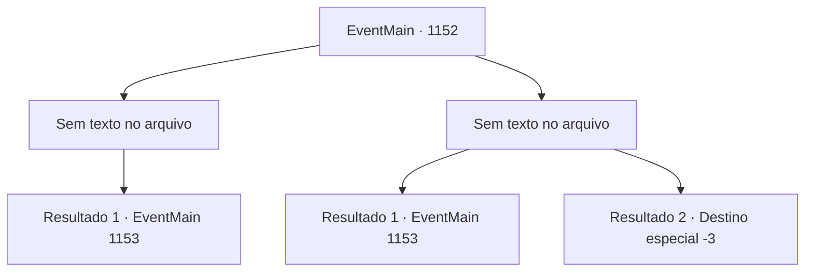

# Eventos principais · 1152

[Índice da tabela](index.md) · [Índice geral](../index.md)

ID: `pt:EventMain:1152` · Fonte: `EventMain4` · Versão: 1.2.47.

Mapeamento estático dos arquivos; a disponibilidade e a execução dependem do estado da run.

## Texto do evento

*Sem texto no arquivo.*

## Dados de entrada

```json
{
  "id": 1152,
  "grade": 1,
  "normalGoal": "",
  "required": ""
}
```

## Mapa das escolhas



## Escolhas e resultados

### Escolha 1

*Sem texto no arquivo; o papel dessa opção depende da interface do jogo.*

Requisitos e outros campos da escolha:

```json
{
  "required": ""
}
```

#### Resultado 1.1

Você consegue colocar o Grizzly de joelhos. Seus lábios tremem e formam um sorriso. 

 "*spit*"

 Grizzly cospe um caroço de catarro sanguinolento. Mas você não consegue terminá-lo. Muitos orcs estão invadindo o posto interno. Infelizmente, você vira as costas imediatamente para fugir. Você ouve os orcs rugindo pelas suas costas. Você pula a cerca novamente e corre rumo à Colina Carmesim. Você sente o pescoço ficando dolorido por causa de toda a respiração pesada. Você sobe a colina rapidamente e monta no seu cavalo, ofegante. 

 "*prrrr*"

 O cavalo cheira o ar, então começa a correr. O vento frio perfura sua pele, e os orcs começam a ficar menores conforme você se afasta. 

 Você chega de volta ao castelo ao amanhecer. O portão se abre, e Rennart sai correndo para recebê-lo. 

 "Como foi?"

 Você balança a cabeça, informando-o do seu fracasso. 

 "Bem, o fato de você ter voltado em uma peça já é suficiente. Bem-vindo de volta, meu senhor."

 Ele se vira para olhar as muralhas do castelo. Parte da muralha leste está destruída - três homens já estão trabalhando para repará-la. Rennart se abre. 

 "Ainda temos muitos suprimentos... mas nossos soldados estão exaustos."


Continuação registrada: [Evento 1153](1153.md) na mesma tabela.

```json
{
  "required": "",
  "chance": "1",
  "nextEvent": 1153,
  "type": 2,
  "reward": "5_970_9"
}
```

### Escolha 2

*Sem texto no arquivo; o papel dessa opção depende da interface do jogo.*

Requisitos e outros campos da escolha:

```json
{
  "required": ""
}
```

#### Resultado 2.1

Você mal consegue desviar do grande machado de Grizzly. Mas você não esperava um chute na sequência. Sente uma força intensa batendo no seu peito enquanto é arremessado no ar. Então, nota um grupo de orcs vindo atrás de você. Você pula a cerca novamente e corre para Crimson Hill. Sente o pescoço dolorido de tanto respirar com força. Você sobe a colina rapidamente e pula no seu cavalo, ofegante. 

 "*prrrr*"

 O cavalo fareja, então começa a correr. O vento frio fura a sua pele, e os orcs começam a ficar menores à medida que você se afasta. 

 Você chega de volta ao castelo ao nascer do sol. O portão se abre, e Rennart corre para receber você. 

 "Como foi?"

 Você balança a cabeça, avisando-o do seu fracasso. 

 "Bem, o fato de você ter voltado inteiro já é suficiente. Bem-vindo de volta, meu senhor."

 Ele se volta para olhar as muralhas do castelo. Parte da muralha leste está destruída — três homens já trabalham para consertá-la. Rennart diz: 

 "Ainda temos muitos suprimentos... mas nossos soldados estão exaustos."


Continuação registrada: [Evento 1153](1153.md) na mesma tabela.

```json
{
  "required": "1_0_2|1_1_2",
  "chance": "1",
  "nextEvent": 1153,
  "type": 2,
  "reward": "0_0_-1|0_1_-1|5_970_9"
}
```

#### Resultado 2.2

O machado grande do Grizzly atinge seu ombro e eventualmente atravessa seu peito. Sangue jorra do seu corpo, e você cai. Grizzly sorri, banhando-se no seu sangue. 

 "GYAHAHA! Contorça-se mais, humano!"

 Essa é a última coisa que você escuta antes de perder a consciência.

Continuação registrada: [Destino especial `-3`](../destinos-especiais.md).

```json
{
  "required": "-1|2_0_2|2_1_2",
  "chance": "1",
  "nextEvent": -3,
  "type": 2,
  "reward": "0_0_-1|0_1_-1"
}
```

## Referências que chegam a este evento

- [Evento 1150 · escolha 1 · resultado 1](1150.md#escolha-1)
- [Evento 1150 · escolha 1 · resultado 2](1150.md#escolha-1)
- [Evento 1150 · escolha 3 · resultado 1](1150.md#escolha-3)
- [Evento 1151 · escolha 1 · resultado 1](1151.md#escolha-1)
- [Evento 1151 · escolha 3 · resultado 1](1151.md#escolha-3)
- [Evento 1151 · escolha 3 · resultado 2](1151.md#escolha-3)
- [Evento 1151 · escolha 4 · resultado 2](1151.md#escolha-4)
- [Evento 1151 · escolha 4 · resultado 3](1151.md#escolha-4)
