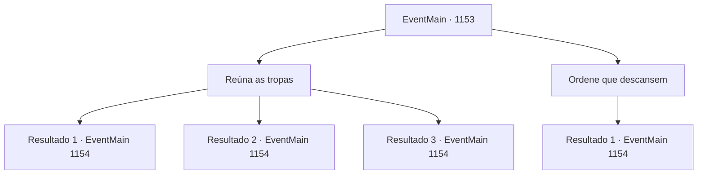

# Eventos principais · 1153

[Índice da tabela](index.md) · [Índice geral](../index.md)

ID: `pt:EventMain:1153` · Fonte: `EventMain4` · Versão: 1.2.47.

Mapeamento estático dos arquivos; a disponibilidade e a execução dependem do estado da run.

## Texto do evento

*Sem texto no arquivo.*

## Dados de entrada

```json
{
  "id": 1153,
  "grade": 1,
  "normalGoal": "",
  "required": ""
}
```

## Mapa das escolhas



## Escolhas e resultados

### Escolha 1

Reúna as tropas

Requisitos e outros campos da escolha:

```json
{
  "required": ""
}
```

#### Resultado 1.1

Você reúne seus soldados, olhando para eles das muralhas do castelo. Você nota cansaço e preocupação em seus rostos. No seu discurso, você promete a eles que lutará com todas as suas forças, jurando pelo nome de Briovich, e lembra os soldados de quão vital é que protejam o castelo. Fascinados pelo seu carisma, os olhos dos soldados começam a arder de paixão mais uma vez. Ao erguer o braço, eles respondem soltando um estrondoso brado de guerra. <link=shake>

 "PELO Briovich!"

</link>

Continuação registrada: [Evento 1154](1154.md) na mesma tabela.

```json
{
  "required": "5_881_1",
  "chance": "1|0_12_1",
  "nextEvent": 1154,
  "type": 0,
  "reward": "5_918_1"
}
```

#### Resultado 1.2

Você reúne seus soldados, olhando para eles das muralhas do castelo. Você nota cansaço e preocupação em seus rostos. No seu discurso, você lhes promete que lutará com todas as suas forças, jurando pelo nome Briovich, e lembra os soldados de como é vital que protejam o castelo. Mas os soldados parecem indiferentes. Alguns ainda olham para o chão, enquanto alguns mal conseguem não suspirar. Depois que seu discurso termina, eles se retiram sem dizer nada. O moral deles não parece melhor do que antes. Rennart vê isso e fala. 

 "...Eles devem estar todos exaustos."


Continuação registrada: [Evento 1154](1154.md) na mesma tabela.

```json
{
  "required": "5_881_1",
  "chance": "14",
  "nextEvent": 1154,
  "type": 1,
  "reward": "5_918_9"
}
```

#### Resultado 1.3

Você reúne seus soldados, olhando para eles de cima das muralhas do castelo. Você percebe cansaço e preocupação em seus rostos. No seu discurso, você promete a eles que lutará com todas as suas forças, jurando pelo nome Briovich, e lembra aos soldados o quão vital é que protejam o castelo. Então, Tarrys levanta ambos os braços, comovido com seu discurso. 

 "Viva Briovich!"

 Ao ouvir Tarrys, os outros soldados respondem soltando um estrondoso grito de guerra. <link=shake>

 "VIVA Briovich!"

</link>

Continuação registrada: [Evento 1154](1154.md) na mesma tabela.

```json
{
  "required": "18_881_1",
  "chance": "1",
  "nextEvent": 1154,
  "type": 2,
  "reward": "5_918_1"
}
```

### Escolha 2

Ordene que descansem

Requisitos e outros campos da escolha:

```json
{
  "required": ""
}
```

#### Resultado 2.1

Você diz a Rennart para dar um tempo aos soldados para descansarem. Rennart inclina-se e responde. 

 "Entendido."

 Ele então circula pelas muralhas do castelo, dizendo aos soldados para descansarem. Um por um, os soldados largam suas armas. Alguns encostam-se nas paredes, e alguns cobrem o rosto com seus capacetes. Apenas o som da respiração cansada preenche as muralhas do castelo. Você também se senta aos pés das muralhas e fecha os olhos.

Continuação registrada: [Evento 1154](1154.md) na mesma tabela.

```json
{
  "required": "",
  "chance": "1",
  "nextEvent": 1154,
  "type": 2,
  "reward": "0_0_1"
}
```

## Referências que chegam a este evento

- [Evento 1143 · escolha 2 · resultado 1](1143.md#escolha-2)
- [Evento 1149 · escolha 1 · resultado 1](1149.md#escolha-1)
- [Evento 1149 · escolha 2 · resultado 1](1149.md#escolha-2)
- [Evento 1151 · escolha 2 · resultado 1](1151.md#escolha-2)
- [Evento 1151 · escolha 2 · resultado 3](1151.md#escolha-2)
- [Evento 1151 · escolha 2 · resultado 4](1151.md#escolha-2)
- [Evento 1152 · escolha 1 · resultado 1](1152.md#escolha-1)
- [Evento 1152 · escolha 2 · resultado 1](1152.md#escolha-2)
