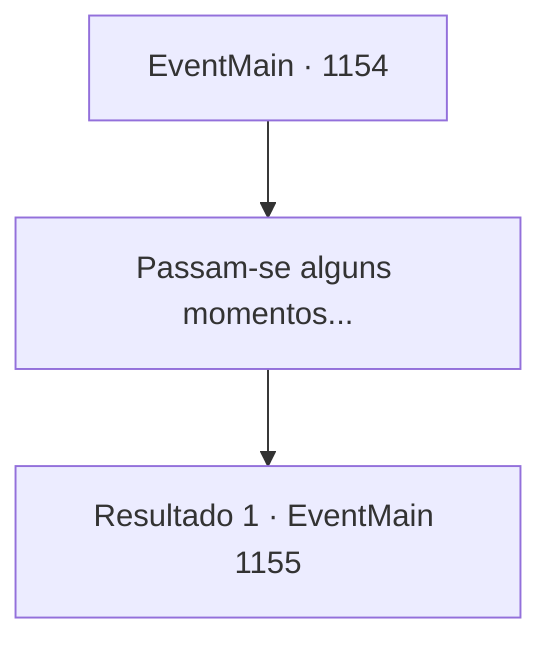

# Eventos principais · 1154

[Índice da tabela](index.md) · [Índice geral](../index.md)

ID: `pt:EventMain:1154` · Fonte: `EventMain4` · Versão: 1.2.47.

Mapeamento estático dos arquivos; a disponibilidade e a execução dependem do estado da run.

## Texto do evento

*Sem texto no arquivo.*

## Dados de entrada

```json
{
  "id": 1154,
  "grade": 1,
  "normalGoal": "",
  "required": ""
}
```

## Mapa das escolhas



## Escolhas e resultados

### Escolha 1

Passam-se alguns momentos...

Requisitos e outros campos da escolha:

```json
{
  "required": ""
}
```

#### Resultado 1.1

Algumas horas depois, um sino na torre de vigia toca alto. 

 "INIMIGO SE APROXIMANDO!"

 Você imediatamente sobe nas muralhas do castelo. Forças orc se aproximam mais uma vez, vindas das planícies áridas. Eles são mais numerosos do que antes. Desta vez não são apenas os orcs - você nota trolls gigantes entre as forças também. Cada troll carrega uma cesta enorme, cheia de rochas do tamanho de um humano. Rennart fica paralisado assim que vê isso. 

 "...Eles até trouxeram trolls desta vez."

 Os orcs marcham à frente, tocando suas cornetas de guerra e batendo os tambores de guerra. Uma badalada grave estremece o chão, à medida que se aproximam cada vez mais. Você ordena que seus homens mantenham a posição, esperando até que estejam no alcance de tiro dos arqueiros. Então, um dos trolls dá um passo à frente. Ele enfi a a mão na cesta e pega uma rocha enorme. Então, balança o braço, seu corpo torcendo em recuo. |drawing_trollThrowing| 

 "Meu senhor! Agache-se!"

 Rennart agarra sua mão e baixa você das muralhas. Imediatamente depois, a rocha atinge a muralha do castelo, cortando o ar. Com um barulho alto, pedaços de pedra voam por toda parte, e toda a muralha treme. 

 "Uau!!"

 Soldados nas muralhas do castelo colidem uns com os outros. Logo depois, ouve-se outro som de uma rocha. A segunda rocha atinge a base da muralha. O dano se espalha.

Continuação registrada: [Evento 1155](1155.md) na mesma tabela.

```json
{
  "required": "",
  "chance": "1",
  "nextEvent": 1155,
  "type": 2,
  "reward": ""
}
```

## Referências que chegam a este evento

- [Evento 1153 · escolha 1 · resultado 1](1153.md#escolha-1)
- [Evento 1153 · escolha 1 · resultado 2](1153.md#escolha-1)
- [Evento 1153 · escolha 1 · resultado 3](1153.md#escolha-1)
- [Evento 1153 · escolha 2 · resultado 1](1153.md#escolha-2)
